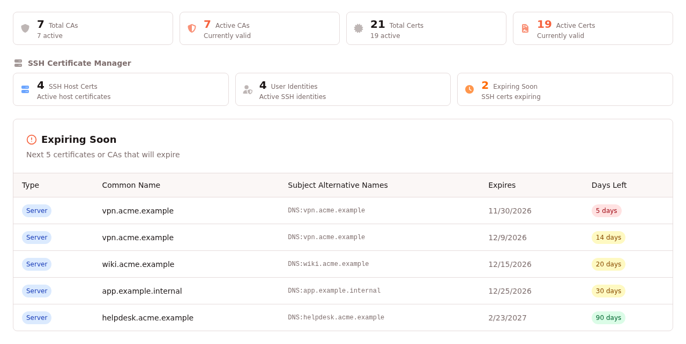

# PKI Manager

> A self-hosted web application to run your own certificate authorities for X.509 and SSH.
> Private keys are made and kept in a KMS.

[](LICENSE)
[](https://pki-manager.oriolrius.cat/)
[](https://scorecard.dev/viewer/?uri=github.com/oriolrius/pki-manager-web)

**Website: <https://pki-manager.oriolrius.cat/>**. It says what PKI Manager does, how it
works and how to use it. This file does not repeat it.



## What it is

You create a certificate authority, issue and revoke certificates in a browser, sign SSH
certificates for people and for servers, and let Kubernetes, devices and scripts request
certificates by themselves.

| Read | To know |
|---|---|
| [What it does](https://pki-manager.oriolrius.cat/features/) | Each capability, with screenshots and with what it does not do |
| [How it works](https://pki-manager.oriolrius.cat/how-it-works/) | The parts, and where each private key lives |
| [Install and log in](https://pki-manager.oriolrius.cat/get-started/install/) | Docker Compose with the published images, about ten minutes |
| [Documentation](https://pki-manager.oriolrius.cat/get-started/) | Guides, SSH certificates (19 short videos), operations and the API reference |
| [Release notes](CHANGELOG.md) | What changed in each version |

## A personal project

I built PKI Manager for my own infrastructure, and I use it there. No company is behind it and
nothing is for sale: there is no paid edition, no hosted service and no support contract. The
source code is public because it can be useful to someone else.
[About this project](https://pki-manager.oriolrius.cat/about/) says what you can expect.

## Repository layout

| Folder | Content |
|---|---|
| `backend/` | API server: REST and tRPC, certificate logic, KMS client, SQLite database |
| `frontend/` | Web UI (React) |
| `k8s/issuer/` | cert-manager external issuer for Kubernetes (Go, with its Helm chart) |
| `scep/` | Optional SCEP gateway for device enrollment (Go) |
| `krl-client/` | Program for SSH servers that fetches their revocation list (Go) |
| `ansible/` | Playbook and end-to-end test of the SSH host certificate role |
| `docker/` | Dockerfile and the Compose files of production |
| `kms/`, `keycloak/` | Containers for local development |
| `docs/` | All the documentation. The website is built from this folder |
| `site/` | The website: layout and build scripts, with no text of its own |
| `backlog/` | Tasks, decision records and specifications ([Backlog.md](https://backlog.md)) |
| `tests/` | End-to-end tests (Playwright) |
| `scripts/`, `justfile` | Development tasks. Run `just` to list them |

## Develop

```bash
just setup    # dependencies, .env files, dev database
just dev      # KMS, Keycloak, backend, frontend and the task board
```

Then open <http://localhost:52080> and log in as `admin` / `admin`. The details are in
[Development setup](docs/development/setup.md). Each kind of document has one home:
[How the docs are organised](docs/development/documentation.md).

Problem reports and pull requests are welcome. There is no response time. The rules for a
change (tests, checks, commits) are in [Contributing](CONTRIBUTING.md).

A security vulnerability is different: do not open a public issue. Report it in private as the
[security policy](SECURITY.md) says.

## Related projects

| Project | Description |
|---------|-------------|
| [pki-manager-cli](https://github.com/oriolrius/pki-manager-cli) | Python command line for PKI Manager |
| [pki-manager-ansible](https://github.com/oriolrius/pki-manager-ansible) | Ansible collection ([Galaxy](https://galaxy.ansible.com/ui/repo/published/oriolrius/pki_manager/)) |
| [pki-manager-skill](https://github.com/oriolrius/pki-manager-skill) | Claude Code skill for certificate management |
| [ssh-ca-cosmian-kms](https://github.com/oriolrius/ssh-ca-cosmian-kms) | Design reference and Docker proof of concept of the SSH certificate authority behind this project |
| [ssh-per-host-access-blocks-lab](https://github.com/oriolrius/ssh-per-host-access-blocks-lab) | Docker lab of the per-host access-block model |

## Licence

[Apache-2.0](LICENSE). The software comes without warranty.
