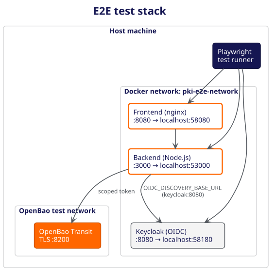

# Testing

How to test PKI Manager: unit tests, type checks, end-to-end tests in Docker, and the examples of the documentation.

## Unit tests and checks

Backend and frontend use Vitest and TypeScript.

```bash
just test         # unit tests of backend and frontend
just typecheck    # type-check both
just lint         # lint both
```

`just lint` fails on lint errors. Warnings do not fail it. An explicit `any` is an error
(`@typescript-eslint/no-explicit-any`) in both workspaces: give the value a real type, or `unknown`
and narrow it. The CI job **Lint** in `test.yml` runs the same command.

CI also checks the offline v3 migration tool. After installing backend dependencies, run its type check and SQLite fixture tests from the repository root with Node 22.18 or later.

```bash
(cd scripts/migration && npm run typecheck && npm test)
```

Run one workspace with `pnpm test` (or `pnpm test:watch`) inside `backend/` or `frontend/`.
Run each workspace's `typecheck`, not only `build`: the frontend Docker build is relaxed, so a
green image build is not a clean type check.

Local backend runs skip live key-store tests when `OPENBAO_ADDR` is unset. To run those
tests with the same scoped OpenBao token as CI, start a disposable instance from the repository
root. Run these commands in Bash:

```bash
bash scripts/openbao-test.sh up unit
(
  set -a
  source <(bash scripts/openbao-test.sh env unit)
  set +a
  OPENBAO_TEST_REQUIRED=1 pnpm --dir backend test
)
bash scripts/openbao-test.sh down unit
```

The helper creates a TLS certificate, starts the pinned fork on a free loopback port and
configures its Transit mounts. It prints file paths for the CA and token. Cleanup removes the
test instance and its state.

The Go components have their own tests. Run `go test ./...` in `k8s/issuer/`, `scep/` or `krl-client/`.

## Fuzzing

The code that parses untrusted input has fuzz tests. A fuzz test gives generated input to a
function and checks a rule that must hold for every input: no crash, a typed error for bad input,
and a round trip where one exists.

### Go: native fuzz targets

The Go modules use the fuzzing of the Go toolchain (`func FuzzXxx(f *testing.F)` in
`fuzz_test.go`).

| Module | Target | Input | Rule |
|---|---|---|---|
| `scep/` | `FuzzEnroll` | the SCEP `PKIOperation` message of a device | no panic; a certificate is requested only for the CSR of a message with a valid signature and the challenge password |
| `scep/` | `FuzzPKIOperationHTTP` | the same message as POST body or as the GET `message` parameter | the answer is HTTP 200, 400, 413 or 415 |
| `scep/` | `FuzzValidateSAN` | the subjectAltName extension of the CSR | an accepted value has 1 to 32 names of a supported type |
| `scep/` | `FuzzParsePEMCerts` | the PEM that the backend returns | accepted PEM gives the same certificates after a round trip |
| `scep/` | `FuzzValidateBackendURL`, `FuzzSharedSubjectConfig` | `SCEP_BACKEND_URL`, `SCEP_SHARED_SUBJECT` | plain HTTP only to loopback; only the subject fields that are enforced |
| `krl-client/` | `FuzzParse` (`internal/payload`) | the decrypted KRL payload (JSON) | a typed error, or a payload that agrees with the KRL header and survives a round trip |
| `krl-client/` | `FuzzOpen`, `FuzzOpenRoundTrip` (`internal/decrypt`) | the ECIES envelope from the server | no input from the fuzzer decrypts; a change of one bit is refused |
| `krl-client/` | `FuzzLoadHostKey` (`internal/decrypt`), `FuzzLoadCAKeys`, `FuzzVerify` (`internal/verify`) | the host key file, the CA public key file, the KRL signature | a typed error; no signature from the fuzzer verifies |
| `krl-client/` | `FuzzParseConfigFile` (`internal/config`), `FuzzHandle` (`internal/krlclient`) | the config file, the HTTP answer of the server | only known keys; the body never exceeds the size limit |
| `k8s/issuer/` | `FuzzClientResponse`, `FuzzWithCABundle` (`internal/issuer/signer`) | the HTTP answer of the PKI Manager API, the `caBundle` of the Issuer | an error for HTTP 400 and above; an accepted sign answer holds a parseable certificate |

`go test ./...` runs each target with its seed corpus (the `f.Add` values and the files in
`testdata/fuzz/`). It does not generate input. To fuzz:

```bash
scripts/fuzz-go.sh scep                 # each target of the module for 30 s
scripts/fuzz-go.sh krl-client 5m        # each target for 5 minutes
scripts/fuzz-go.sh scep 2m FuzzEnroll   # one target

# or one target with the Go command
cd scep && go test -run='^$' -fuzz='^FuzzEnroll$' -fuzztime=60s .
```

The script finds the targets itself, so a new `FuzzXxx` function needs no other change.

When a target fails, Go writes the failing input to `<package>/testdata/fuzz/<Target>/<hash>` and
prints the command that runs it again (`go test -run=FuzzEnroll/<hash>`). Then:

1. Fix the defect.
2. Give the file a name that says what it is, and commit it. `go test ./...` runs it from then
   on, so it is the regression test.
3. Add a unit test when the defect is a rule of the product, not only a crash.

The files in `scep/testdata/fuzz/` are such inputs.

### TypeScript: property tests

The backend uses [fast-check](https://fast-check.dev/) in files named `*.property.test.ts`. They
are Vitest tests, so `just test` and the **Backend Tests** job run them.

| File (under `backend/src/`) | Functions | Rule |
|---|---|---|
| `crypto/validation.property.test.ts` | the CN, DNS name and IP address validators | an accepted value follows the [rules for names](../guides/private-ca.md#rules-for-names-and-validity); a value that follows them is accepted |
| `services/certificate-extensions.property.test.ts` | `buildCertificateExtensions` | a SAN value cannot add a line or a SAN entry to the certificate extension text |
| `crypto/dn.property.test.ts` | `formatDN`, `parseDN`, `validateDN` | parse after format gives the same DN: a value cannot add a field |
| `rest/routes/external-csr.property.test.ts` | the CSR parser of `POST /api/v1/external/sign`, `crypto/csr.ts` | an Error for text that is not a CSR; a changed CSR is refused; PEM to DER to PEM gives the same CSR |
| `crypto/ssh/ssh.property.test.ts` | the OpenSSH public key parser, the wire format, the ECIES envelope | a key or `SshPublicKeyError`; write then read gives the same value; a changed envelope is refused |
| `services/ssh-idempotency.property.test.ts` | the `Idempotency-Key` header | exactly 1 to 255 printable ASCII characters without spaces |

Each property runs 300 generated cases by default (`backend/src/test/property.ts`). To search
longer:

```bash
cd backend && FC_NUM_RUNS=10000 pnpm exec vitest run property
```

A failure prints the seed and the smallest failing value ("Counterexample"). Fix the defect and
put that value in a unit test next to the code (for example `crypto/validation.test.ts`).

### Fuzzing in CI

The workflow `fuzz.yml` runs `scripts/fuzz-go.sh` for each Go module: 30 s for each target on a
push to `main` and on a pull request that touches a Go module, and 5 minutes for each target every
Monday. The Monday run also runs the property tests with 10000 cases. When a Go target fails, the
job uploads the failing inputs as the artifact `fuzz-crashers-<module>`: download it, copy the
files to the same path in the repository and follow the three steps above.

## End-to-end tests

The end-to-end tests check role-based access control (RBAC) through the web UI, with Playwright.
They run against a local Docker environment or against a deployed instance. The workflow
`e2e.yml` runs them on pull requests (see [E2E in CI](#e2e-in-ci)).

#



## E2E Architecture

Playwright drives the frontend from the host. The backend connects to the test OpenBao service
over HTTPS on a separate Docker network. It reads the CA and the scoped token from a read-only mount.

The backend uses `OIDC_DISCOVERY_BASE_URL` to fetch OIDC configuration from the Docker network (`keycloak:8080`) while validating tokens against the issuer URL that browsers use (`localhost:58180`).

### Local E2E Testing (Recommended)

The `docker-compose.e2e.yml` provides a complete isolated environment for testing:

```bash
# 1. Build the images from your checkout
docker build --target backend -t ghcr.io/oriolrius/pki-manager-web/backend:e2e -f docker/Dockerfile .
docker build --target frontend -t ghcr.io/oriolrius/pki-manager-web/frontend:e2e -f docker/Dockerfile .

# 2. Prepare OpenBao and export the settings for the backend container (Bash)
bash scripts/openbao-test.sh up rbac
set -a
source <(bash scripts/openbao-test.sh client rbac)
set +a

# 3. Start Keycloak, the backend and the frontend
IMAGE_TAG=e2e docker compose -f docker/docker-compose.e2e.yml up -d --wait

# 4. Run the RBAC tests
pnpm playwright test tests/e2e-rbac.spec.ts --reporter=list

# 5. Remove the RBAC stack, then the OpenBao test instance
docker compose -f docker/docker-compose.e2e.yml down -v
bash scripts/openbao-test.sh down rbac
```

Without `IMAGE_TAG`, Compose uses the published `latest` backend and frontend images.
The E2E stack reads its Keycloak realm from `docker/keycloak-e2e-realm.json` and its
frontend settings from `docker/config.e2e.json`. Both files must be readable by their container
users. The OpenBao helper prepares the backend token for uid 1001.

### E2E in CI

The workflow `.github/workflows/e2e.yml` runs these steps on each pull request to `main` that
changes the backend, frontend, Docker stack, OpenBao configuration or helper scripts, tests,
Playwright configuration or workspace dependencies. It also supports manual dispatch. It builds the two images from the commit, starts the stack, and runs
`tests/e2e-rbac.spec.ts`. When the tests fail, it uploads `playwright-report/` and
`test-results/` as the artifact `playwright-report`.

`tests/auth.spec.ts` and `tests/auth-m2m.spec.ts` need the dev stack (realm `pki-dev`), and
`tests/e2e-production.spec.ts` needs a deployed instance: CI does not run them.

### E2E Test Users

The E2E environment includes pre-configured test users in Keycloak:

| Username | Password | Role | Description |
|----------|----------|------|-------------|
| `testadmin` | `Test123!` | `admin` | Full access - can create, revoke, delete CAs and certificates |
| `testuser` | `Test123!` | `user` | Limited access - can view and issue certificates, cannot perform admin operations |

### E2E Services

| Service | URL | Description |
|---------|-----|-------------|
| Frontend | http://localhost:58080 | PKI Manager UI |
| Backend API | http://localhost:53000 | tRPC API |
| Keycloak | http://localhost:58180 | Identity Provider (admin/admin for Keycloak console) |
| OpenBao | `https://openbao:8200` inside Docker | Test Transit key store |

### Tests against a deployed instance

`E2E_TARGET=production` runs the same tests against a deployed instance. It has no default URL:
set the frontend URL, the Keycloak URL and, when they are not the defaults, the users.

```bash
E2E_TARGET=production \
E2E_FRONTEND_URL=https://pki.example.com \
E2E_KEYCLOAK_URL=https://iam.example.com \
E2E_ADMIN_USER=testadmin \
E2E_ADMIN_PASSWORD=Test123! \
pnpm playwright test tests/e2e-rbac.spec.ts --reporter=list
```

### E2E Environment Variables

| Variable | Default | Description |
|----------|---------|-------------|
| `E2E_TARGET` | `local` | Target environment: `local` or `production` |
| `E2E_FRONTEND_URL` | (from target) | Frontend URL. Required for `production` |
| `E2E_KEYCLOAK_URL` | (none) | Keycloak URL. Required for `production` |
| `E2E_ADMIN_USER` | `testadmin` | Admin test user |
| `E2E_ADMIN_PASSWORD` | `Test123!` | Admin password |
| `E2E_TEST_USER` | `testuser` | Regular test user |
| `E2E_TEST_PASSWORD` | `Test123!` | Regular user password |

### E2E Keycloak Realm

The `pki-e2e` realm is automatically imported when starting the E2E Docker environment:

- **Realm**: `pki-e2e`
- **Client**: `pki-web` (public client with PKCE)
- **Roles**: `admin`, `user`
- **Direct Access Grants**: Enabled (for automated testing)
- **Brute Force Protection**: Disabled (to prevent test lockouts)

### E2E Keycloak Access

| Service | URL | Credentials |
|---------|-----|-------------|
| Keycloak Console | http://localhost:58180 | admin / admin |
| OIDC Discovery | http://localhost:58180/realms/pki-e2e/.well-known/openid-configuration | - |

### Image versions

`docker/docker-compose.e2e.yml` pins Keycloak. `openbao/image.env` selects the OpenBao
fork revision. `scripts/openbao-image.sh ensure` resolves its container image.

### Test users on a deployed instance

Create the two users in the Keycloak of that instance:

1. **Create `testadmin` user**:
   - Username: `testadmin`
   - Password: `Test123!` (or stronger)
   - Realm roles: `admin`

2. **Create `testuser` user**:
   - Username: `testuser`
   - Password: `Test123!` (or stronger)
   - Realm roles: `user` (no `admin` role)

### When an end-to-end test fails

**Problem**: "no such table: audit_log" error

**Solution**: Database migrations didn't run. The E2E docker compose automatically runs migrations on startup. If using a custom setup:
```bash
docker exec pki-e2e-backend node /app/backend/dist/db/migrate.js
```

**Problem**: OIDC token validation fails in Docker

**Solution**: Ensure `OIDC_DISCOVERY_BASE_URL` is set for Docker networking:
```yaml
# docker-compose.e2e.yml
environment:
  - OIDC_ISSUER=http://localhost:58180/realms/pki-e2e
  - OIDC_DISCOVERY_BASE_URL=http://keycloak:8080/realms/pki-e2e
```

**Problem**: Keycloak healthcheck fails (timeout)

**Solution**: Keycloak 26+ takes ~60-90 seconds to start. The healthcheck has a 90-second start period. Check logs:
```bash
docker logs pki-e2e-keycloak
```

**Problem**: Tests fail with "Login button not found"

**Solution**: Wait for all services to be healthy before running tests:
```bash
docker compose -f docker/docker-compose.e2e.yml ps
# All services should show "healthy" status
```

## Other Playwright specs

`tests/` also has `auth.spec.ts`, `auth-m2m.spec.ts` and `e2e-production.spec.ts` (OIDC login on a deployed instance; it runs only when `PROD_FRONTEND_URL` and `PROD_KEYCLOAK_URL` are set). The base URL of
`playwright.config.ts` is `http://localhost:52082`; set `PLAYWRIGHT_BASE_URL` for another address
(the dev stack serves the web UI on `http://localhost:52080`).

## Examples of the documentation

Every runnable example of [Call the REST API](../api/how-to.md) runs in CI against the demo stack,
and the screenshots of the guides come from the same stack. See
[How the docs are organised](documentation.md#demo-stack-screenshots-and-examples).
