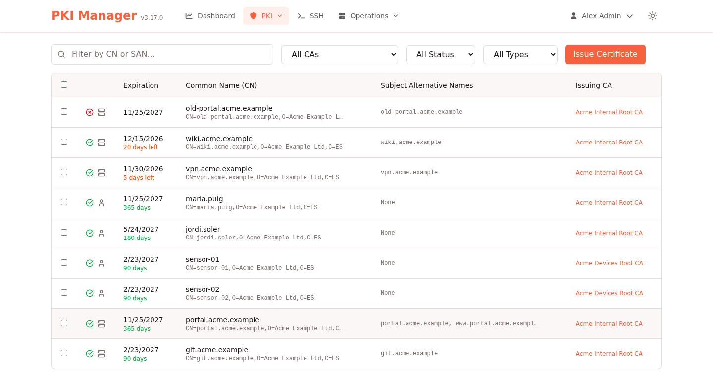
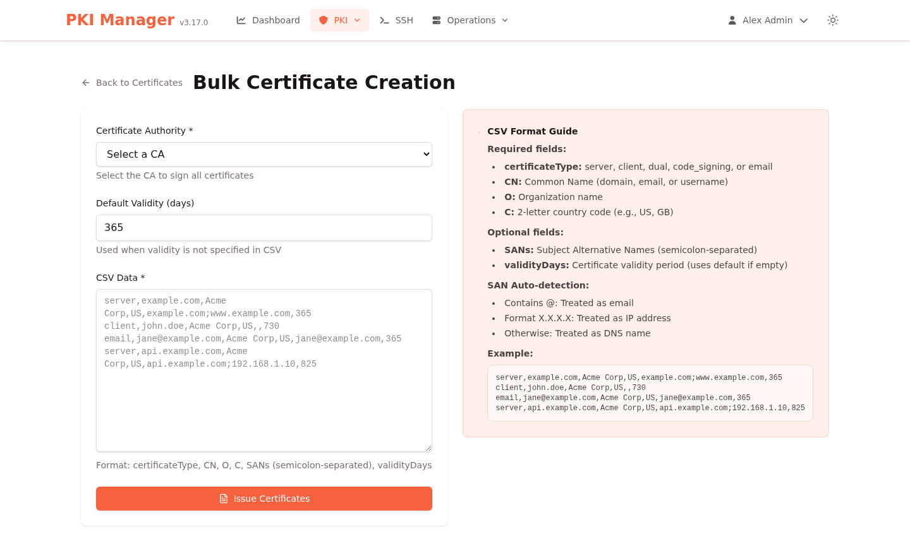

## What you can do

- Issue five types of certificate: server (TLS), client, dual (server and client), email (S/MIME)
  and code signing.
- Add subject alternative names: DNS names, IP addresses and email addresses.
- Choose the key: RSA-2048, RSA-4096, ECDSA P-256 or ECDSA P-384. Validity is up to 825 days.
- Download the format that the target needs: PEM, DER, the chain, PKCS#7, PKCS#12 (PFX), a Java
  keystore or truststore, or a ZIP with all of them. A format that contains the private key asks
  for a password.
- Renew a certificate. The new certificate has a new serial number and, unless you say otherwise,
  a new key. You choose if the old certificate stays valid or is revoked.
- Find certificates by name, SAN, serial number, CA, status or type. The server does the
  filtering, the sorting (by expiry or subject) and the paging (25, 50 or 100 rows per page). The
  filters, the sort and the page are in the URL, so you can bookmark or share a filtered list.

### Many at once

- Paste CSV lines to issue many certificates in one step.
- Select rows on one page of the list to download, renew, revoke or delete up to 100 certificates
  together. A change of page or filter clears the selection.

### What expires next

The dashboard shows the CAs and certificates that expire next. A certificate with 30 days or less
turns yellow, and with 7 days or less turns red.

## How it works

OpenBao Transit makes the key pair of the certificate. The backend builds the certificate, and
Transit signs it with the key of the CA. The database stores the certificate and a reference to
its key in Transit.

The key of an issued certificate is exportable in Transit, so that you can download it. When
someone downloads a format that contains the private key, the backend exports the key from Transit
at that moment and builds the file.

To keep the private key on your own machine, do not use this page: send a certificate signing
request (CSR) through the API. See [Automation and API](automation-api.md).

## What it does not do

- It does not send an email or call a webhook before a certificate expires. The dashboard and the
  API show the dates.
- CSV issuance always makes RSA-2048 keys, and it has no fields for unit, state and locality.
