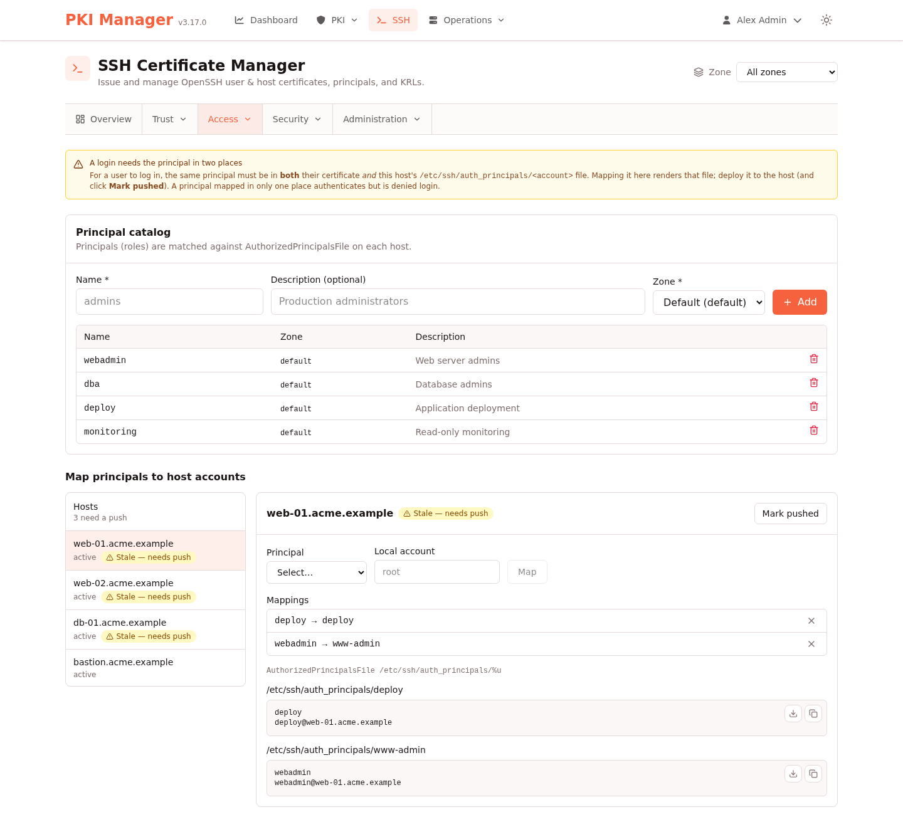
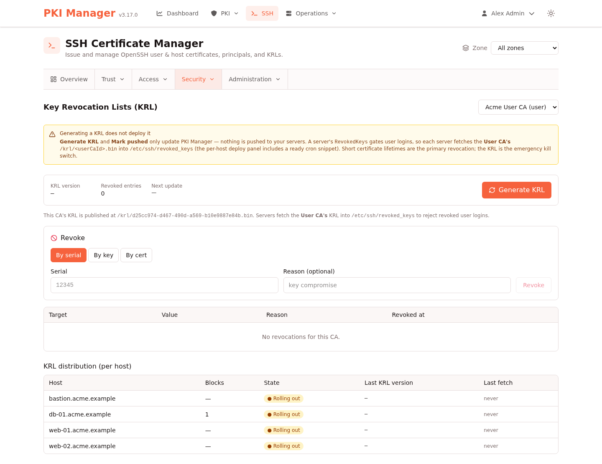

## What you can do

- Run two CAs. The **User CA** signs the keys of people. The **Host CA** signs the keys of servers.
- Create an identity for each person and grant it **principals**: role names such as `dba` or `deploy`.
- Sign the public key of a person for a time that you choose, from one hour to ten years.
- Register a server with its public key. PKI Manager shows every file that the server needs: the
  host certificate, the public keys of the CAs, an `sshd` configuration file and one
  `auth_principals` file for each local account.
- Map a principal to a local account on each server: `dba` logs in as `postgres` on `db-01`.

- Revoke a certificate or a key. Each CA has a key revocation list (KRL) at a public address.
- Block one person on one server. The certificate of that person keeps working on the other servers.
- Keep separate trust domains with **zones**: a server trusts only the User CA of its own zone.
- Rotate a CA. The old CA stays trusted for an overlap period.
- Automate with **fleet tokens**, limited to the operations, principals and lifetime that you allow,
  and with the Ansible role.

## How it works

The keys of the SSH CAs are made in the KMS and cannot be exported. The KMS signs every SSH
certificate and every KRL.

PKI Manager never logs in to your servers. It makes the files, and you place them: by hand, with
the Ansible role, or with `krl-client`, a small program on the server that fetches the KRL of that
host. A per-host KRL is encrypted for the host and signed by the Host CA.

A login needs the same principal in two places: in the certificate of the person, and in the
`auth_principals` file of the account on the server.

Certificates have a start and an end time, so the servers need a correct clock.

## What it does not do

- It does not push files to servers and it does not need an agent to sign certificates.
- It does not accept RSA keys. People use `ed25519` or `ecdsa-sha2-nistp256` keys. Servers use
  `ecdsa-sha2-nistp256` host keys.
- The KRL at the public address is not checked by `sshd` for a signature: it relies on HTTPS and
  on file permissions. The per-host KRL that `krl-client` fetches is signed and checked.
