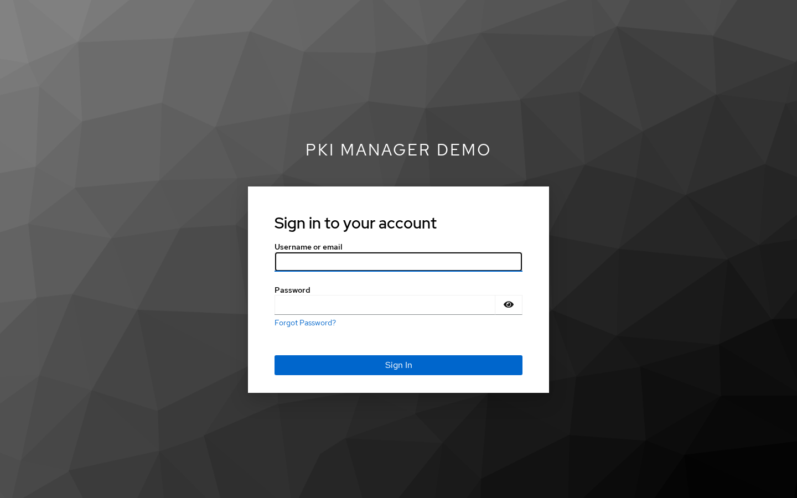
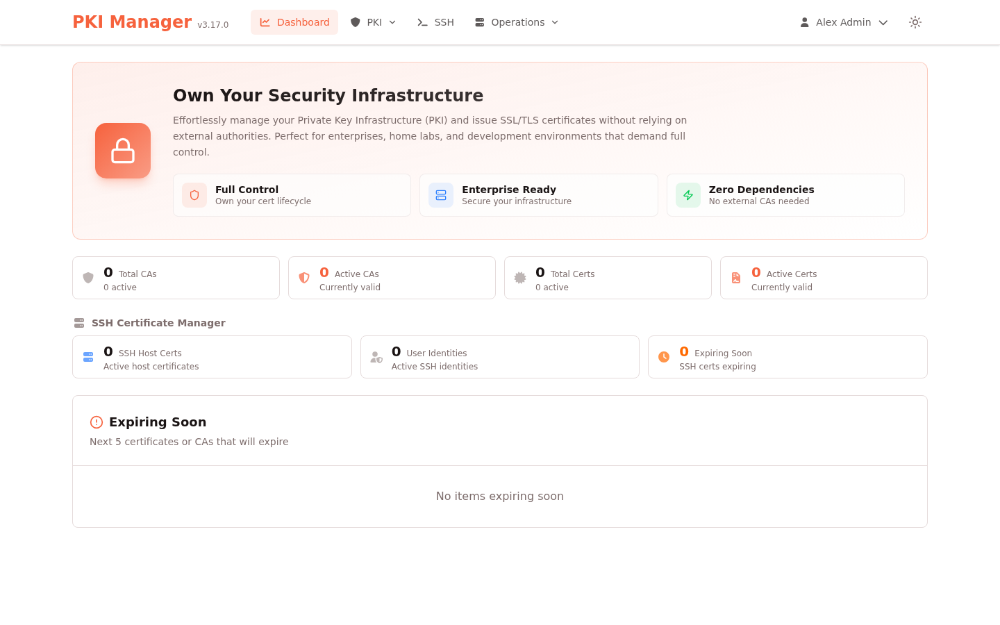
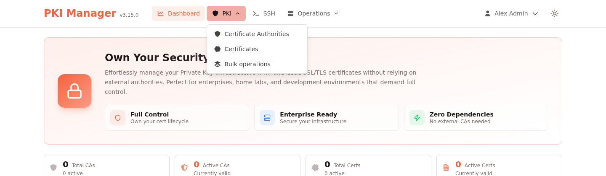
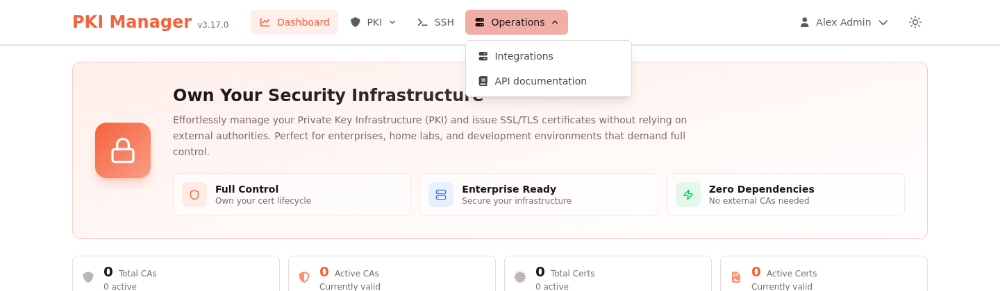

# Install PKI Manager and log in
This guide covers a fresh installation of the OpenBao edition. For an existing v3 installation, keep the matching release configuration and backups while you rehearse the migration.

The production Compose stack has four long-running services.

| Container | What it does |
|---|---|
| `pki-frontend` | Web UI (nginx). It also forwards `/trpc` and `/api` to the backend, so the browser needs only this URL. |
| `pki-backend` | API, certificate logic, SQLite database in `pki/`. |
| `pki-openbao` | Holds the keys and signs on an internal TLS endpoint. |
| `pki-openbao-agent` | Uses AppRole to deliver a scoped X.509/SSH token to the backend. |
| `pki-openbao-agent-ra` | SCEP only (Compose profile `scep`): delivers the separate SCEP RA token. |

## 1. Get the Compose files

You need Docker with the Compose v2 plugin (`docker compose`).

```bash
git clone https://github.com/oriolrius/pki-manager-web.git
cd pki-manager-web/docker
cp .env.example .env
```

## 2. Set the essentials in `.env`

Open `.env` and set these values. The defaults work on `localhost`.

| Variable | Set it to | Why |
|---|---|---|
| `IMAGE_TAG` | the backend and frontend image tag for this checkout | `latest` changes under you; pin a version. |
| `FRONTEND_EXTERNAL_PORT` / `BACKEND_EXTERNAL_PORT` | free ports (default `8080` / `3000`) | Host ports of the UI and the API. |
| `CRL_DISTRIBUTION_URL` | a URL that **clients** can reach, ending in `/crl` | It is written into every certificate you issue, so set it before the first CA. |

## 3. Create the data folder for the backend

The backend runs as user `1001` and keeps its database in `../pki`. If Docker creates that
folder, root owns it and the backend stops with `SqliteError: unable to open database file`.
Create it first:

```bash
mkdir -p ../pki
sudo chown 1001:1001 ../pki
```

> **Note:** if your shell uses `umask 077`, the files from `git clone` are readable only by
> you, and nginx in the container answers `403` for `config.json`. Run `chmod 644 config.json`.

## 4. Start the key store and the application

Follow the [OpenBao setup guide](../operations/openbao.md) from the repository root. It covers the pinned image, TLS files, first unseal and AppRole login. Start the backend and frontend after the Agent writes its token. The backend applies its SQLite migrations on startup.

Check it:

```bash
curl -s http://localhost:3000/health
# {"status":"ok","timestamp":"…"}
```

Open `http://localhost:8080`.

## 5. Choose how people log in

**Without OIDC** (the default `.env`), there is no login and the API accepts every call
without a token. Use this only to try PKI Manager on your own machine.

**With OIDC** (any real use), PKI Manager trusts an identity provider such as Keycloak, Auth0,
Okta or Microsoft Entra ID. Two roles exist: `user` (view, issue, download) and `admin`
(also create CAs, revoke, delete).

1. In `.env`, set the backend side:

   ```bash
   OIDC_ISSUER=https://keycloak.example.com/realms/pki
   OIDC_AUDIENCE=pki-web
   OIDC_ROLES_CLAIM=realm_access.roles
   ```

2. In `docker/config.json` (served to the browser), set the frontend side:

   ```json
   {
     "oidc": {
       "authority": "https://keycloak.example.com/realms/pki",
       "clientId": "pki-web",
       "scope": "openid profile email"
     }
   }
   ```

3. Apply both changes:

   ```bash
   docker compose up -d --no-build --wait
   docker compose restart frontend
   ```

   The first command starts the backend again with the new variables. It does not start the
   frontend again, because only the content of `config.json` changed. The frontend container
   reads the origins of its Content-Security-Policy from `config.json` when it starts. Without
   the restart, the browser cannot reach the identity provider: the page stays on
   "Redirecting to login..." and the browser console shows `Refused to connect ... because it
   violates the following Content Security Policy directive: "connect-src 'self' ..."`.
   After the restart, `docker compose logs frontend` shows the new origins
   (`CSP connect-src/frame-src: 'self' http://localhost:3000 https://keycloak.example.com`).

The client `pki-web` is a **public** client with PKCE (no client secret). Its redirect URI is
`<your UI URL>/callback`. Step-by-step setup: [Keycloak](../operations/keycloak.md), and
[OIDC](../operations/oidc.md) for other providers and the details.

The browser now goes to your identity provider first:



## 6. First look

After login you see the dashboard. A new install has no CAs and no certificates yet.



The top bar has four entries:

- **Dashboard**: counters, and the certificates and CAs that expire next.
- **PKI**: Certificate Authorities, Certificates, Bulk operations.

  
- **SSH**: the SSH certificate authority (user and host certificates). Start with the
  [SSH video series](../ssh/explainer/index.html).
- **Operations**: Integrations (tokens for automation and Kubernetes) and the API documentation.

  

Your name (top right) opens the user menu. The sun icon switches light and dark mode.

## Next

- [Build a private CA and issue certificates](../guides/private-ca.md)
- [Production settings, backups, reverse proxy](../operations/deployment.md)

## Stop or remove

```bash
docker compose down          # stop; the data stays on disk
```

Back up the SQLite database in `pki/` together with the OpenBao Raft state. Keep the unseal shares and TLS and AppRole credentials (both AppRoles with SCEP) for recovery. Follow the [OpenBao backup and restore procedure](../operations/openbao.md).
