# Automate issuance: integrations, tokens and SCEP
<!-- tested-with: 3.15.0 -->

This guide shows how a machine, not a person, gets certificates from PKI Manager.
Every command and screenshot below was run against a demo stack with release **3.15.0**.
Output is trimmed. Ids, serials and dates are examples; yours differ.

The reference for every endpoint is [docs/api/integrations.md](../api/integrations.md).
This guide is the task-oriented companion: read it first, then use the reference.

Parts:

1. [Create a service identity and a scoped token](#1-create-a-service-identity-and-a-scoped-token)
2. [Sign a CSR with the external issuer API](#2-sign-a-csr-with-the-external-issuer-api)
3. [See a policy rejection and its audit row](#3-see-a-policy-rejection-and-its-audit-row)
4. [Rotate and revoke a token](#4-rotate-and-revoke-a-token)
5. [Enroll a device with SCEP](#5-enroll-a-device-with-scep)

You need a running stack (see [Install PKI Manager and log in](../get-started/install.md)), an admin
login, and `curl`, `jq` and `openssl`. The examples use these variables:

```bash
API=http://localhost:47300          # backend origin, no /api/v1
B=$API/api/v1/external              # external issuer base
```

Two CAs exist in the demo: `Integrations Demo Issuing CA` (parts 1 to 4) and
`Integrations Demo Device CA` (part 5). Both are RSA-4096 root CAs, created as in [Build a private CA](private-ca.md#1-create-the-root-ca).

## 1. Create a service identity and a scoped token

An **integration** is a service identity. It has:

- a **type**: `Generic`, `Kubernetes cert-manager` or `SCEP / MDM`;
- one **bound CA**: it can issue only from this CA;
- one **service token** (`pkimg_...`), shown once.

Only users with the `admin` role can create or revoke integrations. Any logged-in user can
list them.

Steps:

1. Open **Operations**, then **Integrations**.
2. Select **Add Integration**.
3. Set **Type** to `Generic`, **Name** to `Integrations Demo CI`, and **Bound CA** to the
   issuing CA. **Description** is optional.

   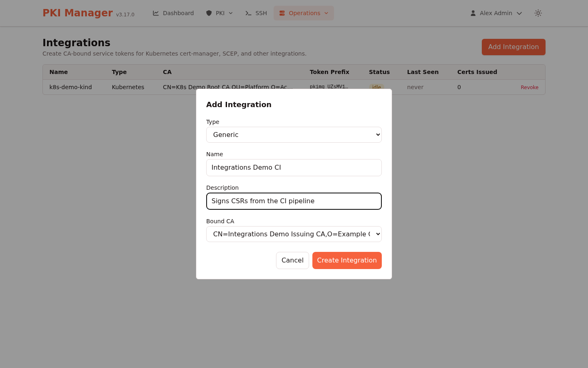

4. Select **Create Integration**. The token appears once.

   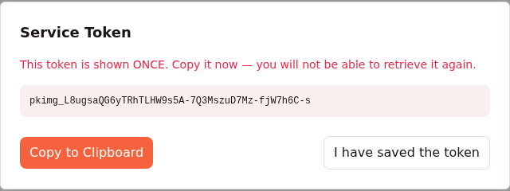

5. Copy the token to your secret store, then select **I have saved the token**.

   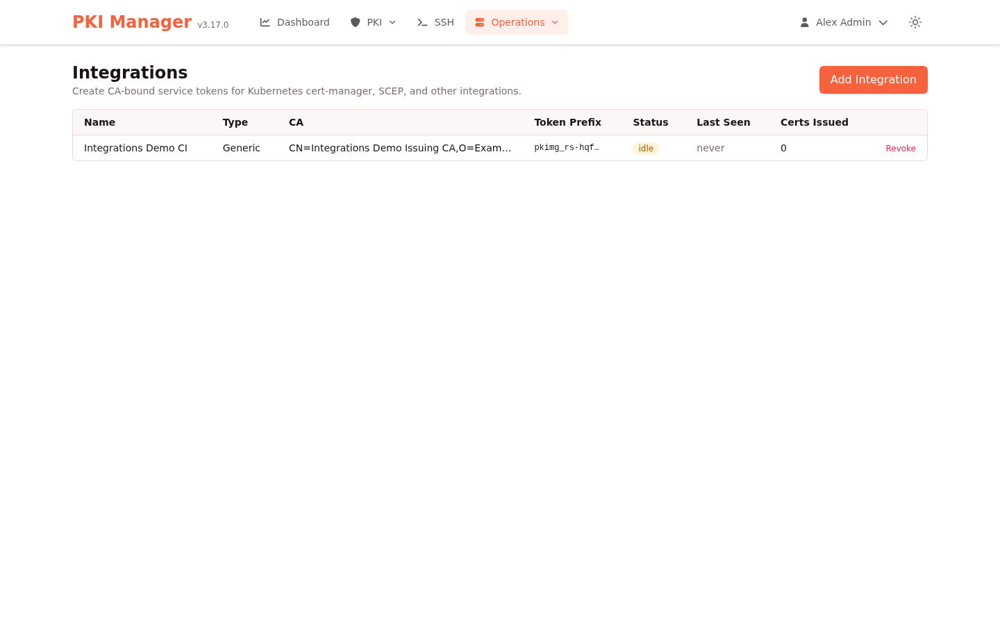

The list never shows the token again, only its prefix. The status is `idle` until the token is
used for the first time, then `active`.

Store the token in a variable for the next steps (do not put it in shell history on a shared
host):

```bash
TOKEN=pkimg_...        # the token from step 4
```

### What the token can do

The token is not an OIDC login. It works only on `/api/v1/external`.

```bash
curl -s $B/health -H "Authorization: Bearer $TOKEN" | jq '{status, integration}'
```

```json
{
  "status": "ok",
  "integration": {
    "id": "3be26e02-47ad-4b30-ab69-86f9294827f1",
    "name": "Integrations Demo CI",
    "caId": "74b59b95-c98a-49d9-b444-aff318f6f4a5",
    "kind": "generic"
  }
}
```

| Call | Result with the token |
|---|---|
| `GET /health` | `200`, shows the identity and its CA |
| `GET /ca-bundle` | `200`, CA certificate of the bound CA |
| `POST /sign` | `200`, signs a CSR with the bound CA |
| `GET /certificate-status/{serial}` | `200`, `{"active": true}` or `false` |
| `POST /revoke` | `200` for certificates this integration issued |

### What the token cannot do

| Call | Real result |
|---|---|
| Any call without a token | `401` `Missing or invalid Authorization header` |
| Management tRPC, for example `integration.list` | `401` `Invalid token` |
| Management REST, for example `GET /api/v1/certificates` | `401` `Invalid token` |
| `GET /external/ra/state` on a `generic` integration | `403` `RA operations require a SCEP integration` |
| `POST /revoke` for a certificate another integration issued | `403` `Integration cannot revoke a certificate it did not issue` |
| `GET /certificate-status/{serial}` for a certificate it does not own | `200` `{"active":false}` (it does not reveal the certificate) |
| Create an integration as a non-admin user (`uma`) | tRPC error `Admin role required` |

The token is bound to one CA. It cannot choose another CA, and it cannot read private keys:
private keys stay in the KMS.

> **Note:** the token is a secret. Anyone who has it can get certificates from the bound CA,
> inside the policy of part 3. Give each system its own integration, so you can revoke one
> without stopping the others.

## 2. Sign a CSR with the external issuer API

The flow: the system makes its own key and CSR, sends the CSR, and gets a certificate. The
private key never leaves the system.

**1. Make the key and the CSR.** Subject and SANs come from the CSR. Key usage and EKU also
come from the CSR.

```bash
openssl req -new -newkey rsa:2048 -nodes -keyout app.key -out app.csr \
  -subj "/CN=app.example.internal/O=Example Corp/C=ES" \
  -addext "subjectAltName=DNS:app.example.internal" \
  -addext "extendedKeyUsage=serverAuth" \
  -addext "keyUsage=digitalSignature,keyEncipherment"
```

**2. Send it.** `requestUid` is your idempotency key (1 to 256 characters). `durationDays` is
optional (default 90, maximum 825).

```bash
jq -n --rawfile csr app.csr \
  '{csrPem:$csr, requestUid:"ci-build-1001", durationDays:30, certificateType:"server"}' > sign.json

curl -s -X POST $B/sign -H "Authorization: Bearer $TOKEN" \
  -H 'Content-Type: application/json' -d @sign.json > sign.out
jq 'del(.certificatePem, .chainPem)' sign.out
```

```json
{
  "idempotent": false,
  "id": "e923b222-7c9a-4248-9c42-6b624d39b762",
  "serialNumber": "37226b0f4fc8cedea659d67b1c8b09070abaf653",
  "notBefore": "2026-11-24T09:58:14.000Z",
  "notAfter": "2026-12-24T09:58:14.000Z"
}
```

Send the same body again. You get the same certificate, not a new one:

```bash
curl -s -X POST $B/sign -H "Authorization: Bearer $TOKEN" \
  -H 'Content-Type: application/json' -d @sign.json | jq '{idempotent, serialNumber}'
# { "idempotent": true, "serialNumber": "37226b0f4fc8cedea659d67b1c8b09070abaf653" }
```

**3. Verify the certificate against the CA.** Fetch the CA certificate with the same token. Do
not trust the `chainPem` you just received as the only proof: verify against a CA you fetched
separately.

```bash
jq -r .certificatePem sign.out > app.crt
curl -s $B/ca-bundle -H "Authorization: Bearer $TOKEN" | jq -r .certificatePem > ca.pem

openssl verify -CAfile ca.pem app.crt
openssl x509 -in app.crt -noout -subject -issuer -dates \
  -ext subjectAltName,extendedKeyUsage,keyUsage,basicConstraints
diff <(openssl x509 -in app.crt -noout -pubkey) <(openssl pkey -in app.key -pubout) && echo "key matches"
```

```text
app.crt: OK
subject=CN = app.example.internal, O = Example Corp, C = ES
issuer=CN = Integrations Demo Issuing CA, C = ES, O = Example Corp
notBefore=Nov 24 09:58:14 2026 GMT
notAfter=Dec 24 09:58:14 2026 GMT
X509v3 Subject Alternative Name:
    DNS:app.example.internal
X509v3 Extended Key Usage:
    TLS Web Server Authentication
X509v3 Key Usage:
    Digital Signature, Key Encipherment
X509v3 Basic Constraints: critical
    CA:FALSE
key matches
```

**4. Check the status, and see it in the UI.**

```bash
curl -s $B/certificate-status/37226b0f4fc8cedea659d67b1c8b09070abaf653 \
  -H "Authorization: Bearer $TOKEN"
# {"active":true}
```

The certificate is also in **PKI**, **Certificates**. The integration list shows `Last Seen`
and the `Certs Issued` counter:

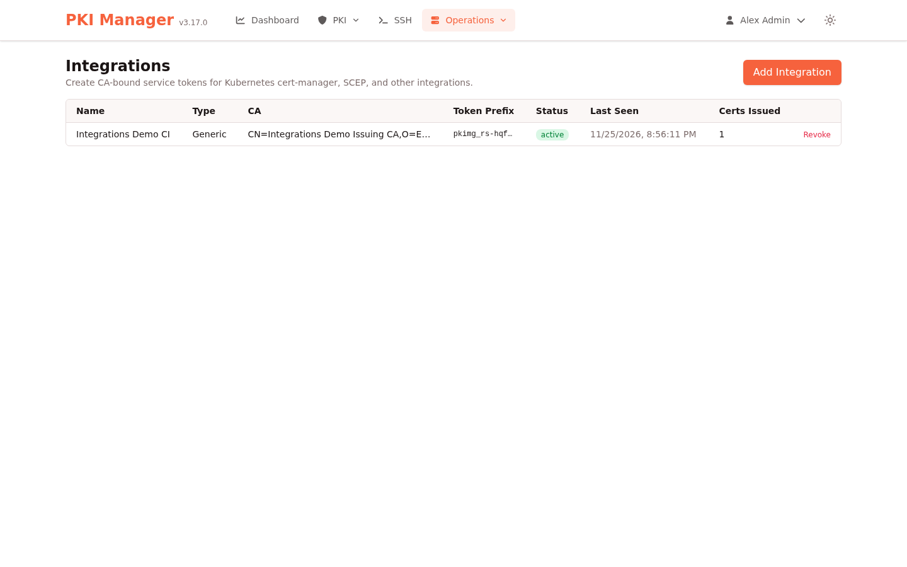

To revoke it from the system that owns it (the CRL of the CA is updated at once):

```bash
curl -s -X POST $B/revoke -H "Authorization: Bearer $TOKEN" -H 'Content-Type: application/json' \
  -d '{"serialNumber":"37226b0f4fc8cedea659d67b1c8b09070abaf653","reason":"superseded"}'
# {"id":"e923b222-...","serialNumber":"3722...","status":"revoked","revocationDate":"2026-11-24T09:58:40.853Z"}
```

`certificate-status` now returns `{"active":false}`, and the certificate shows as revoked in
the UI:

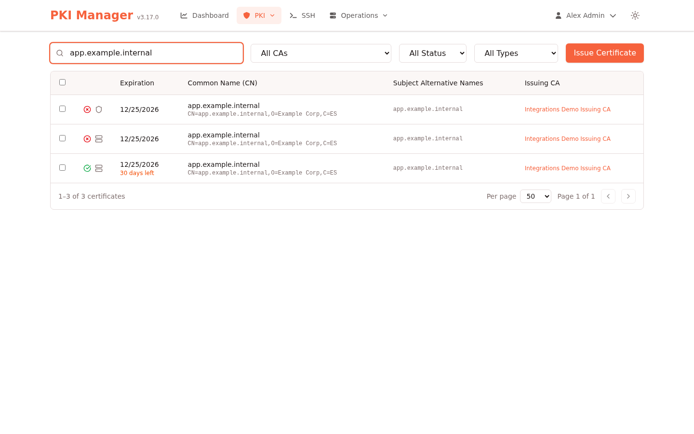

> **Doc mismatch found while writing this guide:** the API reference says the default
> revocation `reason` is `cessationOfOperation`. The backend stores `unspecified` when you
> send no reason (`backend/src/rest/routes/external.routes.ts`), and any text is accepted.
> Send an RFC 5280 reason name yourself.

## 3. See a policy rejection and its audit row

The backend checks every CSR before it asks the KMS to sign. Test it with a CSR that asks for
a CA certificate:

```bash
openssl req -new -newkey rsa:2048 -nodes -keyout evil.key -out evil.csr \
  -subj "/CN=evil-ca.example.internal/O=Example Corp/C=ES" \
  -addext "basicConstraints=critical,CA:TRUE" -addext "keyUsage=keyCertSign,cRLSign"
jq -n --rawfile csr evil.csr '{csrPem:$csr, requestUid:"ci-build-1002"}' > evil.json

curl -s -w '\n[%{http_code}]\n' -X POST $B/sign -H "Authorization: Bearer $TOKEN" \
  -H 'Content-Type: application/json' -d @evil.json
```

```text
{"error":{"code":"CSR_PROFILE_REJECTED","message":"External enrollment cannot request a CA certificate"}}
[400]
```

Other rejections that were run, all `400`:

| Request | Code | Message |
|---|---|---|
| RSA-1024 key in the CSR | `INVALID_CSR` | `RSA 2048..8192 is required` |
| `durationDays: 5000` on a generic token | `BAD_REQUEST` | `body/durationDays must be <= 825` |
| `scep` token, `durationDays: 365` | `INVALID_VALIDITY` | `SCEP validity is limited to 90 days` |
| `scep` token, CSR with `serverAuth` EKU | `CSR_PROFILE_REJECTED` | `SCEP requires clientAuth-only EKU` |

> **Doc mismatch found while writing this guide:** the API reference says `durationDays` is
> "clamped to 1 to 825". The request schema rejects a larger value with `400` before the
> clamp can apply. Send 825 or less.

### Where the rejection is logged

Each rejected request writes an `external.reject` row in the audit log, with the route, the
HTTP status, and the integration id. It never stores the token or the CSR. The UI has no audit
page in this release, so read it through the API with an admin token:

```bash
# $ADMIN is a management token; the demo prints one with: site/demo/demo.sh token
curl -s -G $API/trpc/audit.list \
  --data-urlencode 'input={"operation":"external.reject","limit":3,"offset":0}' \
  -H "Authorization: Bearer $ADMIN" | jq -c '.result.data.items[] | [.timestamp, .status, .details]'
```

```text
["2026-11-24T09:58:25.000Z","failure",{"route":"/api/v1/external/sign","statusCode":400,"code":"INVALID_CSR"}]
["2026-11-24T09:58:24.000Z","failure",{"route":"/api/v1/external/sign","statusCode":400,"code":"CSR_PROFILE_REJECTED"}]
["2026-11-24T09:58:10.000Z","failure",{"route":"/api/v1/external/health","statusCode":401,"code":"UNAUTHORIZED"}]
```

Filter by integration with `entityId` (the integration id from `/health`). This shows the whole
life of the identity, in order:

```bash
curl -s -G $API/trpc/audit.list \
  --data-urlencode 'input={"entityId":"3be26e02-47ad-4b30-ab69-86f9294827f1","limit":20,"offset":0}' \
  -H "Authorization: Bearer $ADMIN" | jq -c '.result.data.items[] | [.timestamp, .operation, .status]'
```

```text
["2026-11-24T09:58:25.000Z","external.reject","failure"]
["2026-11-24T09:58:24.000Z","external.reject","failure"]
["2026-11-24T09:58:02.000Z","integration.register","success"]
```

A successful sign is logged as `external.sign` on the **certificate** id (not on the
integration id). It holds `requestUid`, `subjectDn` and `serialNumber`. A revoke through the
API is logged as `external.revoke`.

## 4. Rotate and revoke a token

There is no in-place "rotate" button. Rotate in two steps, so the system never has a gap:

1. Create a new integration on the same CA (for example `Integrations Demo CI v2`) and give
   its token to the system.
2. Revoke the old integration.

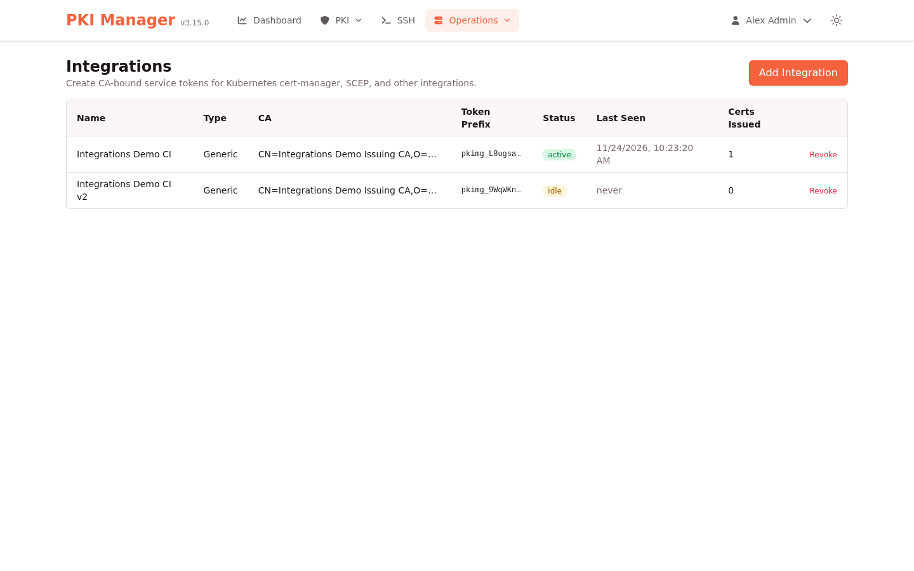

To revoke, select **Revoke** on the old row and confirm:

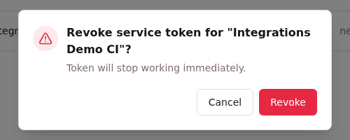

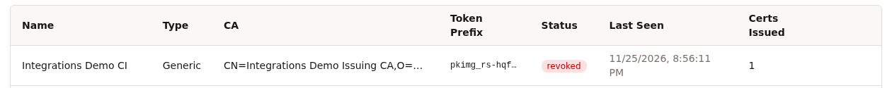

The old token stops at once. The new token works:

```bash
curl -s -w ' [%{http_code}]\n' $B/health -H "Authorization: Bearer $OLD_TOKEN"
# {"error":{"code":"UNAUTHORIZED","message":"Invalid or revoked service token"}} [401]

curl -s $B/health -H "Authorization: Bearer $NEW_TOKEN" | jq -c .integration.name
# "Integrations Demo CI v2"
```

Facts about revocation:

- It is permanent. A revoked integration cannot be turned on again; create a new one.
- Certificates that the integration already issued stay valid. Revoke them with
  `POST /revoke`, or in the UI, if you need to.
- The audit log has an `integration.revoke` row.
- The same flow exists in tRPC: `integration.register` and `integration.revoke` (see the
  [reference](../api/integrations.md#create-and-manage-a-service-identity)).

## 5. Enroll a device with SCEP

SCEP lets a device (or an MDM) get a client certificate with no login. The device sends an
encrypted request that carries a shared **challenge**. The **gateway** (a separate container)
speaks SCEP. It calls the backend with a SCEP integration token. The backend owns the
registration authority (RA) key in the KMS, so the gateway has no KMS access and no private
keys.

```text
device --SCEP--> gateway --HTTPS + integration token--> backend --> KMS
```

What was run, and what was not:

| Item | Status |
|---|---|
| SCEP integration in the UI | run |
| Gateway from the published image `ghcr.io/oriolrius/pki-manager-web/scep:3.15.0` | run |
| RA provisioned by the backend on first start | run |
| `GetCACaps`, `GetCACert` | run |
| One device enrollment, certificate checked with OpenSSL | run |
| Wrong challenge rejected | run |
| HTTPS in front of the gateway, rate limiting | **not run** (see the [README](../../scep/README.md#required-gateway-rate-limiting)) |
| Intune and webhook (MDM) modes, renewal, a real phone or laptop | **not run** (need a tenant or a device) |

### 5.1 Create the SCEP integration

Same form as in part 1, with **Type** `SCEP / MDM` and a CA used only for devices. Use a
dedicated CA: anyone with the challenge can choose the certificate CN.

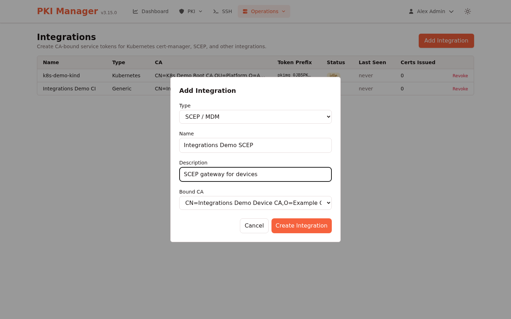

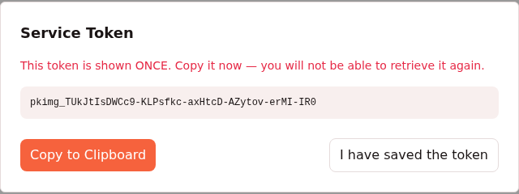

### 5.2 Give the gateway its two secrets

The gateway reads two files: the integration token and the device challenge. A challenge has
32 to 256 bytes.

```bash
mkdir secrets
printf '%s' "$SCEP_TOKEN" > secrets/backend-token      # the token from step 5.1
openssl rand -hex 32     > secrets/challenge           # 64 characters
chmod 755 secrets && chmod 644 secrets/*               # the container runs as uid 10001
```

Give the challenge to devices (or to the MDM profile). Never give them the integration token.

### 5.3 Start the gateway

The gateway accepts a plain `http://` backend URL only on loopback. Otherwise it needs
`https://` (a real deployment uses the HTTPS address of your reverse proxy). The demo has one
Docker network and no TLS, so the overlay `site/demo/compose.scep-demo.yml` puts a small
`socat` container in front: the gateway shares its network, and `127.0.0.1:3000` there
forwards to the backend. It is a separate Compose project, so it only adds containers.

```bash
export SCEP_DEMO_SECRETS=$PWD/secrets
docker compose -p pki-demo-scep -f site/demo/compose.scep-demo.yml up -d
```

For a real stack, use `docker/docker-compose.scep.yml` or `scep/compose.yml` and set
`SCEP_BACKEND_URL` to your HTTPS backend URL; see the
[SCEP README](../../scep/README.md#docker--arcane-one-additional-container). The gateway
logs one line when it is ready:

```text
{"level":"INFO","msg":"scep listening","address":":8085"}
```

On first start the gateway asks the backend to provision the RA. Check it:

```bash
curl -s "http://localhost:47385/scep?operation=GetCACaps"
```

```text
POSTPKIOperation
SHA-256
AES
Renewal
```

```bash
curl -s "http://localhost:47385/scep?operation=GetCACert" -o cacert.der
openssl pkcs7 -inform DER -in cacert.der -print_certs -noout | grep -E 'subject|issuer'
```

```text
subject=CN = SCEP Registration Authority
issuer=CN = Integrations Demo Device CA, C = ES, O = Example Corp
subject=CN = Integrations Demo Device CA, C = ES, O = Example Corp
issuer=CN = Integrations Demo Device CA, C = ES, O = Example Corp
```

The RA certificate is signed by the device CA, and it appears in the CA's certificate list.
The integration list now shows the SCEP integration as active:

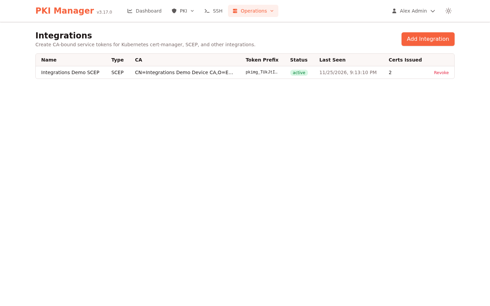

### 5.4 Enroll one device

The gateway needs a client that sends an AES-encrypted request and a CSR with the
`clientAuth` EKU. These clients were tried:

| Client | Result |
|---|---|
| micromdm `scepclient` v2.3.0 (released binary) | **Not verified end to end.** It POSTs with `Content-Type: application/octet-stream`. The gateway accepts this type (besides `application/x-pki-message`). In an earlier test, the gateway then answered `400 invalid SCEP message`. Its CSR has no extensions, so it cannot send the required `clientAuth` EKU. |
| The project test `TestLiveEnrollment` in `scep/live_test.go` (Go, Smallstep SCEP library) | **Works.** |

Use the project test as a reference client. It needs Go and a clone of this repository. It
generates a key, builds the CSR with the challenge, sends the request, decrypts the answer,
checks that the certificate is signed by the CA and is not a CA, and sends the request a
second time to check that no second certificate is issued:

```bash
cd scep
SCEP_TEST_SERVER_URL=http://localhost:47385/scep \
SCEP_TEST_CHALLENGE_FILE=../secrets/challenge \
go test -run TestLiveEnrollment -v -count=1 .
```

```text
=== RUN   TestLiveEnrollment
    live_test.go:97: live SCEP discovery, KMS RA signature/decryption, backend issuance and idempotent retry verified
--- PASS: TestLiveEnrollment (0.62s)
PASS
```

The gateway log shows the issued serial, and the same serial again for the retry:

```text
{"level":"INFO","msg":"scep.enroll","status":"success","serial":"3faea358180744c6502edb5da55706f84c2c48dd"}
{"level":"INFO","msg":"scep.enroll","status":"success","serial":"3faea358180744c6502edb5da55706f84c2c48dd"}
```

> **Note:** the test makes the device certificate with `CN=device-1`. It stays in the CA
> as a real certificate. Use an isolated CA, as the README says.

### 5.5 Verify the device certificate

The test does not save the certificate, so fetch it from PKI Manager. In the UI, open
**PKI**, **Certificates** and filter by the device CA:

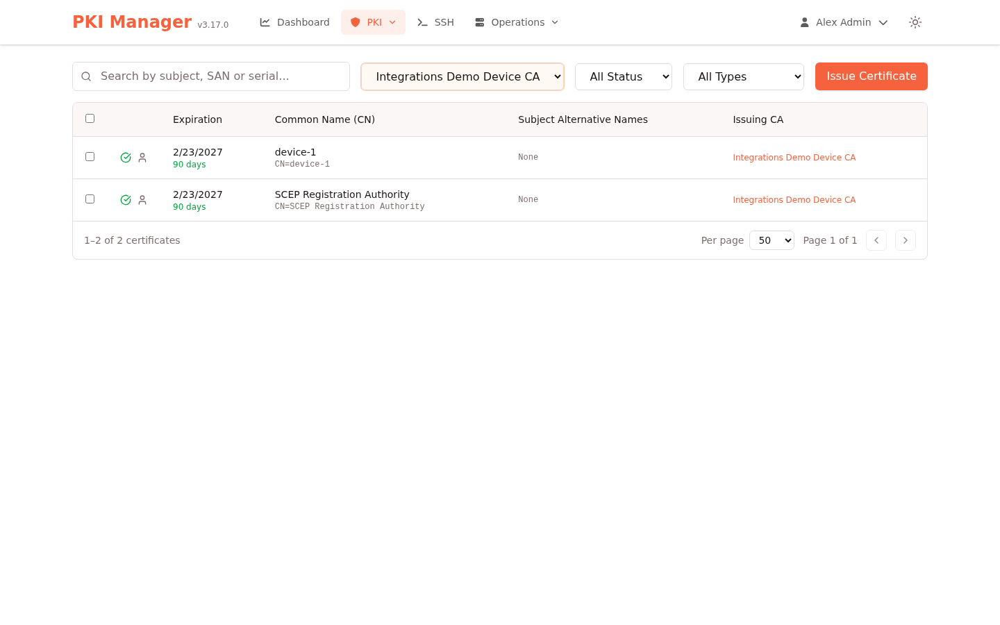

Or use the API (`$ADMIN` is a management token; `format=pem` returns base64 in a JSON field):

```bash
CERT_ID=$(curl -s "$API/api/v1/certificates?limit=100" -H "Authorization: Bearer $ADMIN" \
  | jq -r '.items[] | select(.serialNumber=="3faea358180744c6502edb5da55706f84c2c48dd") | .id')
curl -s "$API/api/v1/certificates/$CERT_ID/download?format=pem" -H "Authorization: Bearer $ADMIN" \
  | jq -r .data | base64 -d > device.crt
curl -s $B/ca-bundle -H "Authorization: Bearer $SCEP_TOKEN" | jq -r .certificatePem > device-ca.pem

openssl verify -CAfile device-ca.pem device.crt
openssl x509 -in device.crt -noout -subject -issuer -dates -ext extendedKeyUsage,basicConstraints
```

```text
device.crt: OK
subject=CN = device-1
issuer=CN = Integrations Demo Device CA, C = ES, O = Example Corp
notBefore=Nov 24 10:01:21 2026 GMT
notAfter=Feb 22 10:01:21 2027 GMT
X509v3 Extended Key Usage:
    TLS Web Client Authentication
X509v3 Basic Constraints: critical
    CA:FALSE
```

The device certificate is a client certificate (`clientAuth` only, `CA:FALSE`), valid 90
days.

### 5.6 What the gateway refuses

A wrong challenge is rejected and no certificate is issued. The test fails with
`enrollment rejected`, and the gateway log says why:

```text
{"level":"WARN","msg":"scep.enroll","status":"rejected","reason":"challenge"}
```

The same policy applies if you call the backend directly with the SCEP token (see the table
in part 3): validity above 90 days gives `INVALID_VALIDITY`, and a non-`clientAuth` CSR gives
`CSR_PROFILE_REJECTED`. The SCEP integration also writes `scep.ra.provision`,
`scep.ra.sign` and `scep.ra.decrypt` rows in the audit log, found with the same `entityId`
filter as in part 3.

In shared mode the gateway accepts a CN only. SANs and a different O, OU or C are refused.
Use the MDM modes when you need SANs: [Intune setup](../../scep/docs/intune.md).

### 5.7 Stop the demo gateway

```bash
docker compose -p pki-demo-scep -f site/demo/compose.scep-demo.yml down -v
```

Then revoke the SCEP integration in the UI, as in part 4, if you do not need it.

## Next

- [Endpoint reference and failure auditing](../api/integrations.md)
- [SCEP gateway, Intune and rate limiting](../../scep/README.md)
- [Install PKI Manager and log in](../get-started/install.md)
