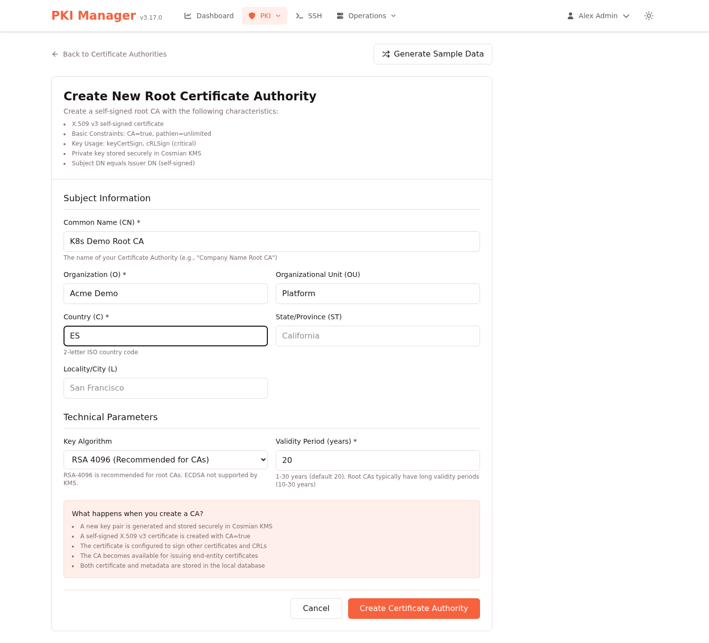
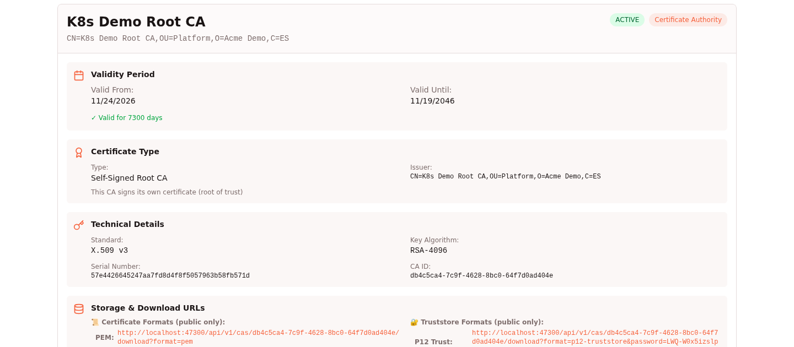
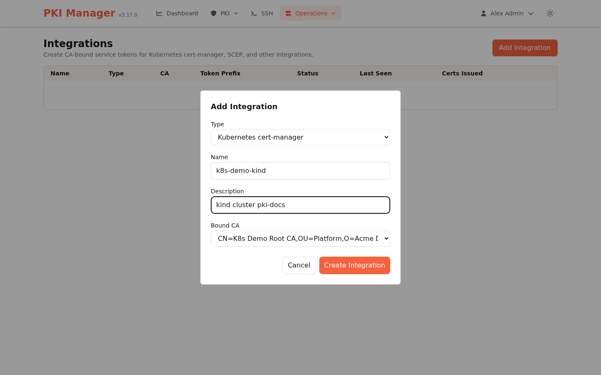
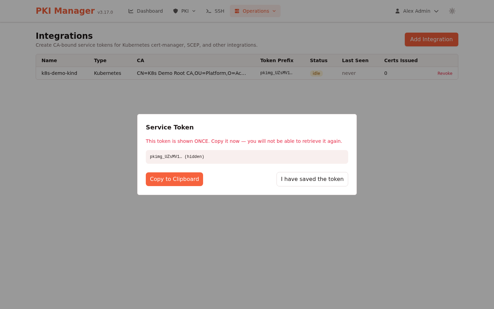
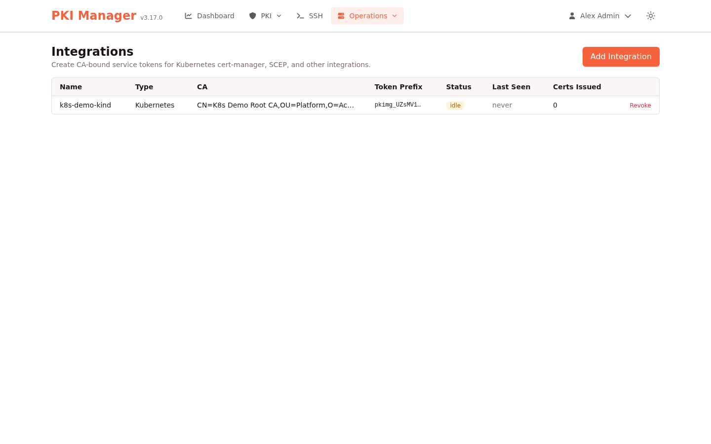
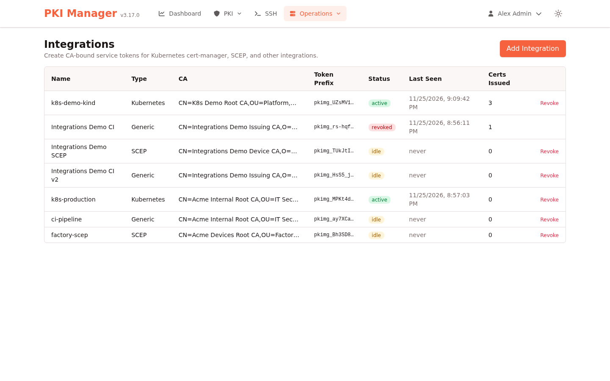
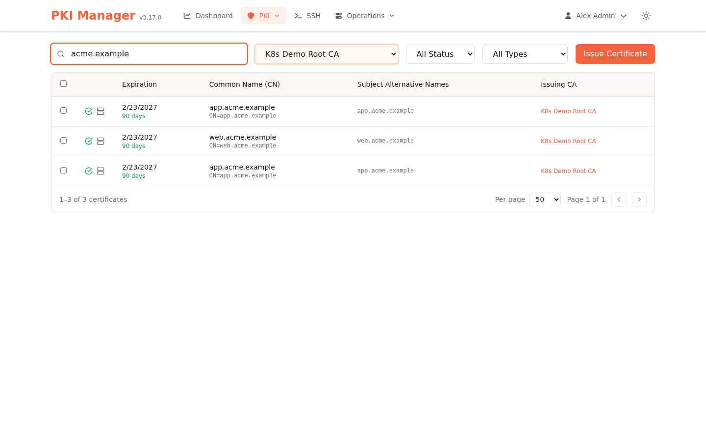
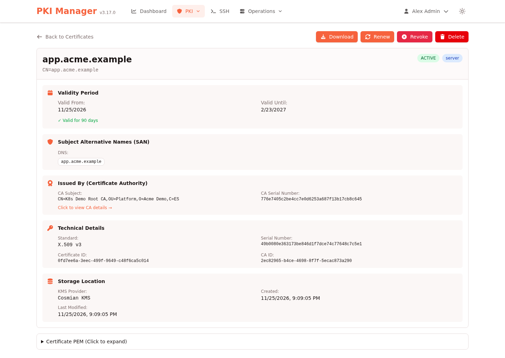

# Issue Kubernetes certificates with cert-manager
<!-- tested-with: 3.15.0 -->

This guide issues a TLS certificate for `app.acme.example` inside Kubernetes.
cert-manager creates the request. The PKI Manager issuer sends it to PKI Manager.
PKI Manager signs it with your CA. The private key of the CA stays in the KMS.
The private key of the certificate never leaves the cluster.

Every step below ran on a local **kind** cluster against a demo PKI Manager **3.15.0**.
Output is trimmed. Names and IDs are from that run.

| Part | Version used |
|---|---|
| PKI Manager (backend, UI) | 3.15.0 |
| Kubernetes (kind node) | v1.35.0 |
| cert-manager (Helm chart) | v1.19.1 |
| cmctl (for renewal) | v2.1.1 |
| Issuer chart | `pki-manager-issuer` 3.16.0, from `k8s/issuer/deploy/helm/` in the repository |
| Issuer image | `ghcr.io/oriolrius/pki-manager-issuer:64d0e19` |

## How it fits together


One service token is bound to one CA. One `Issuer` or `ClusterIssuer` uses one token.

## 1. Prerequisites

You need:

- `kubectl`, `helm`, and a cluster with Kubernetes 1.30 or newer (here: `kind`). The chart refuses an older cluster.
- A running PKI Manager that the cluster can reach over HTTP(S). See [Install PKI Manager](../get-started/install.md).
- An admin login in PKI Manager.
- A local clone of the repository (the chart is in it).

Create the cluster:

```bash
kind create cluster --name pki-docs
```

```text
 ✓ Starting control-plane 🕹️
 ✓ Installing CNI 🔌
Set kubectl context to "kind-pki-docs"
```

Install cert-manager. The version is pinned. The issuer needs cert-manager 1.16 or newer.

```bash
helm repo add jetstack https://charts.jetstack.io
helm install cert-manager jetstack/cert-manager \
  --namespace cert-manager --create-namespace \
  --version v1.19.1 --set crds.enabled=true --wait
kubectl get pods -n cert-manager
```

```text
NAME                                       READY   STATUS    RESTARTS   AGE
cert-manager-74d45887dd-vnc76              1/1     Running   0          29s
cert-manager-cainjector-57974bd7f8-tzjgf   1/1     Running   0          29s
cert-manager-webhook-75774cfd97-k7ltj      1/1     Running   0          29s
```

### Which URL can the pods use?

The issuer pod calls PKI Manager. It needs a URL that works from inside the cluster.

| Setup | URL used for `spec.url` |
|---|---|
| This guide (demo stack in Docker, kind) | `http://pki-demo-backend:3000` |
| Real install | The public HTTPS URL of PKI Manager, for example `https://pki.example.com` |

In this guide the demo backend runs in Docker on the network `pki-demo-network`.
The kind node joins that network. Pods then resolve the container name:

```bash
docker network connect pki-demo-network pki-docs-control-plane
kubectl run nettest --rm -i --restart=Never --image=curlimages/curl -- \
  curl -sS -i http://pki-demo-backend:3000/api/v1/external/health
```

```text
HTTP/1.1 401 Unauthorized
{"error":{"code":"UNAUTHORIZED","message":"Missing or invalid Authorization header"}}
```

A `401` is the right answer here. The pod reached PKI Manager and it asked for a token.
If the issuer's URL is HTTPS with a private CA, set `spec.caBundle` (PEM) on the issuer.

## 2. Create a CA and an integration in PKI Manager

### 2.1 Create the CA

1. Open **PKI → Certificate Authorities** and start a new root CA (`/cas/new`).
2. Fill **Common Name** `K8s Demo Root CA`, **Organization** `Acme Demo`, **Organizational Unit** `Platform`, **Country** `ES`.
3. Create it.



The CA page opens. Note the **CA ID**. The issuer needs it.



In a real install you can use an existing issuing CA. It must be **active**.

### 2.2 Create the integration (service token)

1. Open **Operations → Integrations** and click **Add Integration**.
2. **Type**: `Kubernetes cert-manager`.
3. **Name**: `k8s-demo-kind`. **Description**: optional.
4. **Bound CA**: pick `K8s Demo Root CA`. Only active CAs are listed.
5. Click **Create Integration**.



PKI Manager shows the **Service Token** one time. Copy it now.
It starts with `pkimg_`. PKI Manager cannot show it again.



Click **I have saved the token**. The integration is in the list.



Keep the CA ID and the token in shell variables for the next steps:

```bash
export CA_ID=fcc188c4-a767-418f-883c-b9f4748cf5e7   # from the CA page
export TOKEN=pkimg_...                                # from the dialog
```

## 3. Install the issuer

The chart is in the repository, not in a Helm repository. Install it from your clone.

`values.yaml`:

```yaml
image:
  tag: "64d0e19"
```

```bash
cd pki-manager-web/k8s/issuer
helm upgrade --install pki-manager-issuer deploy/helm/pki-manager-issuer \
  --namespace pki-manager-issuer --create-namespace -f values.yaml --wait
kubectl get pods -n pki-manager-issuer
kubectl get crd | grep pki-manager
```

```text
NAME                                                     READY   STATUS    RESTARTS   AGE
pki-manager-issuer-pki-manager-issuer-86868dc74c-pzpgt   1/1     Running   0          17s

clusterissuers.pki-manager.issuer.io   2026-11-24T09:58:50Z
issuers.pki-manager.issuer.io          2026-11-24T09:58:50Z
```

Notes:

- **`image.tag` defaults to the chart `appVersion`.** The version is the release version (`cz bump` keeps it in sync), and the `k8s-issuer` workflow publishes the image tag `X.Y.Z` on each `vX.Y.Z` tag. The workflow also publishes the short commit SHA and `latest` from `main`. Pin a tag with `image.tag` if you need one.
- The chart also installs an approver ClusterRole (`approver.enabled=true`, default). It lets cert-manager approve requests for the signers `issuers.pki-manager.issuer.io/*` and `clusterissuers.pki-manager.issuer.io/*`. Without it, cert-manager never approves requests for this issuer. See [Troubleshooting](#7-troubleshooting). Set `approver.enabled=false` only when you approve requests in another way.
- If cert-manager runs under another ServiceAccount than `cert-manager` in namespace `cert-manager`, set `approver.certManagerServiceAccount.name` and `.namespace`.

### Create the token Secret and the ClusterIssuer

A `ClusterIssuer` reads its Secret from the controller namespace (`pki-manager-issuer`).

```bash
kubectl create secret generic pki-manager-token \
  --namespace pki-manager-issuer --from-literal=token="$TOKEN"
```

`clusterissuer.yaml`:

```yaml
apiVersion: pki-manager.issuer.io/v1alpha1
kind: ClusterIssuer
metadata:
  name: pki-manager
spec:
  url: http://pki-demo-backend:3000   # real install: https://pki.example.com
  caId: fcc188c4-a767-418f-883c-b9f4748cf5e7
  authSecretRef:
    name: pki-manager-token
    key: token
  certificateType: server
```

```bash
kubectl apply -f clusterissuer.yaml
kubectl get clusterissuer.pki-manager.issuer.io pki-manager
kubectl get clusterissuer.pki-manager.issuer.io pki-manager -o jsonpath='{.status.conditions}'
```

```text
NAME          READY   AGE
pki-manager   True    8s
[{"message":"PKI Manager reachable and CA matches","reason":"Verified","status":"True","type":"Ready"}]
```

`Ready=True` and reason `Verified` mean:

- The controller authenticated with the token.
- The token is bound to the same CA as `spec.caId`.

Fields of the issuer `spec`:

| Field | Required | Meaning |
|---|---|---|
| `url` | yes | PKI Manager base URL. Must start with `http://` or `https://`. |
| `caId` | yes | CA UUID. Must match the CA of the token. |
| `authSecretRef` | yes | Secret name. `key` defaults to `token`. |
| `caBundle` | no | PEM CA bundle to verify TLS to PKI Manager. |
| `certificateType` | no | `server`, `client` or `dual`. Default `dual`. It is a label in PKI Manager. Key usage comes from the CSR. |
| `revokeOnDelete` | no | If `true`, PKI Manager revokes the certificate when the Kubernetes resource is deleted. Default `false`. |

Use a namespaced `Issuer` instead if you want the Secret in the application namespace.

## 4. Request a certificate

`certificate.yaml`:

```yaml
apiVersion: cert-manager.io/v1
kind: Certificate
metadata:
  name: app-tls
  namespace: default
spec:
  secretName: app-tls
  commonName: app.acme.example
  dnsNames:
    - app.acme.example
  duration: 2160h      # 90 days
  renewBefore: 360h    # renew 15 days before expiry
  privateKey:
    rotationPolicy: Always
  usages:
    - server auth
  issuerRef:
    group: pki-manager.issuer.io
    kind: ClusterIssuer
    name: pki-manager
```

PKI Manager needs an identity in the request: a **Common Name**, or at least one SAN (`dnsNames`, `ipAddresses`, `emailAddresses`). This example sets both.

```bash
kubectl apply -f certificate.yaml
kubectl get certificate,certificaterequest
```

```text
NAME                                  READY   SECRET    AGE
certificate.cert-manager.io/app-tls   True    app-tls   10s

NAME                                           APPROVED   DENIED   READY   ISSUER        AGE
certificaterequest.cert-manager.io/app-tls-1   True                True    pki-manager   10s
```

`READY True` means cert-manager stored the signed certificate in the Secret `app-tls`.
The Secret has `tls.crt`, `tls.key` and `ca.crt`.

Check the certificate:

```bash
kubectl get secret app-tls -o jsonpath='{.data.tls\.crt}' | base64 -d > tls.crt
kubectl get secret app-tls -o jsonpath='{.data.ca\.crt}'  | base64 -d > ca.crt
openssl x509 -in tls.crt -noout -subject -issuer -serial -dates \
  -ext subjectAltName,extendedKeyUsage,basicConstraints
openssl verify -CAfile ca.crt tls.crt
```

```text
subject=CN = app.acme.example
issuer=CN = K8s Demo Root CA, OU = Platform, C = ES, O = Acme Demo
serial=51E1A69E54CB718DAE5437F5D43AB63F0C541710
notBefore=Nov 24 10:00:26 2026 GMT
notAfter=Feb 22 10:00:26 2027 GMT
X509v3 Subject Alternative Name:
    DNS:app.acme.example
X509v3 Extended Key Usage:
    TLS Web Server Authentication
X509v3 Basic Constraints: critical
    CA:FALSE
tls.crt: OK
```

The issuer is your PKI Manager CA. The SAN is the DNS name you asked for.
The controller also writes the serial on the request:

```bash
kubectl get certificaterequest app-tls-1 -o jsonpath='{.metadata.annotations.pki-manager\.issuer\.io/serial}'
```

```text
51e1a69e54cb718dae5437f5d43ab63f0c541710
```

The same serial is in PKI Manager. The **Integrations** list counts the certificates this token issued:



Open **PKI → Certificates**. Filter by CA `K8s Demo Root CA`.
Each issuance is one row.



## 5. Optional: certificate from an Ingress annotation

cert-manager can create the `Certificate` for you from an Ingress.
For an external issuer you set three annotations: the issuer name, its kind, and its group.
This was verified without an ingress controller. cert-manager only reads the Ingress object.

`ingress.yaml`:

```yaml
apiVersion: networking.k8s.io/v1
kind: Ingress
metadata:
  name: web
  namespace: default
  annotations:
    cert-manager.io/issuer: pki-manager
    cert-manager.io/issuer-kind: ClusterIssuer
    cert-manager.io/issuer-group: pki-manager.issuer.io
    cert-manager.io/common-name: web.acme.example
spec:
  tls:
    - hosts:
        - web.acme.example
      secretName: web-tls
  rules:
    - host: web.acme.example
      http:
        paths:
          - path: /
            pathType: Prefix
            backend:
              service:
                name: web
                port:
                  number: 80
```

```bash
kubectl apply -f ingress.yaml
kubectl get certificate
kubectl get secret web-tls -o jsonpath='{.data.tls\.crt}' | base64 -d \
  | openssl x509 -noout -subject -issuer -ext subjectAltName
```

```text
NAME      READY   SECRET    AGE
app-tls   True    app-tls   94s
web-tls   True    web-tls   16s
subject=CN = web.acme.example
issuer=CN = K8s Demo Root CA, OU = Platform, C = ES, O = Acme Demo
X509v3 Subject Alternative Name:
    DNS:web.acme.example
```

Two rules to remember:

- **Use `cert-manager.io/issuer`, not `cert-manager.io/cluster-issuer`.** The `cluster-issuer` annotation cannot be combined with kind and group. See [Troubleshooting](#7-troubleshooting).
- **No CN is needed.** An Ingress certificate has no CN by default. PKI Manager accepts a CSR with an empty subject when it has at least one SAN (RFC 5280). It rejects a CSR with neither a CN nor a SAN. The certificate then has an empty subject and carries the hosts in its SAN extension. The example above sets `cert-manager.io/common-name` so the certificate has a CN; remove it to get an empty subject.

## 6. Renew a certificate

cert-manager renews by itself when `renewBefore` is reached. To renew now, use `cmctl`:

```bash
cmctl renew app-tls
kubectl get certificate,certificaterequest
kubectl get secret app-tls -o jsonpath='{.data.tls\.crt}' | base64 -d | openssl x509 -noout -serial -dates
kubectl get certificate app-tls -o jsonpath='{.status.revision}{"\n"}'
```

```text
Manually triggered issuance of Certificate default/app-tls

NAME                                  READY   SECRET    AGE
certificate.cert-manager.io/app-tls   True    app-tls   29s

NAME                                           APPROVED   DENIED   READY   ISSUER        AGE
certificaterequest.cert-manager.io/app-tls-2   True                True    pki-manager   10s

serial=7571947267DC3A96069F0E17ADC3D7E15BE9E13F
notBefore=Nov 24 10:00:46 2026 GMT
notAfter=Feb 22 10:00:46 2027 GMT
2
```

What changed:

| Item | Before | After |
|---|---|---|
| CertificateRequest | `app-tls-1` | `app-tls-2` |
| Certificate revision | 1 | 2 |
| Serial | `51E1A69E...` | `7571947267...` |

A renewal is a new certificate. PKI Manager keeps the old one until it expires or you revoke it.
The new certificate is in the list. Open it from **PKI → Certificates**:



The **Renew** button in that page renews a certificate that PKI Manager holds the key for.
It does not apply here: Kubernetes holds the key of these certificates.

## 7. Troubleshooting

All messages below were seen in this run.

| Where | Message or symptom | Cause | Fix |
|---|---|---|---|
| Pod events | `Failed to pull image "ghcr.io/oriolrius/pki-manager-issuer:<tag>": ... not found` (`ErrImagePull`) | The image tag is not published (for example a chart from an unreleased commit, or a release whose `k8s-issuer` run has not finished). | Wait for the workflow, or set `image.tag` to a published tag (release `X.Y.Z`, short SHA or `latest`). |
| ClusterIssuer `Ready=False`, reason `SecretMissing` | `Secret "missing-secret" not found` | Wrong Secret name, or Secret not in the controller namespace. | Create the Secret in `pki-manager-issuer` (ClusterIssuer) or in the Issuer namespace. |
| Reason `Unreachable` | `Get "http://localhost:3000/api/v1/external/health": dial tcp [::1]:3000: connect: connection refused` | The URL is not reachable from the pod. `localhost` is the pod itself. | Use a URL the pod can reach. Set `caBundle` for a private TLS CA. |
| Reason `Unreachable` | `pki-manager GET /api/v1/external/health: 401 UNAUTHORIZED: Invalid or revoked service token` | The token is wrong or the integration is revoked. | Create a new integration and replace the Secret. |
| Reason `CAIDMismatch` | `token bound to caId=fcc188c4-... but spec.caId=00000000-...` | `spec.caId` is not the CA of the token. | Set `spec.caId` to the CA of the integration. |
| `kubectl get certificaterequest`: APPROVED and READY empty, Certificate `False` | Request never approved. | The approver ClusterRole is missing (`approver.enabled=false`) or bound to the wrong ServiceAccount. | Install with `approver.enabled=true`. Set `approver.certManagerServiceAccount.*` to match cert-manager. Approval then happens on its own. |
| CertificateRequest `Ready=False`, event `SignFailed` | `pki-manager POST /api/v1/external/sign: 400 INVALID_CSR: CSR must include a subject CN or at least one SAN` | The Certificate has neither `commonName` nor any SAN. | Set `dnsNames` (or `commonName`) on the Certificate. |
| Ingress event `BadConfig` (no Certificate is created) | `Could not determine issuer for ingress due to bad annotations: both "cert-manager.io/cluster-issuer" and "cert-manager.io/issuer-group" may not be set, both "cert-manager.io/cluster-issuer" and "cert-manager.io/issuer-kind" may not be set` | The `cluster-issuer` annotation was used together with kind and group. | Use `cert-manager.io/issuer` with `issuer-kind` and `issuer-group`. |

Useful commands:

```bash
kubectl describe certificaterequest <name>
kubectl get clusterissuer.pki-manager.issuer.io <name> -o jsonpath='{.status.conditions}'
kubectl logs -n pki-manager-issuer deploy/pki-manager-issuer-pki-manager-issuer
kubectl logs -n cert-manager deploy/cert-manager
```

## Demo-only choices

| In this guide | In a real install |
|---|---|
| `http://pki-demo-backend:3000` over a Docker network | HTTPS URL of PKI Manager, and `caBundle` if its CA is private |
| kind node joined to the Docker network | A cluster with a route to PKI Manager (check firewalls and NetworkPolicy; the chart has `networkPolicy.pkiManagerEgressCIDR`) |
| Certificate CRL URL is `http://localhost:47300/crl/...` (the demo setting `CRL_DISTRIBUTION_URL`) | Set `CRL_DISTRIBUTION_URL` on the backend to a URL that clients can reach |
| Token passed with `--from-literal` | Keep the token in your secret manager. Rotate it by creating a new integration and revoking the old one. |

## Clean up

```bash
kubectl delete -f certificate.yaml -f ingress.yaml
helm uninstall pki-manager-issuer -n pki-manager-issuer
kind delete cluster --name pki-docs
```

To stop the issuer from using the token, open **Operations → Integrations** and click **Revoke** on the integration.
The token stops working at once.
