# Client certificate authentication with revocation (worked example: Mosquitto)

Acme Example Ltd runs a Mosquitto broker for factory sensors. Only sensors with a valid
certificate may connect, and the broker must use TLS. This guide builds that setup with
PKI Manager: a CA, a server certificate for `mqtt.acme.example`, client certificates, and
a revocation that the broker enforces.

The author wrote the same setup by hand, with easy-rsa and `openssl`, in a blog series.
This guide redoes the broker posts with PKI Manager and says what changes and what does not.

| # | Post | Topic |
|---|---|---|
| 1 | [Certificate management with easy-rsa](https://oriolrius.blog/en/2025/01/31/certificate-management-pki-easy-rsa/) | CA, server and client certificates, revoke, CRL, renew, OCSP |
| 2 | [Mosquitto with a self-signed server certificate](https://oriolrius.blog/en/2025/02/07/mqtt-broker-mosquitto-with-server-certificate-self-signed/) | TLS on 8883, WSS on 8884 |
| 3 | [Mosquitto with server and client certificates](https://oriolrius.blog/en/2025/02/18/mqtt-broker-mosquitto-with-server-certificate-self-signed-and-client-certificate/) | mutual TLS, `use_identity_as_username` |
| 4 | [Mosquitto with a Let's Encrypt certificate](https://oriolrius.blog/en/2025/02/18/mqtt-broker-mosquitto-with-server-certificate-lets-encrypt/) | public names only, no client certificates |
| 5 | [Certificate formats: PEM, DER and PKCS#12](https://oriolrius.blog/en/2025/02/18/certificate-formats-pem-der-and-pkcs12-and-private-key-handling/) | formats, passphrases |

Read post 1 for the concepts. This guide does not repeat them. Post 4 is not redone: a
public CA cannot issue client certificates, and PKI Manager is a private CA.

Every step was run on a demo stack with release **3.15.0** (see
[Install PKI Manager and log in](get-started.md)) and Mosquitto **2.0.22**
(`eclipse-mosquitto:2.0.22`). You log in as an `admin` user. The CA, certificate and CRL
steps use the same screens as [Build a private CA](private-ca.md). That guide has the
details of each form and download format.

## Easy-rsa step and PKI Manager step

Each PKI Manager cell is something that was run in this guide, or is written in
[Build a private CA](private-ca.md) or [Automate issuance](integrations.md).

| Task | easy-rsa (posts 1 to 3) | PKI Manager |
|---|---|---|
| Create the CA | `init-pki`, `build-ca` on your machine. The CA key is a file, protected by a passphrase. | **Create CA** in the UI. The key pair is made in the Cosmian KMS. You type no CA passphrase. The CA is always a **root** CA. |
| Where the CA key lives | `pki/private/ca.key` on disk. | In the KMS. The CA key leaves the KMS in two cases only. The backend reads it to sign each CRL (in memory only; audit row `kms.get_private_key` in `crl.generate`). And, only if the server runs with `ALLOW_CA_KEY_EXPORT=true` (default `false`), an admin can download the CA as a PKCS#12/JKS keystore (audit row `ca.export_private_key`). Certificates are signed in the KMS (audit row `kms.sign_certificate`). |
| Server certificate | `gen-req` then `sign-req server`. You edit the SAN by hand. | **Issue Certificate**, type `Server`, DNS Names list. Key and certificate come from one form. |
| Client certificate | `gen-req` then `sign-req client`. | Same form, type `Client`. |
| CSR from another machine | `import-req` then `sign-req`. | External issuer API: an admin makes an integration with a token. The machine sends its CSR to `POST /api/v1/external/sign`. The key stays on the machine (step 6). |
| Key passphrase | `gen-req` asks for one. Mosquitto asks for it at start. You remove it for MQTTX. | **Download** has the checkbox "Encrypt private key with password". Leave it off to get an unencrypted key. Not tested here: Mosquitto with an encrypted key. |
| Export PKCS#12 | `export-p12` | **Download**, format `PKCS#12`. Also `PEM with Private Key` (ZIP) and `JKS`. Password is optional for PEM and PKCS#12. |
| Revoke | `revoke`, then `gen-crl`. | **Revoke** on the certificate page. The CRL is made at once. |
| Publish the CRL | You copy `crl.pem` to every place that needs it. | PKI Manager serves it at the URL inside each certificate. **The broker still reads a local file**, so you fetch it (step 7 and 8). |
| Renew and revoke the old one | `renew`, then `revoke-renewed`, then `gen-crl`. | **Renew** makes a new certificate and, by default, a new key (an option keeps the key). The old certificate stays active unless you select "Revoke the previous certificate (superseded)" in the dialog. |
| OCSP | `openssl ocsp` with your own responder. | **Not available.** No responder, and the certificates have no OCSP URL. Use the CRL. |
| First CRL | You run `gen-crl` once. | Each new CA gets an empty, signed CRL at creation. The CRL URL works at once (step 4). |
| Inventory and expiry | `index.txt` | Dashboard "Expiring Soon" and the certificate list with filters. |
| Who did what | Shell history. | Audit log with operation, entity, time, IP address and the actor (`actorType` user, integration, SSH token or anonymous, with `actorId` and `actorName`). Rows written before 3.16.1 have no actor. The UI has no audit page: use the API. |
| Several operators | Everyone who can read the CA key. | OIDC login with two roles: `user` (view, issue, download) and `admin` (also create CAs, revoke, delete). |

## 1. Create the CA, the server certificate and the client certificate

Use the screens of [Build a private CA](private-ca.md#1-create-the-root-ca). The values used here:

| Object | Value |
|---|---|
| CA | CN `Acme MQTT Root CA`, O `Acme Example Ltd`, OU `IT Security`, C `ES`, RSA 4096, 10 years |
| Server certificate | type `Server (TLS/SSL Web Server)`, CN `mqtt.acme.example`, OU `Messaging`, DNS Names `mqtt.acme.example`, 365 days |
| Client certificate | type `Client (User Authentication)`, CN `sensor-01`, OU `Factory Sensors`, 365 days |

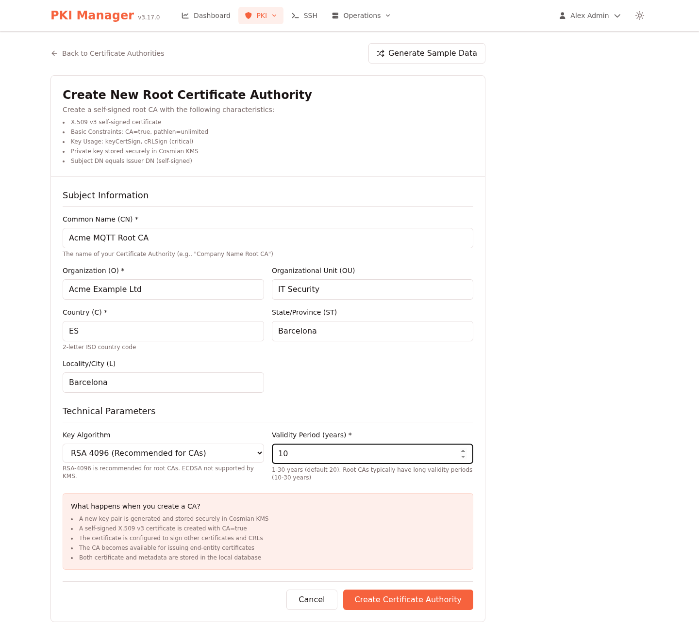

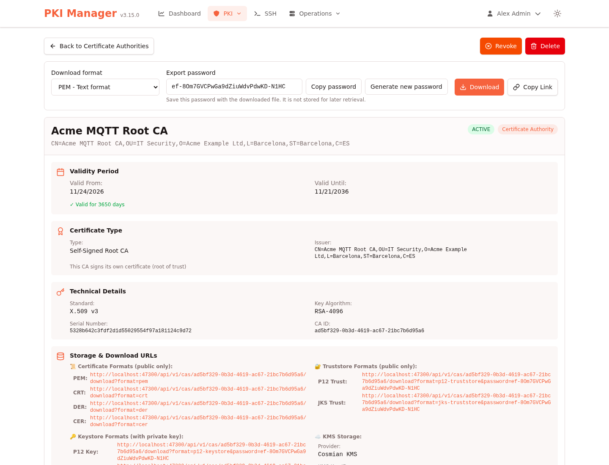

For the server certificate, put the name in **DNS Names**. Clients check the SAN, not the CN.

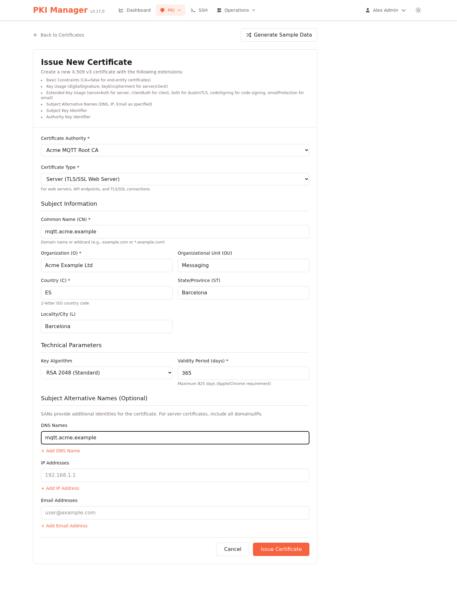

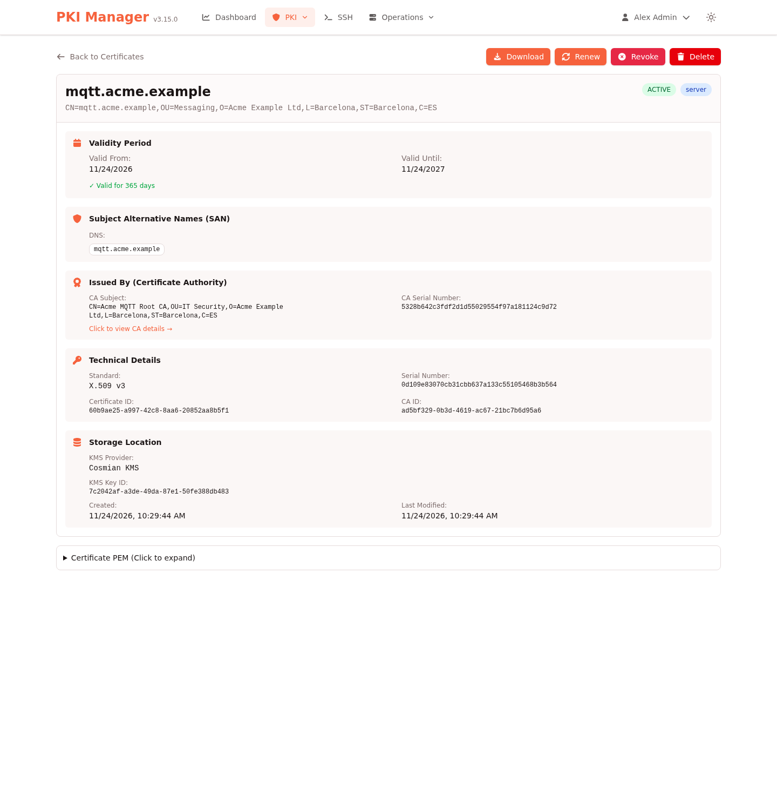

For the client certificate the CN `sensor-01` is the MQTT user name later (step 3).

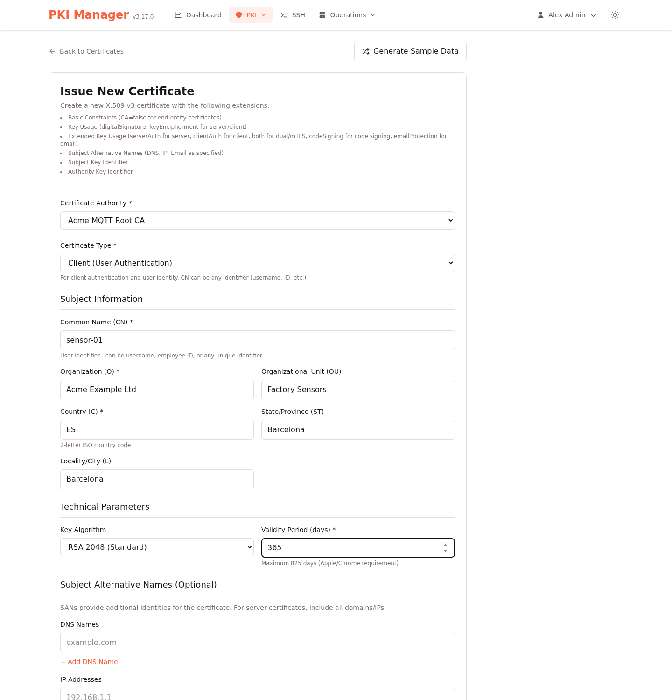

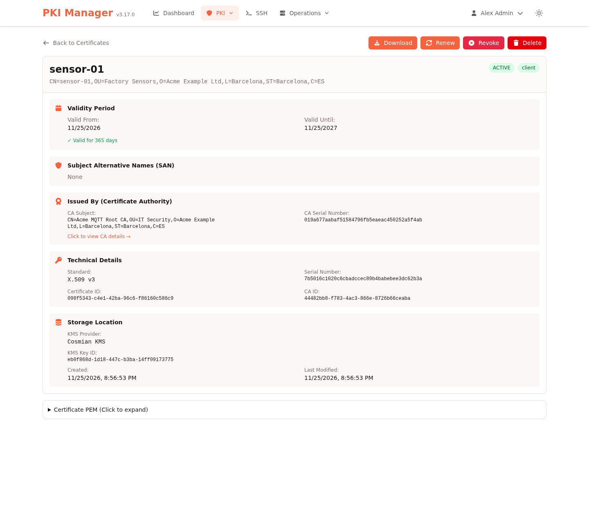

## 2. Download the files

Make a work folder with a `certs` folder in it. Download these files into `certs`:

| From | Format | Save as |
|---|---|---|
| CA page | `PEM - Text format` | `ca.pem` |
| Server certificate | `PEM with Private Key`, encrypt box **off** | ZIP, then `server.pem` and `server.key` |
| Client certificate | `PEM with Private Key`, encrypt box **off** | ZIP, then `client.pem` and `client.key` |

The ZIP holds a `.pem` (certificate) and a `.priv` (key). Rename the `.priv` to `.key`.

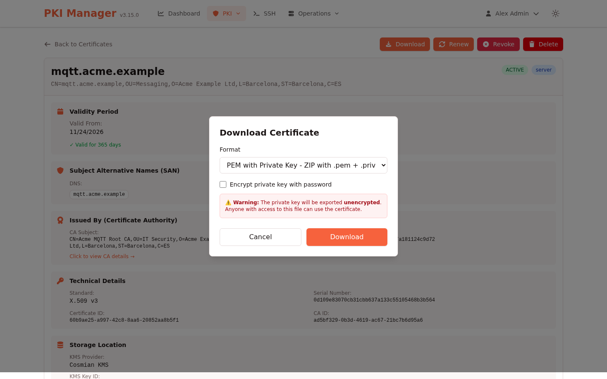

Mosquitto has no terminal in a container and cannot ask for a passphrase, so the key must be
unencrypted. Protect the file with its permissions:

```bash
chmod 600 certs/*.key
openssl verify -CAfile certs/ca.pem certs/server.pem certs/client.pem
```

```text
certs/server.pem: OK
certs/client.pem: OK
```

```bash
openssl x509 -in certs/server.pem -noout -subject -ext subjectAltName,extendedKeyUsage
openssl x509 -in certs/client.pem -noout -subject -ext extendedKeyUsage,crlDistributionPoints
```

```text
subject=CN = mqtt.acme.example, OU = Messaging, C = ES, ST = Barcelona, L = Barcelona, O = Acme Example Ltd
X509v3 Extended Key Usage:
    TLS Web Server Authentication
X509v3 Subject Alternative Name:
    DNS:mqtt.acme.example
subject=CN = sensor-01, OU = Factory Sensors, C = ES, ST = Barcelona, L = Barcelona, O = Acme Example Ltd
X509v3 Extended Key Usage:
    TLS Web Client Authentication
X509v3 CRL Distribution Points:
    Full Name:
      URI:http://localhost:47300/crl/ad5bf329-0b3d-4619-ac67-21bc7b6d95a6.crl
```

The server certificate is for servers only (`serverAuth`). The client certificate is for
clients only (`clientAuth`). The client certificate holds the CRL URL. You need it in step 7.

For tools that want one file (MQTTX, a browser), download the client certificate as `PKCS#12`
with a password. Check it:

```bash
openssl pkcs12 -in client.p12 -passin pass:Acme-Export-1 -nokeys -clcerts | openssl x509 -noout -subject
```

```text
subject=CN = sensor-01, OU = Factory Sensors, C = ES, ST = Barcelona, L = Barcelona, O = Acme Example Ltd
```

In post 3 you removed the key passphrase by hand. Here you choose it in the download dialog.

## 3. The broker configuration

The file is [mqtt/mosquitto.conf](mqtt/mosquitto.conf):

```text
listener 8883
cafile   /mosquitto/certs/ca.pem
certfile /mosquitto/certs/server.pem
keyfile  /mosquitto/certs/server.key
crlfile  /mosquitto/certs/crl.pem

require_certificate true
use_identity_as_username true

connection_messages true
log_dest stdout
```

| Option | Effect |
|---|---|
| `cafile` | The CA that signed the client certificates. |
| `certfile`, `keyfile` | The server certificate and its key. |
| `crlfile` | The CRL. Mosquitto reads it from a file. |
| `require_certificate true` | A client without a certificate is refused. |
| `use_identity_as_username true` | The certificate CN is the MQTT user name. |

Post 2 also opens WSS on 8884. This guide uses one listener. WSS needs a second `listener`
block with `protocol websockets` and the same files.

## 4. The CRL file must exist before the broker starts

`crlfile` needs a file. Since 3.16.1, PKI Manager makes an empty, signed CRL when it creates
the CA (CRL number 1), so the URL in the certificate works before the first revocation.
Fetch the CRL with that URL and check it:

```bash
curl -sS -o certs/crl.pem http://localhost:47300/crl/ad5bf329-0b3d-4619-ac67-21bc7b6d95a6.crl
chmod 600 certs/crl.pem
openssl crl -in certs/crl.pem -noout -nextupdate -issuer
```

The CRL is valid for 7 days (`Next Update`). See [step 8](#8-keep-the-crl-fresh).

## 5. Start the broker and test the handshake

A Docker network gives the broker the name `mqtt.acme.example`, so the names in the
certificate match. The broker runs as your user, so it can read the `600` files.

```bash
docker network create acme-mqtt
docker run -d --name acme-mosquitto --user "$(id -u):$(id -g)" \
  --network acme-mqtt --network-alias mqtt.acme.example -p 127.0.0.1:47391:8883 \
  -v "$PWD/mosquitto.conf:/mosquitto/config/mosquitto.conf:ro" \
  -v "$PWD/certs:/mosquitto/certs:ro" eclipse-mosquitto:2.0.22
docker logs acme-mosquitto
```

```text
mosquitto version 2.0.22 starting
Config loaded from /mosquitto/config/mosquitto.conf.
Opening ipv4 listen socket on port 8883.
Opening ipv6 listen socket on port 8883.
mosquitto version 2.0.22 running
```

Test the handshake with `openssl s_client` from the host (the port is published on `127.0.0.1:47391`):

```bash
openssl s_client -connect 127.0.0.1:47391 -servername mqtt.acme.example \
  -CAfile certs/ca.pem -cert certs/client.pem -key certs/client.key \
  -verify_hostname mqtt.acme.example </dev/null 2>&1 \
  | grep -E "^depth|Verification|Verified peername|Verify return|New,"
```

```text
depth=1 CN = Acme MQTT Root CA, OU = IT Security, C = ES, ST = Barcelona, L = Barcelona, O = Acme Example Ltd
depth=0 CN = mqtt.acme.example, OU = Messaging, C = ES, ST = Barcelona, L = Barcelona, O = Acme Example Ltd
Verification: OK
Verified peername: mqtt.acme.example
New, TLSv1.3, Cipher is TLS_AES_256_GCM_SHA384
Verify return code: 0 (ok)
```

The client verified the server name against the SAN.

> **Note:** with TLS 1.3 the server checks the client certificate after the handshake.
> `s_client` without a client certificate also ends with `Verify return code: 0`. Use an MQTT
> client to test the refusal (below).

## 6. Publish and subscribe with the client certificate

The MQTT clients run in containers on the same network. Set a shortcut first:

```bash
MQ="docker run --rm --network acme-mqtt --user $(id -u):$(id -g) -v $PWD/certs:/certs:ro eclipse-mosquitto:2.0.22"
TLS="-h mqtt.acme.example -p 8883 --cafile /certs/ca.pem --cert /certs/client.pem --key /certs/client.key"
```

Subscribe in the background, then publish:

```bash
$MQ mosquitto_sub $TLS -t 'acme/sensors/#' -C 1 -v &
$MQ mosquitto_pub $TLS -t acme/sensors/line1/temp -m '21.5'
```

```text
acme/sensors/line1/temp 21.5
```

The broker log shows the user name. It is the CN of the certificate:

```text
New client connected from 10.222.14.3:58398 as auto-7073B8C7-... (p2, c1, k60, u'sensor-01').
```

Without a client certificate the broker refuses:

```bash
$MQ mosquitto_pub -h mqtt.acme.example -p 8883 --cafile /certs/ca.pem -t acme/sensors/line1/temp -m '21.5'
```

```text
Error: The connection was lost.
```

```text
OpenSSL Error[0]: error:0A0000C7:SSL routines::peer did not return a certificate
Client <unknown> disconnected: Protocol error.
```

The first lines are the client output, the last two are the broker log.

## 7. Revoke the certificate and make the broker refuse it

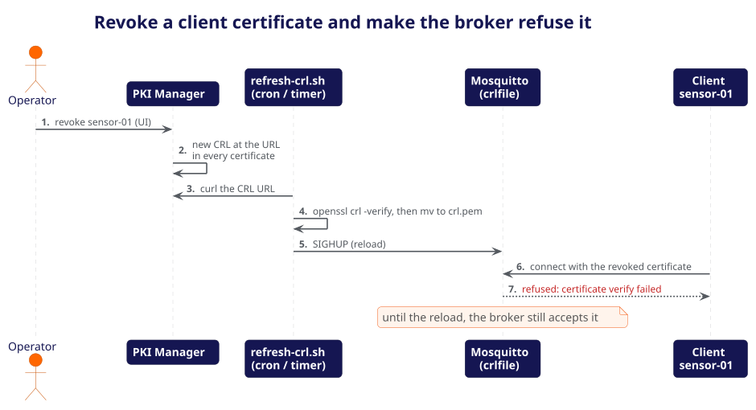

A sensor is stolen. Open its certificate page, select **Revoke**, choose `Key Compromise`,
add a detail, and select **Revoke Certificate**.

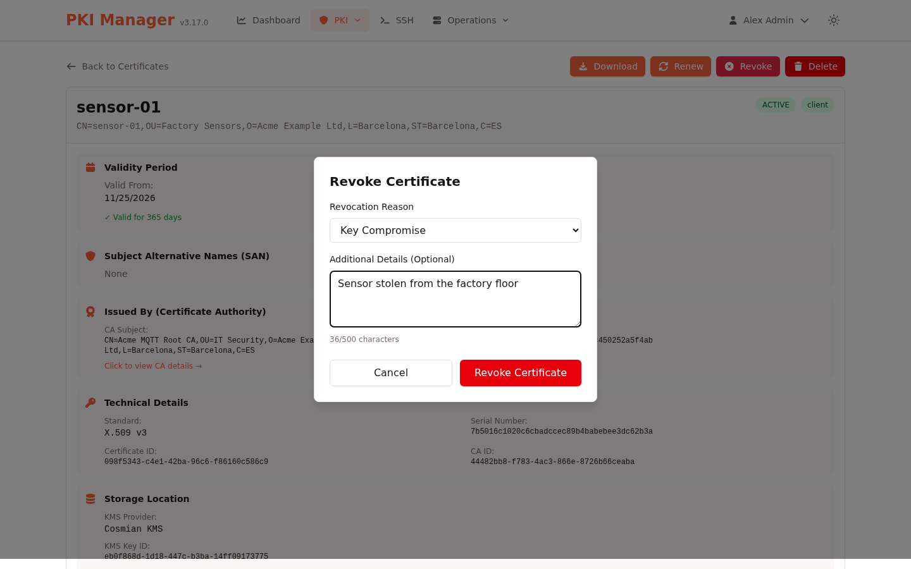

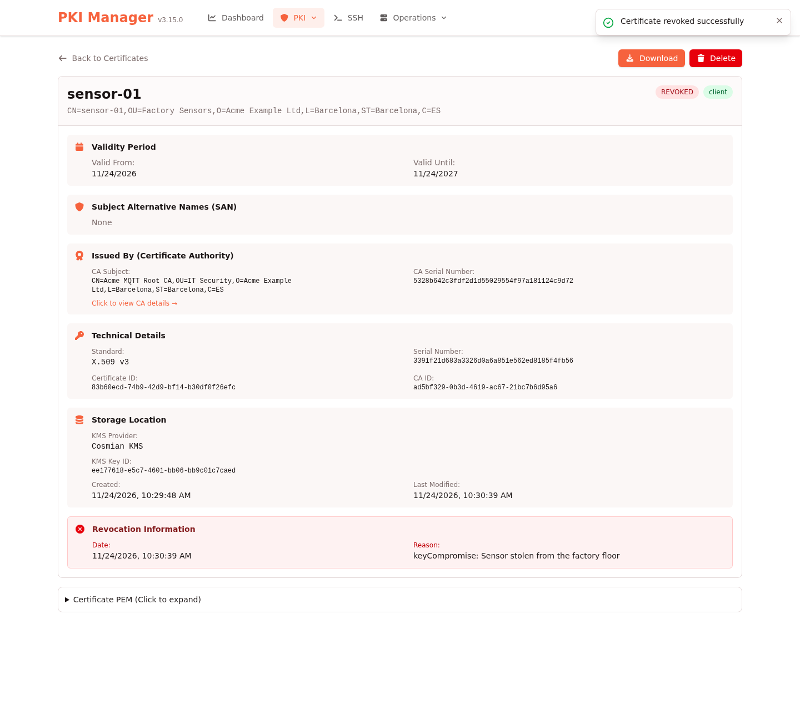

**The broker still accepts the certificate.** It reads its own copy of the CRL, which is old:

```bash
$MQ mosquitto_pub $TLS -t acme/sensors/line1/temp -m '21.5'; echo "rc=$?"
```

```text
rc=0
```

Fetch the new CRL from the URL inside the certificate:

```bash
curl -sS -o certs/crl.pem http://localhost:47300/crl/ad5bf329-0b3d-4619-ac67-21bc7b6d95a6.crl
openssl crl -in certs/crl.pem -noout -text | grep -E "CRL Number|Serial Number|Reason" -A1
```

```text
            X509v3 CRL Number:
                2
    Serial Number: 3391F21D683A3326D0A6A851E562ED8185F4FB56
        Revocation Date: Nov 24 10:30:39 2026 GMT
            X509v3 CRL Reason Code:
                Key Compromise
    Serial Number: 2925792E20E72BF41564363CF16EF811E4245D1E
        Revocation Date: Nov 24 10:30:11 2026 GMT
            X509v3 CRL Reason Code:
                Superseded
```

The serial `3391…FB56` is `sensor-01` (`openssl x509 -in certs/client.pem -noout -serial`).
This output comes from a run before 3.16.1. A new CA had no CRL then, so that run also
revoked a spare certificate (`2925…5D1E`, reason `Superseded`) to get a first CRL. With
3.16.1 the CRL has only the `sensor-01` entry.
Tell the broker to reload. In this test `SIGHUP` was enough, no restart:

```bash
docker kill -s HUP acme-mosquitto
$MQ mosquitto_pub $TLS -t acme/sensors/line1/temp -m '21.5'; echo "rc=$?"
```

```text
Error: The connection was lost.
rc=7
```

The broker log (timestamps trimmed):

```text
Reloading config.
New connection from 10.222.14.3:32938 on port 8883.
OpenSSL Error[0]: error:0A000086:SSL routines::certificate verify failed
Client <unknown> disconnected: Protocol error.
```

The log does not say "revoked". It says `certificate verify failed`. Check the reason
yourself with `openssl verify -crl_check` (see [Build a private CA](private-ca.md#check-clients-reject-the-revoked-certificate)).
A restart (`docker restart acme-mosquitto`) gave the same refusal.

Other sensors are not affected. A second sensor, `sensor-02`, was signed with the external
API (below) and still connects:

```text
New client connected from 10.222.14.3:32924 as B89621AF-... (p2, c1, k60, u'sensor-02').
```

### A CSR made on the device

Post 1 uses `import-req` and `sign-req` for a key made on another machine. PKI Manager has
the **external issuer API** for this. See [Automate issuance](integrations.md) for the full
flow. In short:

1. An admin opens **Operations > Integrations**, selects **Add Integration**, and sets
   Type `Generic`, a Name, and the Bound CA `Acme MQTT Root CA`. The token appears once.

   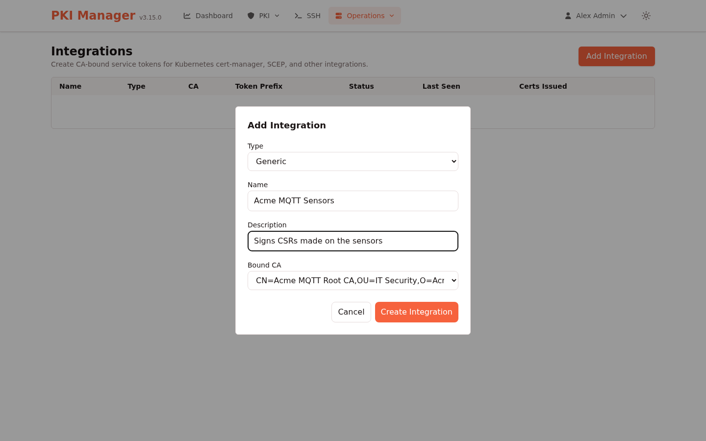

2. On the sensor, make the key and the CSR. The key never leaves the sensor:

   ```bash
   openssl req -new -newkey rsa:2048 -nodes -keyout sensor-02.key -out sensor-02.csr \
     -subj "/CN=sensor-02/O=Acme Example Ltd/C=ES" \
     -addext "extendedKeyUsage=clientAuth" -addext "keyUsage=digitalSignature"
   ```

3. Send it. `B` is `http://localhost:47300/api/v1/external`:

   ```bash
   jq -n --rawfile csr sensor-02.csr \
     '{csrPem:$csr, requestUid:"sensor-02-1", durationDays:365, certificateType:"client"}' > sign.json
   curl -s -X POST $B/sign -H "Authorization: Bearer $TOKEN" \
     -H 'Content-Type: application/json' -d @sign.json | tee sign.out | jq 'del(.certificatePem, .chainPem)'
   jq -r .certificatePem sign.out > sensor-02.crt
   ```

   ```json
   {
     "idempotent": false,
     "id": "35a5f44d-1cce-43e4-b0b8-74cb1c2cc1dd",
     "serialNumber": "75cdb48b111ab69107cf91c3cc44fdbb36f720d8",
     "notBefore": "2026-11-24T10:31:19.000Z",
     "notAfter": "2027-11-24T10:31:19.000Z"
   }
   ```

The certificate has the same CRL URL and works with the same broker. Its CN `sensor-02` is
the MQTT user name.

## 8. Keep the CRL fresh

The broker reads a local file. PKI Manager serves the CRL over HTTP. Something must copy it.
The script [mqtt/refresh-crl.sh](mqtt/refresh-crl.sh) does four things:

1. It fetches the URL with `curl -f` (a `404` is an error and the old file stays).
2. It checks that the CA signed the CRL (`openssl crl -CAfile`).
3. It replaces `crl.pem` in one step (`mv`).
4. It sends `SIGHUP` to the broker.

One manual run, against the stack of this guide:

```bash
CRL_URL=http://localhost:47300/crl/ad5bf329-0b3d-4619-ac67-21bc7b6d95a6.crl CERTS=$PWD/certs ./refresh-crl.sh
```

```text
verify OK
2026-11-24T10:31:06Z CRL updated, nextUpdate=Dec  1 10:30:39 2026 GMT
```

A wrong CRL URL (a CA id that does not exist) stops the script and keeps the old file:

```text
curl: (22) The requested URL returned error: 404
```

Run it every hour with cron (the CRL is valid for 7 days):

```text
0 * * * * CRL_URL=http://pki.acme.example/crl/<CA id>.crl /opt/mqtt/refresh-crl.sh >>/var/log/refresh-crl.log 2>&1
```

Or with a systemd timer:

```ini
# /etc/systemd/system/refresh-crl.service
[Service]
Type=oneshot
Environment=CRL_URL=http://pki.acme.example/crl/<CA id>.crl
ExecStart=/opt/mqtt/refresh-crl.sh

# /etc/systemd/system/refresh-crl.timer
[Timer]
OnCalendar=hourly
Persistent=true
[Install]
WantedBy=timers.target
```

> **Not tested:** only the script command was run, once, by hand. The cron line and the
> systemd units were not run, and no timer ran for days. Set `CERTS` and `BROKER` to your
> paths. In a real install the CRL URL host must be a name the broker host can reach: set
> `CRL_DISTRIBUTION_URL` in the PKI Manager configuration. The demo uses `localhost`.

## What changed, and what did not

| Changed | Not changed |
|---|---|
| No CA key file and no CA passphrase to look after. | The broker reads a local CRL file. You still copy and reload it. |
| One form for the certificate, the SAN list and the key. | No OCSP. A revoked client is refused only after the broker has the new CRL. |
| The CRL is made and served for you, from the moment the CA exists. | `crlfile` must exist at start. You fetch it once before the first start. |
| A CSR flow with a scoped token, no shell access to the CA. | Renew makes a new key by default and leaves the old certificate active unless you ask to revoke it. |
| Inventory, expiry view and audit rows with the actor of each operation. | The UI has no audit page. Read the audit log through the API. |

Source of the screenshots: `docs/site/demo/shots/05-mqtt.spec.ts` (run with `PHASE=issue`,
`bootstrap`, `revoke` and `csr`).
