# Build a private CA and issue certificates
<!-- tested-with: 3.17.0+298b92d5 -->

Acme Example Ltd runs internal HTTPS services (`portal.acme.example`, a wiki, a VPN). It wants
its own CA, so that browsers and tools inside the company trust these services without a
public CA. This guide builds that CA and issues, renews and revokes certificates. Every step
shows the UI and then checks the result with `openssl`, `keytool` or `curl`.

Every step was run on a demo stack with a build of `main` at commit `298b92d5` (after release
**3.17.0**; see [Install PKI Manager and log in](../get-started/install.md) to install one). You log in as an `admin` user. The `user` role can issue and download, but it
cannot create CAs or revoke.

PKI Manager creates **root CAs** only. Each root CA is its own trust anchor and signs end-entity
certificates directly.

Used in the examples:

| What | Value |
|---|---|
| UI | `http://localhost:47380` |
| API | `http://localhost:47300` |
| CRL URL in certificates | `http://localhost:47300/crl/<CA id>.crl` (from `CRL_DISTRIBUTION_URL`) |
| Export password | `Acme-Export-1` (you choose it in the Download dialog) |

Work in an empty folder. The commands below use the files `ca.pem`, `portal.pem`, and so on.

## 1. Create the root CA

Open **PKI > Certificate Authorities** and select **Create CA**.

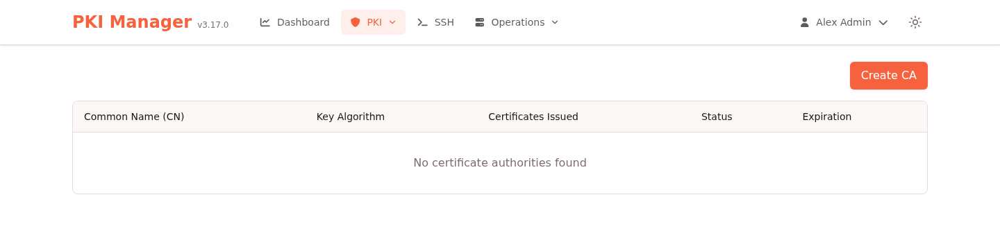

Fill the form. The fields marked `*` are required.

| Field | Value | Note |
|---|---|---|
| Common Name (CN) | `Acme Internal Root CA` | max 64 characters |
| Organization (O) | `Acme Example Ltd` | |
| Organizational Unit (OU) | `IT Security` | optional |
| Country (C) | `ES` | 2 letters |
| State/Province (ST), Locality/City (L) | `Barcelona` | optional |
| Key Algorithm | `RSA 4096 (Recommended for CAs)` | the other choice is `RSA 2048` |
| Validity Period (years) | `10` | 1 to 30, default 20 |

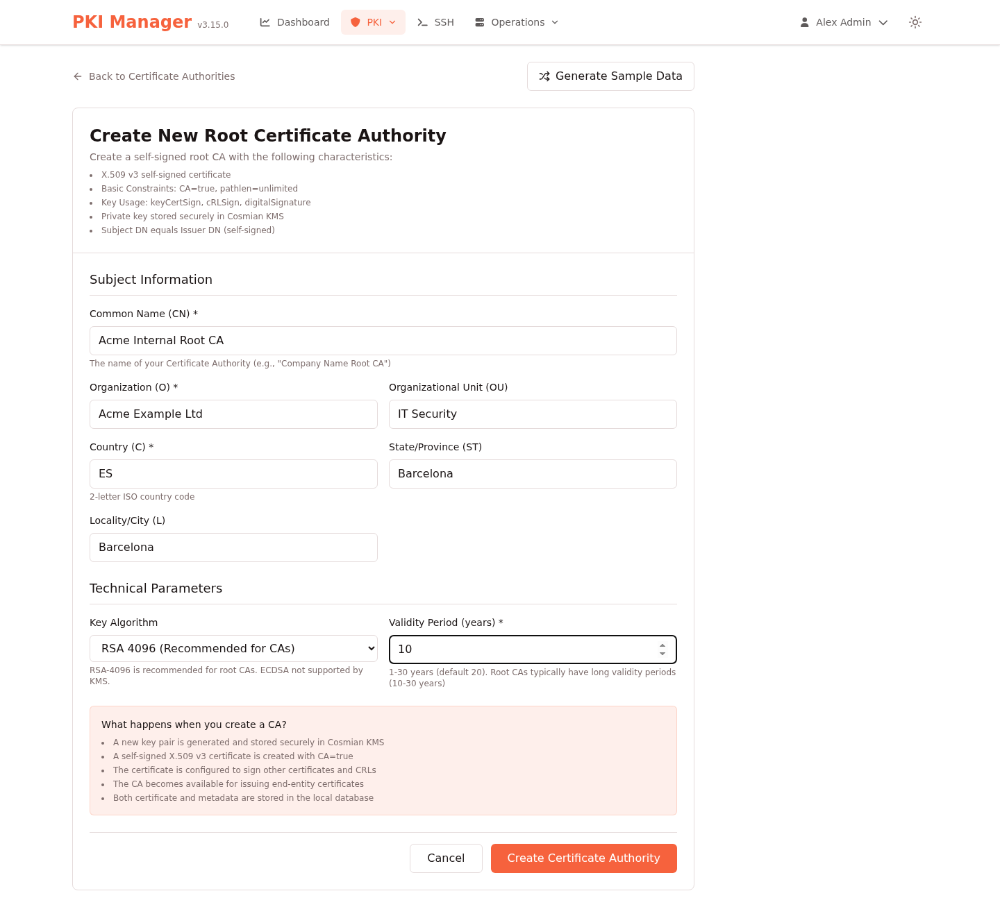

Select **Create Certificate Authority**. The key pair is made inside the Cosmian KMS. The CA page
opens.

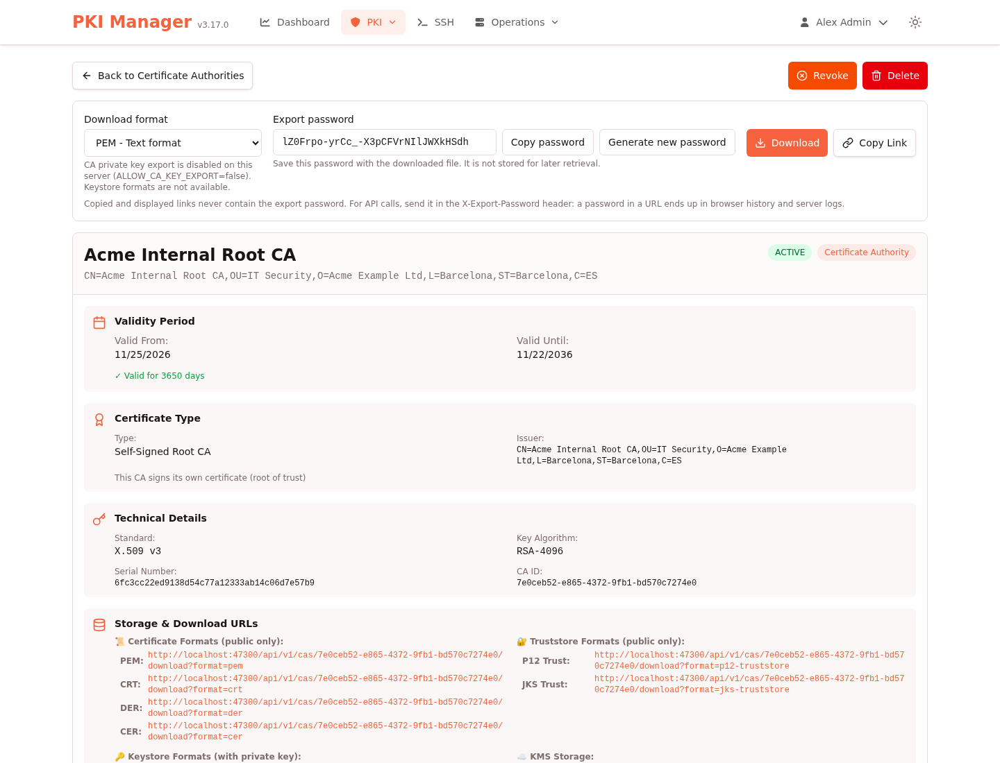

### Check: download the CA certificate and read it

The CA page has a **Download format** list. Keep `PEM - Text format` and select **Download**.
The file is `Acme_Internal_Root_CA.pem`. Save it as `ca.pem`.

The list has these CA formats:

| Format | Content | Availability |
|---|---|---|
| `PEM`, `CRT`, `DER`, `CER` | CA certificate only | always |
| `P12 Truststore`, `JKS Truststore` | CA certificate only | always |
| `P12 Keystore`, `JKS Keystore` | CA certificate + **CA private key** | only if the server has `ALLOW_CA_KEY_EXPORT=true` (default `false`), for the `admin` role, with a password; every export is audited as `ca.export_private_key` |

By default the keystore formats are hidden in the UI and the REST API answers `403 CA_KEY_EXPORT_DISABLED`.
A CA private key leaves the KMS in two cases only: to sign a CRL (in memory, never stored), and this
audited admin keystore export.

```bash
openssl x509 -in ca.pem -noout -subject -issuer -dates -ext basicConstraints,keyUsage
```

```text
subject=CN = Acme Internal Root CA, OU = IT Security, C = ES, ST = Barcelona, L = Barcelona, O = Acme Example Ltd
issuer=CN = Acme Internal Root CA, OU = IT Security, C = ES, ST = Barcelona, L = Barcelona, O = Acme Example Ltd
notBefore=Nov 25 20:54:23 2026 GMT
notAfter=Nov 22 20:54:23 2036 GMT
X509v3 Basic Constraints: critical
    CA:TRUE
X509v3 Key Usage: critical
    Certificate Sign, CRL Sign
```

- `subject` equals `issuer`: the CA is self-signed.
- `CA:TRUE` and `Certificate Sign, CRL Sign`: it can sign certificates and CRLs.
- The key is RSA 4096 (`openssl x509 -in ca.pem -noout -text` shows `Public-Key: (4096 bit)`).

Where to get the CA certificate later:

- The CA page, as above. The same page has `CRT`, `DER` and `CER` formats, and truststores
  (`P12`, `JKS`) for clients that need one.
- The REST API: `GET /api/v1/cas/<id>/download?format=pem`. It needs a Bearer token (without it you
  get `401`). The answer is JSON; the certificate is base64 in `data`:

  ```bash
  curl -s -H "Authorization: Bearer $TOKEN" \
    "http://localhost:47300/api/v1/cas/<CA id>/download?format=pem" | jq -r .data | base64 -d > ca.pem
  ```

  The result is byte-for-byte the same as the UI download.

Give `ca.pem` to every client that must trust Acme services (system trust store, browser, `curl --cacert`).

## 2. Issue a server certificate

Open **PKI > Certificates**, select **Issue Certificate**, and fill the form.

| Field | Value |
|---|---|
| Certificate Authority | `Acme Internal Root CA` |
| Certificate Type | `Server (TLS/SSL Web Server)` |
| Common Name (CN) | `portal.acme.example` |
| Organization (O) / OU | `Acme Example Ltd` / `Web Platform` |
| Country (C) / State / Locality | `ES` / `Barcelona` / `Barcelona` |
| Key Algorithm | `RSA 2048 (Standard)` (also `RSA 4096`, `ECDSA P-256`, `ECDSA P-384`) |
| Validity Period (days) | `365` (maximum 825) |
| DNS Names | `portal.acme.example`, `www.portal.acme.example` (**+ Add DNS Name** adds a row) |
| IP Addresses | `127.0.0.1` (**+ Add IP Address**) |

The form also has an **Email Addresses** list, for S/MIME certificates.

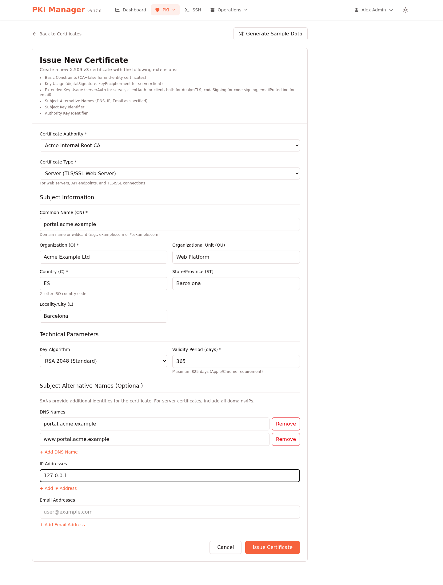

> **Important:** put the CN in the DNS Names list too. The form does not copy the CN into the SAN
> list. Clients check the SAN, not the CN.

Select **Issue Certificate**. The certificate page opens.

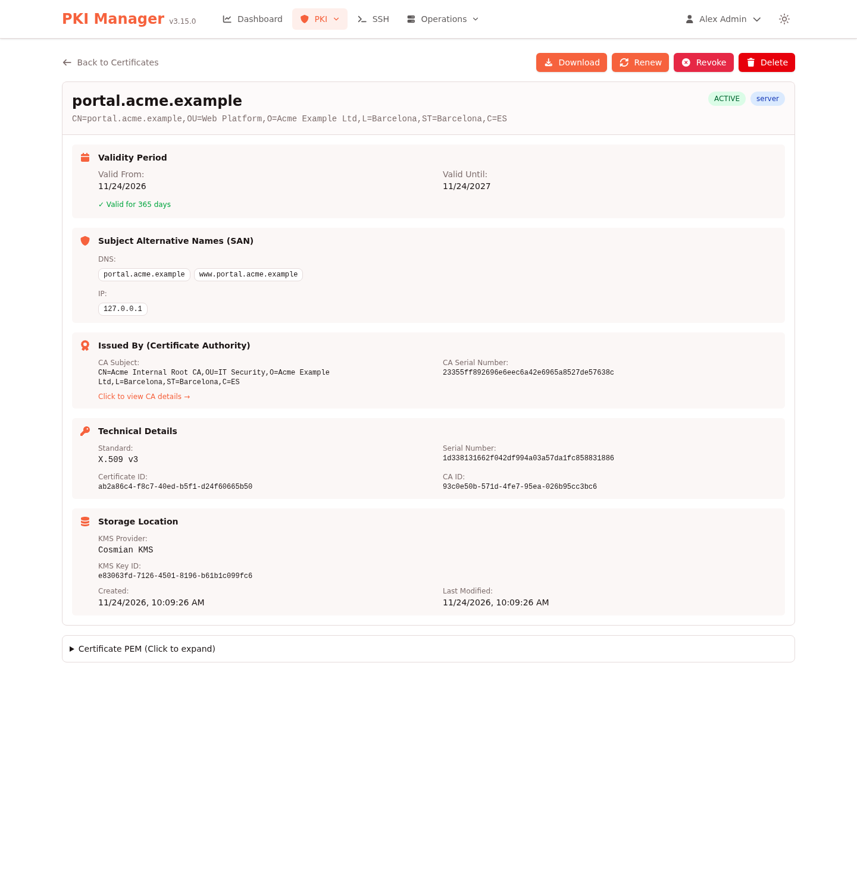

### Screencast: issue a server certificate

The same flow for `intranet.acme.example`, about 15 seconds:

<video src="video/private-ca-issue-server.webm" controls muted playsinline width="100%"></video>

### Check: download the certificate and inspect it

On the certificate page select **Download**, choose `PEM - Certificate only (ASCII)`, and
select **Download**. Save the file as `portal.pem`.

```bash
openssl x509 -in portal.pem -noout -subject -issuer -serial -dates \
  -ext subjectAltName,extendedKeyUsage,keyUsage,basicConstraints,crlDistributionPoints
```

```text
subject=CN = portal.acme.example, OU = Web Platform, C = ES, ST = Barcelona, L = Barcelona, O = Acme Example Ltd
issuer=CN = Acme Internal Root CA, OU = IT Security, C = ES, ST = Barcelona, L = Barcelona, O = Acme Example Ltd
serial=291D4370A05BAA6DAC883EB617B3C23F74597775
notBefore=Nov 25 20:54:32 2026 GMT
notAfter=Nov 25 20:54:32 2027 GMT
X509v3 Basic Constraints: critical
    CA:FALSE
X509v3 Key Usage: critical
    Digital Signature, Key Encipherment
X509v3 Extended Key Usage:
    TLS Web Server Authentication
X509v3 Subject Alternative Name:
    DNS:portal.acme.example, DNS:www.portal.acme.example, IP Address:127.0.0.1
X509v3 CRL Distribution Points:
    Full Name:
      URI:http://localhost:47300/crl/7e0ceb52-e865-4372-9fb1-bd570c7274e0.crl
```

Check the chain:

```bash
openssl verify -CAfile ca.pem portal.pem
```

```text
portal.pem: OK
```

- `CA:FALSE`: it is an end-entity certificate.
- EKU `TLS Web Server Authentication`: it is valid for servers only.
- The CRL URL comes from `CRL_DISTRIBUTION_URL`. Clients that check revocation use it (step 7).

## 3. Issue a client certificate

Use the same form with these changes:

| Field | Value |
|---|---|
| Certificate Type | `Client (User Authentication)` |
| Common Name (CN) | `maria.puig` (any user ID) |
| OU | `Finance` |

The other types are `Dual (Server + Client mTLS)`, `Code Signing` and `Email (S/MIME)`.

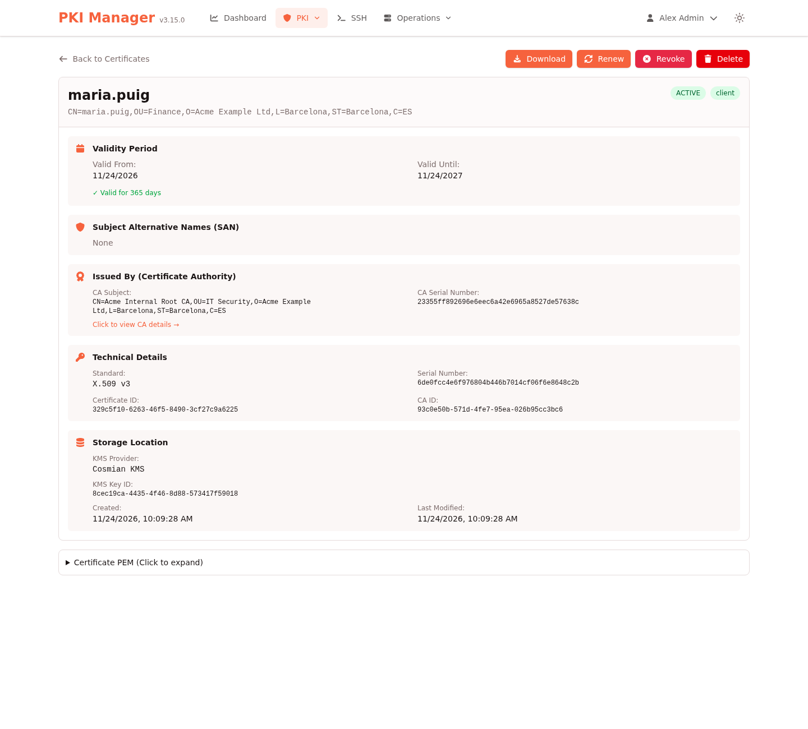

Check it. The REST download returns JSON with base64 in `data`:

```bash
curl -s -H "Authorization: Bearer $TOKEN" \
  "http://localhost:47300/api/v1/certificates/<certificate id>/download?format=pem" \
  | jq -r .data | base64 -d > client.pem
openssl x509 -in client.pem -noout -subject -ext keyUsage,extendedKeyUsage
openssl verify -CAfile ca.pem -purpose sslclient client.pem
openssl verify -CAfile ca.pem -purpose sslserver client.pem
```

```text
subject=CN = maria.puig, OU = Finance, C = ES, ST = Barcelona, L = Barcelona, O = Acme Example Ltd
X509v3 Key Usage: critical
    Digital Signature
X509v3 Extended Key Usage:
    TLS Web Client Authentication
client.pem: OK
CN = maria.puig, OU = Finance, C = ES, ST = Barcelona, L = Barcelona, O = Acme Example Ltd
error 26 at 0 depth lookup: unsupported certificate purpose
error client.pem: verification failed
```

The certificate works for client authentication and is rejected as a server certificate.

### Rules for names and validity

The backend checks the request before it calls the KMS. A request that breaks a rule is refused
with a message that names the rule. These rules are read from the code
(`backend/src/crypto/validation.ts`, `backend/src/services/certificate.service.ts` and
`backend/src/trpc/schemas.ts`, the request schema in `backend/src/rest/routes/certificate.routes.ts`);
they apply to the form and to the API.

For every type:

- CN: 1 to 64 characters. O: 1 to 64 characters. C: exactly 2 characters. OU: up to 64
  characters. ST and L: up to 128 characters in the web UI, up to 64 in the REST API.
- Validity: 1 to 825 days.
- Each entry of the Email Addresses list must be an email address.
- Each entry of the DNS Names, IP Addresses and Email Addresses lists is refused when it has a
  space, a line break or another control character, a comma, or one of the characters
  `\ # $ " ' ;`. Each IP address must be a valid IPv4 or IPv6 address. These values go into the
  extension text that the KMS reads, so the check applies to every certificate type.

For `server` and `dual` certificates, the CN and each DNS name must be a domain name:

- 253 characters or less (and the CN 64 or less), with at least two labels:
  `portal.acme.example` is accepted, `portal` and `localhost` are refused.
- Each label is 1 to 63 characters of letters, digits and hyphens, and starts and ends with a
  letter or a digit. An underscore is refused.
- A wildcard is accepted only as the full first label, followed by at least two labels:
  `*.acme.example` is accepted; `www.*.acme.example`, `*.example` and `*` are refused.
- Each IP address must be an IPv4 address (four numbers from 0 to 255, with no leading zero:
  `010.0.0.1` is refused) or an IPv6 address without a zone (`fe80::1%eth0` is refused).
- A space or a line break before or after a name or an address is refused.

For the other types:

| Type | Rules |
|---|---|
| `client` | The CN is an email address, a user name (letters, digits, `_` and `-`), or a host name. Validity up to 730 days. |
| `email` | At least one email address, and all the addresses have the same domain. Validity up to 730 days. |
| `code_signing` | O is required. The key is not RSA-2048: use RSA-4096, ECDSA P-256 or ECDSA P-384. |

The DNS and IP lists are not checked for `client`, `email` and `code_signing` certificates.

CSV bulk issuance (section 8) has its own copy of these checks. It uses the same domain name, IP
address and validity rules, with these differences:

- It does not check the length of the subject fields.
- A `client` user name can also contain `.`.
- The email addresses of an `email` row can have different domains.
- A `code_signing` row accepts up to 1095 days, and CSV always makes RSA-2048 keys.

## 4. Download formats

On the server certificate page select **Download**.

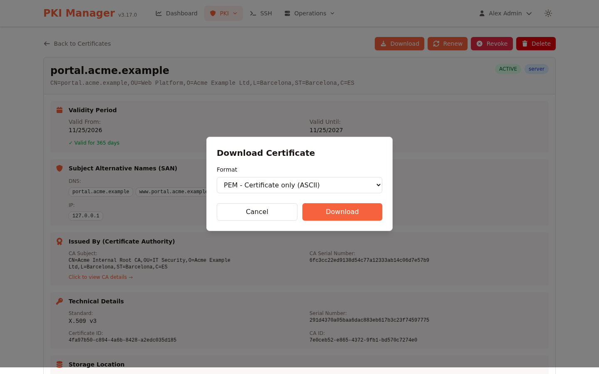

| Format | Content | Password |
|---|---|---|
| `PEM`, `CRT`, `DER`, `CER` | certificate only | no |
| `PEM Chain`, `PKCS#7`, `P7B` | certificate + CA | no |
| `PEM with Private Key` | ZIP with a `.pem` and a `.priv` file | optional (checkbox) |
| `PKCS#12`, `PFX`, `P12` | certificate + CA + private key | optional (checkbox) |
| `JKS Keystore` | certificate + private key, for Java servers | required |
| `JKS Truststore` | CA certificate only, for Java clients | required |
| `Docker Volume` | TAR for a Docker volume | optional (checkbox) |
| `All Formats` | everything in one ZIP | optional (checkbox) |

Formats with a private key ask for a confirmation ("This format includes the private key"). The
password field is filled with a generated password. You can type your own (8 characters or
more) or use **Generate new password**. The page shows it again after the download. **It is not
stored**: save it with the file.

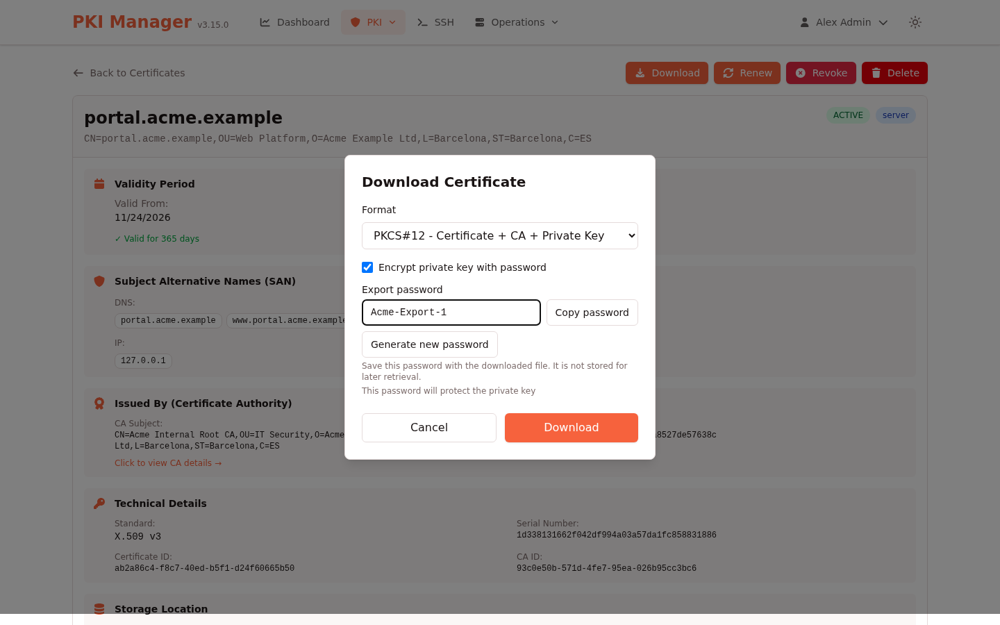

Download `PKCS#12`, `PEM with Private Key` and `JKS Keystore` with the password `Acme-Export-1`.
The files are named like `portal.acme.example-291d4370.p12` (CN and the first 8 characters of
the serial). Rename them `portal.p12`, `portal-key.zip` and `portal.jks`.

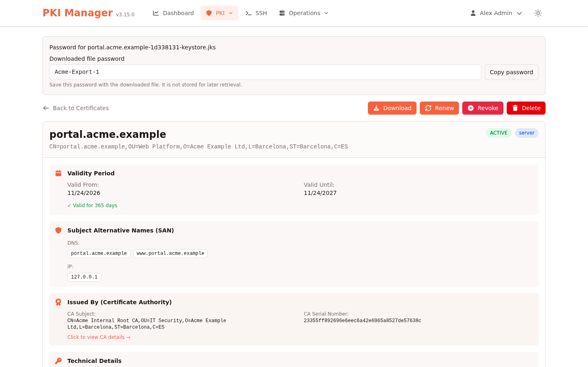

### Check: PKCS#12

```bash
openssl pkcs12 -in portal.p12 -passin pass:Acme-Export-1 -info -noout
openssl pkcs12 -in portal.p12 -passin pass:Acme-Export-1 -nokeys -clcerts | openssl x509 -noout -subject -serial
```

```text
MAC: sha1, Iteration 2048
MAC length: 20, salt length: 8
PKCS7 Encrypted data: pbeWithSHA1And3-KeyTripleDES-CBC, Iteration 2048
Certificate bag
Certificate bag
PKCS7 Data
Shrouded Keybag: pbeWithSHA1And3-KeyTripleDES-CBC, Iteration 2048

subject=CN = portal.acme.example, OU = Web Platform, C = ES, ST = Barcelona, L = Barcelona, O = Acme Example Ltd
serial=291D4370A05BAA6DAC883EB617B3C23F74597775
```

The file has two certificate bags (server + CA) and one encrypted private key (`Shrouded Keybag`).

### Check: JKS

```bash
keytool -list -v -keystore portal.jks -storepass Acme-Export-1
```

```text
Keystore type: JKS
Your keystore contains 1 entry
Alias name: portal.acme.example
Creation date: Nov 25, 2026
Entry type: PrivateKeyEntry
Certificate chain length: 2
Owner: O=Acme Example Ltd, L=Barcelona, ST=Barcelona, C=ES, OU=Web Platform, CN=portal.acme.example
Owner: O=Acme Example Ltd, L=Barcelona, ST=Barcelona, C=ES, OU=IT Security, CN=Acme Internal Root CA
```

(`keytool` also prints a warning that JKS is a proprietary format. The output above is trimmed.)

### Check: PEM with private key

```bash
unzip portal-key.zip
openssl pkey -in portal.acme.example-291d4370.priv -passin pass:Acme-Export-1 -pubout | openssl sha256
openssl x509 -in portal.acme.example-291d4370.pem -noout -pubkey | openssl sha256
```

```text
SHA256(stdin)= fa344d4e567a98bb4d1ac17a322e2caef416be8d57a930722e1ad7c0849daa9b
SHA256(stdin)= fa344d4e567a98bb4d1ac17a322e2caef416be8d57a930722e1ad7c0849daa9b
```

The ZIP has a `.pem` (certificate) and a `.priv` (key, `BEGIN ENCRYPTED PRIVATE KEY`). Both
hashes are equal: the key belongs to the certificate.

## 5. Use it: an HTTPS server

Start a test TLS server with the certificate and the key from the ZIP:

```bash
openssl s_server -accept 48443 -www -cert portal.pem \
  -key portal.acme.example-291d4370.priv -pass pass:Acme-Export-1
```

In a second terminal, call it by name. `--resolve` maps the name to `127.0.0.1`:

```bash
curl -sS -o /dev/null -w 'HTTP %{http_code}\nssl_verify_result=%{ssl_verify_result}\n' \
  --cacert ca.pem --resolve portal.acme.example:48443:127.0.0.1 https://portal.acme.example:48443/
```

```text
HTTP 200
ssl_verify_result=0
```

Without the CA certificate the same call fails:

```bash
curl -sS -o /dev/null --resolve portal.acme.example:48443:127.0.0.1 https://portal.acme.example:48443/
```

```text
curl: (60) SSL certificate problem: unable to get local issuer certificate
```

Two more checks show that the SAN list is used:

```bash
curl -sS -o /dev/null -w 'HTTP %{http_code}\n' --cacert ca.pem https://127.0.0.1:48443/
curl -sS -o /dev/null --cacert ca.pem --resolve other.acme.example:48443:127.0.0.1 https://other.acme.example:48443/
```

```text
HTTP 200
curl: (60) SSL: no alternative certificate subject name matches target host name 'other.acme.example'
```

The IP address works because it is in the SAN list. A name that is not in the list fails.

## 6. Renew a certificate

Open the certificate page and select **Renew**. The **Renew Certificate** dialog states what
renewal does and has two options, both off by default:

- **Keep the current key pair (same public key).** Only for certificates less than 90 days old.
  Off: renewal creates a new private key.
- **Revoke the previous certificate (superseded).** Off: the previous certificate stays active.

Leave both off for this guide and select **Renew**.

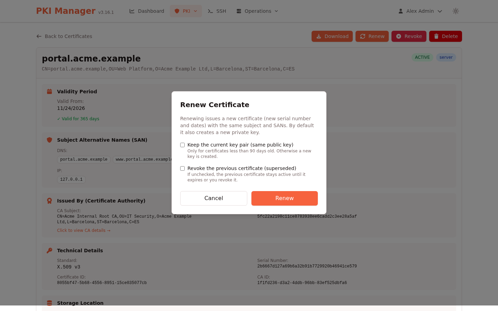

PKI Manager makes a **new certificate** with the same subject, SANs and validity length, and opens
its page. A message shows the new ID.

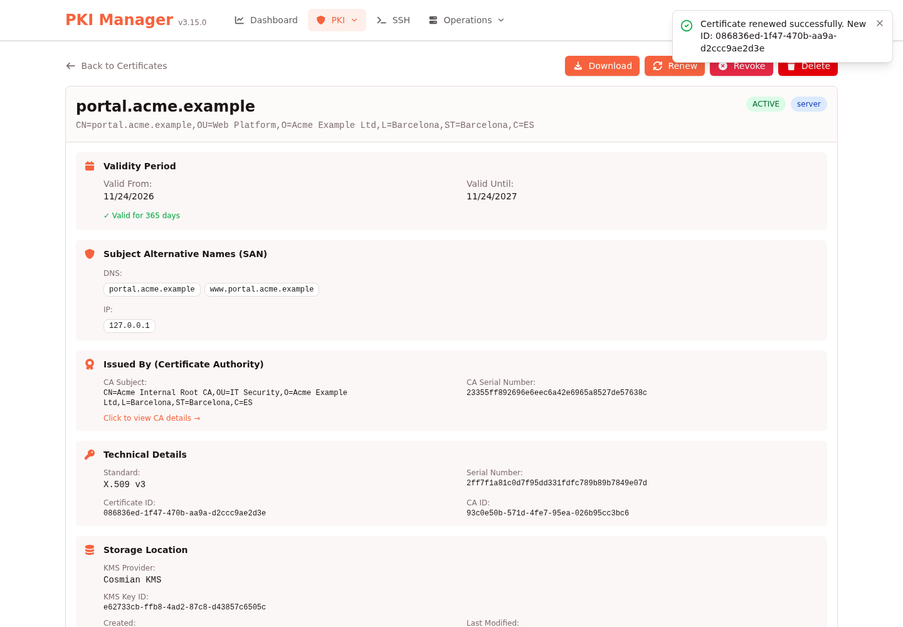

Download the renewed certificate (`PEM`, saved as `portal2.pem`) and compare:

```bash
for f in portal.pem portal2.pem; do echo $f; openssl x509 -in $f -noout -serial -dates; done
```

```text
portal.pem
serial=291D4370A05BAA6DAC883EB617B3C23F74597775
notBefore=Nov 25 20:54:32 2026 GMT
notAfter=Nov 25 20:54:32 2027 GMT
portal2.pem
serial=0349BB30EB624410219704645919EB25C4C05723
notBefore=Nov 25 20:54:50 2026 GMT
notAfter=Nov 25 20:54:50 2027 GMT
```

What to know:

- The serial number is new, and the validity starts at the renewal time.
- The key is **new** too, because **Keep the current key pair** was off. The public keys of
  `portal.pem` and `portal2.pem` differ. Install the new key together with the new certificate
  (download `PEM with Private Key` again). With the option on, the public key stays the same.
- The **old certificate stays active** unless you select **Revoke the previous certificate
  (superseded)**. Revoke it yourself when you no longer need it (step 7).

## 7. Revoke, end to end

Acme now uses the renewed certificate on the server. Restart `s_server` with `portal2.pem` and
its key (from `portal2-key.zip`), then revoke that certificate.

On the certificate page select **Revoke**. Choose a reason, add optional details (up to 500
characters), and select **Revoke Certificate**.

The reasons are: Unspecified, Key Compromise, CA Compromise, Affiliation Changed, Superseded,
Cessation of Operation, Certificate Hold, Privilege Withdrawn.

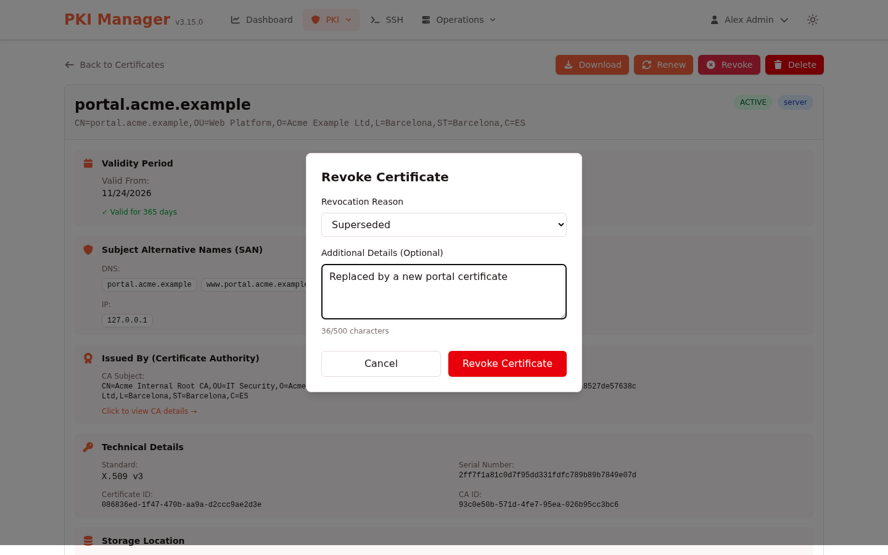

The page now shows `REVOKED` and the revocation date and reason. A revoked certificate has only
**Download** and **Delete** buttons.

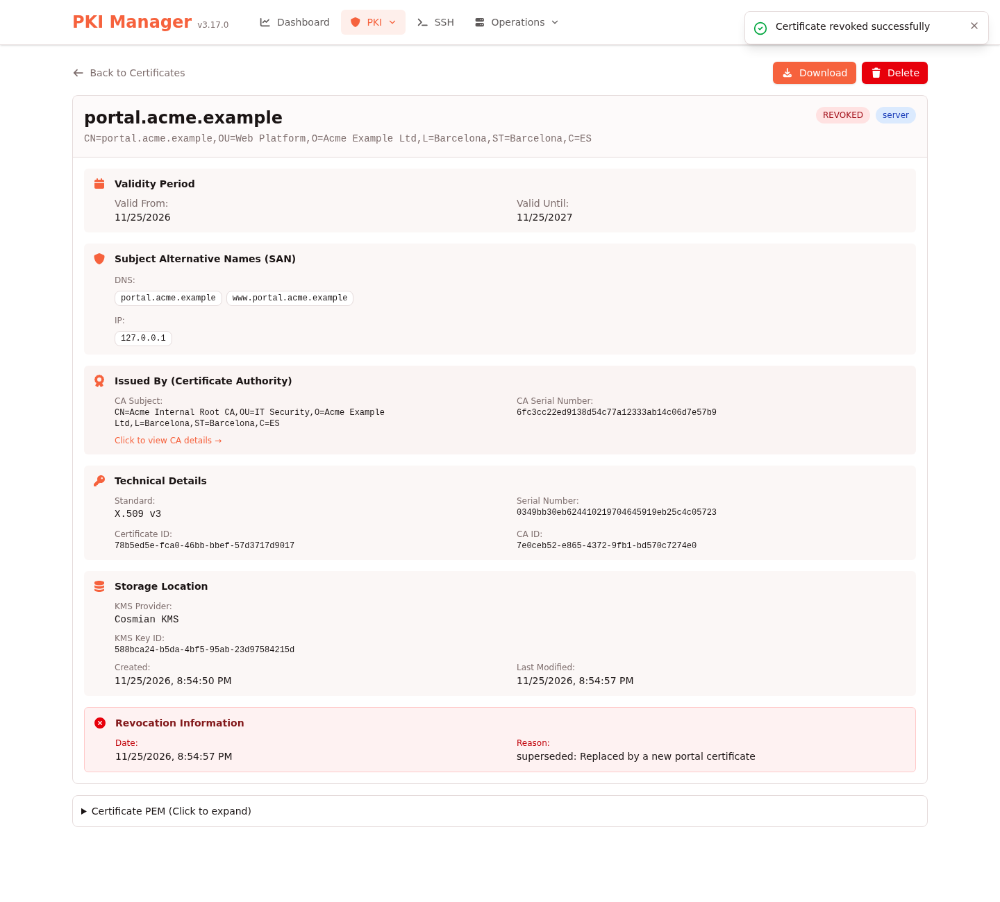

### Check: the CRL

Fetch the CRL from the URL that is inside the certificate. No login is needed.

```bash
curl -s -o crl.pem -D - http://localhost:47300/crl/7e0ceb52-e865-4372-9fb1-bd570c7274e0.crl | head -8
openssl crl -in crl.pem -noout -text
```

```text
HTTP/1.1 200 OK
vary: Origin
access-control-allow-credentials: true
content-type: application/x-pem-file
last-modified: Wed, 25 Nov 2026 20:54:57 GMT
expires: Wed, 02 Dec 2026 20:54:57 GMT
cache-control: public, max-age=604068
content-length: 1173
Certificate Revocation List (CRL):
        Version 2 (0x1)
        Signature Algorithm: sha384WithRSAEncryption
        Issuer: CN = Acme Internal Root CA, OU = IT Security, C = ES, ST = Barcelona, L = Barcelona, O = Acme Example Ltd
        Last Update: Nov 25 20:54:57 2026 GMT
        Next Update: Dec  2 20:54:57 2026 GMT
        CRL extensions:
            X509v3 CRL Number:
                2
            X509v3 Authority Key Identifier:
                DB:3B:1E:22:A4:35:52:BE:54:8D:38:97:6A:A4:F0:04:EB:D1:DA:AB
Revoked Certificates:
    Serial Number: 0349BB30EB624410219704645919EB25C4C05723
        Revocation Date: Nov 25 20:54:57 2026 GMT
        CRL entry extensions:
            X509v3 CRL Reason Code:
                Superseded
```

The CRL lists the serial of the renewed certificate (`0349…5723`) with the reason `Superseded`.
Its number is 2: number 1 is the empty CRL that the CA got when it was created. The two CORS
headers are there because the demo sets `FRONTEND_URL`. The CRL is valid for 7 days (`Next Update`). The same URL with `.der` instead of `.crl` gives the CRL in DER format (`application/pkix-crl`).

> **Note:** since 3.16.1, each new CA gets an empty, signed CRL at creation. The URL in the
> certificates works before the first revocation, so a client that must find a CRL (strict mode)
> works from the start. Before 3.16.1, the URL answered `404` until the first revocation.

### Check: clients reject the revoked certificate

```bash
openssl verify -CAfile ca.pem -crl_check -CRLfile crl.pem portal2.pem
```

```text
CN = portal.acme.example, OU = Web Platform, C = ES, ST = Barcelona, L = Barcelona, O = Acme Example Ltd
error 23 at 0 depth lookup: certificate revoked
error portal2.pem: verification failed
```

The first certificate was not revoked, so it still passes:

```bash
openssl verify -CAfile ca.pem -crl_check -CRLfile crl.pem portal.pem
```

```text
portal.pem: OK
```

Now connect to the running `s_server` (which serves `portal2.pem`). Without a CRL check the
connection is trusted. With the CRL it is not:

```bash
openssl s_client -connect 127.0.0.1:48443 -servername portal.acme.example -CAfile ca.pem \
  -verify_hostname portal.acme.example </dev/null 2>&1 | grep -E "Verification|Verify return"
openssl s_client -connect 127.0.0.1:48443 -servername portal.acme.example -CAfile ca.pem \
  -crl_check -CRL crl.pem -verify_hostname portal.acme.example </dev/null 2>&1 | grep -E "verify error|Verify return"
curl -sS -o /dev/null --cacert ca.pem --crlfile crl.pem \
  --resolve portal.acme.example:48443:127.0.0.1 https://portal.acme.example:48443/
```

```text
Verification: OK
Verify return code: 0 (ok)

verify error:num=23:certificate revoked
Verify return code: 23 (certificate revoked)

curl: (60) SSL certificate problem: certificate revoked
```

- Revocation is **not** checked unless the client has a CRL. A browser or `curl` without
  `--crlfile` still trusts the certificate. Distribute the CRL, or use software that downloads it.
- With `openssl s_client`, the option for the file is `-CRL` (not `-CRLfile`). In the test,
  `-crl_download` ended with `unable to get certificate CRL`; use `curl` to fetch the CRL
  and pass it with `-CRL`.

## 8. Bulk issuance

For many certificates at once open **PKI > Bulk operations** (page "Bulk Certificate Creation",
`/certificates/bulk`).

Fields:

| Field | Meaning |
|---|---|
| Certificate Authority | The CA that signs all rows (active CAs only). |
| Default Validity (days) | Used when a row has no `validityDays` (max 825). |
| CSV Data | One certificate per line, no header. |

The line format is:

```text
certificateType,CN,O,C,SANs,validityDays
```

- `certificateType`: `server`, `client`, `dual`, `code_signing` or `email`.
- `CN`, `O` and `C` (2 letters) are required.
- `SANs` is optional: separate several values with `;`. A value with `@` is an email, `X.X.X.X`
  is an IP address, anything else is a DNS name. Leave it empty for none.
- `validityDays` is optional (the default applies when empty).

Example (the last row has a wrong country code on purpose):

```csv
server,crm.acme.example,Acme Example Ltd,ES,crm.acme.example;10.20.0.17,365
server,helpdesk.acme.example,Acme Example Ltd,ES,helpdesk.acme.example,90
client,anna.ferrer,Acme Example Ltd,ES,,365
email,marc.vidal@acme.example,Acme Example Ltd,ES,marc.vidal@acme.example,365
server,bad.acme.example,Acme Example Ltd,ESP,bad.acme.example,365
```

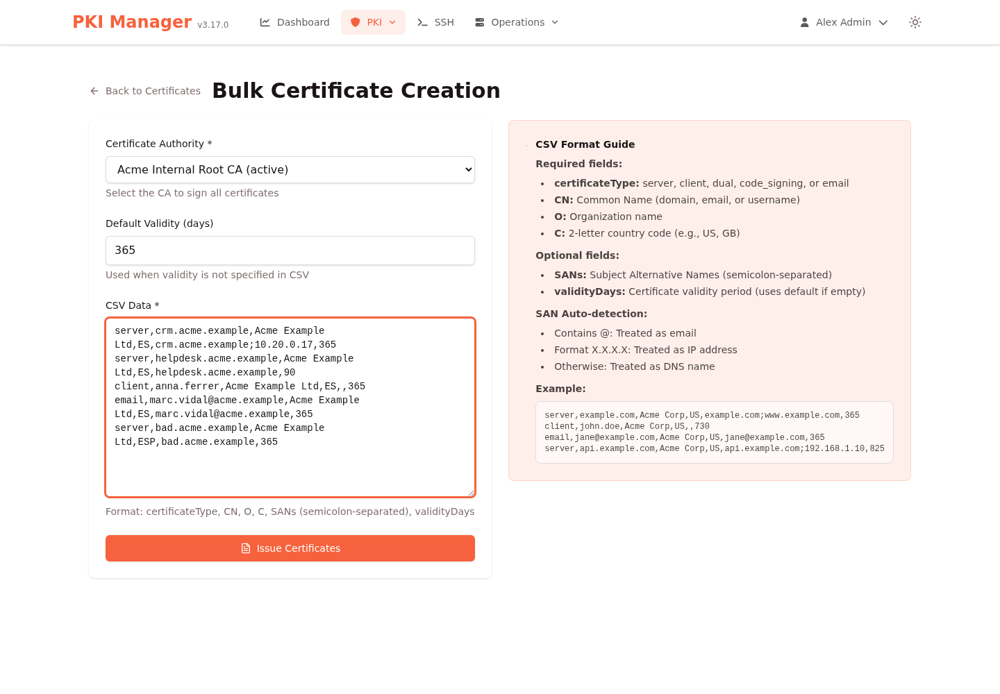

Select **Issue Certificates**. The **Results** box shows the number of successes and failures,
and one entry per row: subject, serial and a **View Certificate** link, or the error.

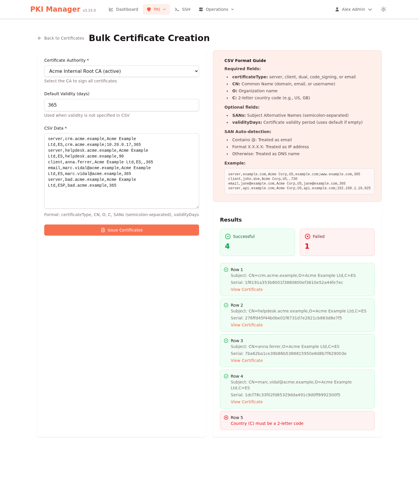

A failed row does not stop the others. Here rows 1 to 4 were issued and row 5 failed with
`Country (C) must be a 2-letter code`. Fix the row and send only that row again.

> **Note:** bulk rows have no OU, ST or L. The subject has only CN, O and C. Use the single
> form (step 2) when you need the other fields.

## 9. Watch expiry

Short validity is normal for internal certificates. To see the monitoring, issue a certificate
with a short validity. Here: `vpn.acme.example`, server type, validity **14** days.

**Dashboard.** The **Expiring Soon** table lists the next 5 certificates or CAs that expire, with
type, CN, SANs, date and days left. The **Days Left** badge changes colour (green at 90 days, yellow at 30 and 14 days).

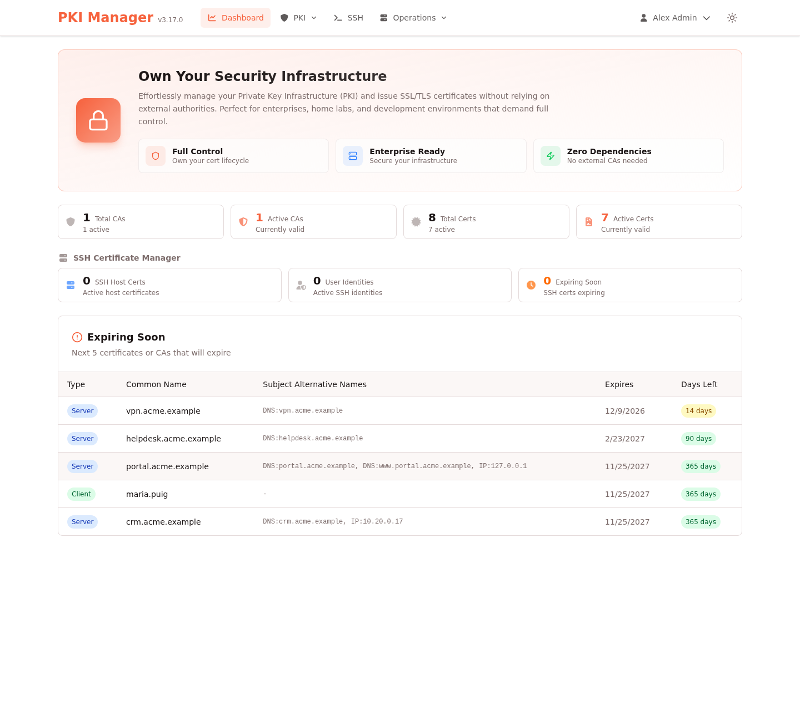

**Certificate list** (**PKI > Certificates**). The filters are:

| Filter | Values |
|---|---|
| Text box "Search by subject, SAN or serial..." | part of the subject DN, a SAN or the serial number |
| CA list | `All CAs` or one CA |
| Status list | `All Status`, `Active`, `Revoked`, `Expired` |
| Type list | `All Types`, `Server`, `Client`, `Dual (mTLS)`, `Email (S/MIME)`, `Code signing` |

Each row shows the status icon, the type icon, the expiry date with the days left
(`14 days left` is shown in orange), the CN, the SANs and the issuing CA.

The server applies the filters. The list shows 50 rows per page. The bar below the table shows
the total, changes the page and sets 25, 50 or 100 rows per page. Click the **Expiration** or
**Common Name (CN)** header to sort by that column.

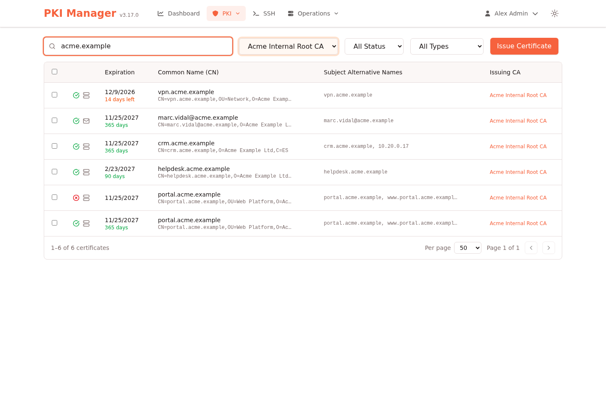

Choose `Revoked` in the status list to see the revoked certificates only:

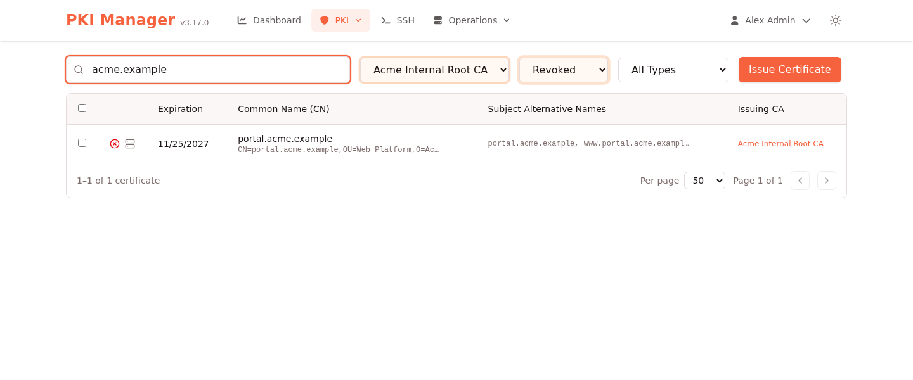

> **Note:** a **revoked** certificate stays in the database. It can be deleted only after it has
> been revoked or expired for more than 90 days. A CA can be deleted only when it is revoked or
> expired.

## Summary

| Step | Result you checked |
|---|---|
| 1 Root CA | self-signed, `CA:TRUE`, `Certificate Sign, CRL Sign`, 10 years |
| 2 Server certificate | SAN (DNS + IP), EKU `serverAuth`, CRL URL, `openssl verify` OK |
| 3 Client certificate | EKU `clientAuth`, rejected for the server purpose |
| 4 Formats | PKCS#12, JKS and PEM+key open with the export password |
| 5 HTTPS | `curl --cacert ca.pem` works; without it, error 60 |
| 6 Renew | new serial, new dates, new key; old certificate still active |
| 7 Revoke | serial in the CRL; `openssl verify`, `s_client` and `curl` report `certificate revoked` |
| 8 Bulk | 4 issued, 1 rejected with a clear error |
| 9 Expiry | dashboard and list filters show the 14-day certificate |

Source of the screenshots and the screencast: `site/demo/shots/02-private-ca.spec.ts`.
