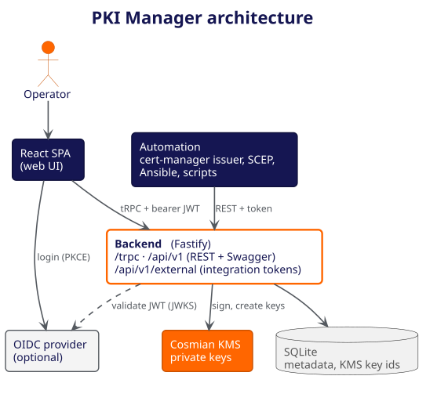

## The parts

| Part | What it does |
|---|---|
| Web UI | The pages that you use in the browser. An nginx container serves them and passes API calls to the backend |
| Backend | The API and all certificate logic. It checks each request, talks to the KMS and writes the audit log |
| Cosmian KMS | Makes and keeps the private keys. It signs certificates with the key of the CA |
| Database | One SQLite file: CAs, certificates, the ids of the keys in the KMS, SSH data and the audit log. It has no private keys |
| Identity provider | Optional. Logs people in through OIDC, for example Keycloak |

Three optional parts run outside this core. The [SCEP gateway](features/device-enrollment.md) is one
more container. The [Kubernetes issuer](features/kubernetes.md) runs in your cluster. `krl-client`
runs on SSH servers and fetches their revocation list.

## Where each private key lives

| Key | Where it is made | When it leaves the KMS |
|---|---|---|
| Key of a certificate authority (CA) | In the KMS | To sign a revocation list: the backend holds it in memory for that call. To export the CA as a keystore: only on a server with `ALLOW_CA_KEY_EXPORT=true` (off by default), only by an admin, and each export is written to the audit log |
| Key of a certificate that you issue in the web UI or the API | In the KMS | When someone downloads a file that contains the key (PEM key, PKCS#12, Java keystore) |
| Key of a certificate that is requested with a CSR (Kubernetes, SCEP, your scripts) | By the requester | It is never in PKI Manager. PKI Manager sees only the CSR |
| Key of an SSH CA | In the KMS, and it cannot be exported | Never. The KMS signs each SSH certificate and each KRL |
| Key of the SCEP registration authority | In the KMS | Never. The KMS signs and decrypts |
| Keys of SSH servers and of people | On the server, or on the machine of the person | PKI Manager gets the public key only |

## When you issue a certificate

1. You choose the CA, the type, the names and the validity.
2. The backend checks the request: the CA must be active and not expired, the names must be valid,
   and the validity must be 825 days or less.
3. The KMS makes the key pair of the certificate.
4. The KMS signs the certificate with the key of the CA. The key of the CA stays in the KMS.
5. The backend stores the certificate and the id of its key, and writes a row in the audit log.
6. You download the certificate in the format that you need.

With a certificate signing request (CSR), steps 3 and 6 are different: the requester already has
the key, and gets back only the signed certificate.

## When you revoke a certificate

1. You revoke it with a reason.
2. The backend marks it as revoked and signs a new certificate revocation list (CRL) for that CA.
3. Clients and servers fetch the CRL from a public address and refuse the certificate.

SSH uses its own list, the KRL. See [SSH certificate authority](features/ssh-certificates.md).

## Login and permissions

People log in through your OIDC identity provider, in the browser, with the authorization code
flow and PKCE. The backend checks each access token against the public keys of the provider.

In the web UI, the sensitive actions need the `admin` role. Scripts and services do not log in
as people. An integration has its own token, bound to one CA, and SSH automation uses fleet
tokens. See [Keys, login and audit](features/keys-login-audit.md).

## What you run

The core is three containers, started with Docker Compose from published images: the web UI, the
backend and the KMS. The KMS is on an internal network and has no port on the host.

All data is in two folders: the database, and the data of the KMS. A backup is a copy of both.
See [Install PKI Manager and log in](get-started/install.md).

## What it does not have

- **More than one node.** It is one backend with one SQLite database and one KMS. There is no cluster mode.
- **Intermediate CAs.** Each CA is a self-signed root.
- **OCSP.** Revocation is by CRL for X.509 and by KRL for SSH.
- **ACME, EST or CMP.** Machines get certificates through the REST API, the cert-manager issuer or SCEP.
- **A hardware security module.** Keys are in Cosmian KMS.
- **Alerts.** The dashboard and the API show what expires next. Nothing is sent to you.
- **Other languages.** The web UI is in English.
