# Keycloak Integration Guide for PKI Manager

This guide provides step-by-step instructions for configuring Keycloak as the OIDC provider for PKI Manager.

## Overview

PKI Manager uses OpenID Connect (OIDC) for authentication. Keycloak serves as the identity provider, handling:

- User authentication via Authorization Code Flow with PKCE
- Token issuance (access tokens, refresh tokens, ID tokens)
- User session management
- Optional: Machine-to-machine (M2M) authentication via Client Credentials flow

## Prerequisites

- Keycloak server accessible via HTTPS. The repository runs Keycloak 26: `26.5.2` in the
  dev stack (`keycloak/docker-compose.yml`), and `26.0.5` in the demo stack
  (`site/demo/compose.demo.yml`) and the end-to-end environment (`docker/docker-compose.e2e.yml`).
  Other versions are not tested.
- Admin access to Keycloak
- PKI Manager deployed and accessible

## Keycloak Configuration

### Step 1: Access Keycloak Admin Console

1. Navigate to your Keycloak admin URL (e.g., `https://your-keycloak-domain/admin`)
2. Log in with administrator credentials

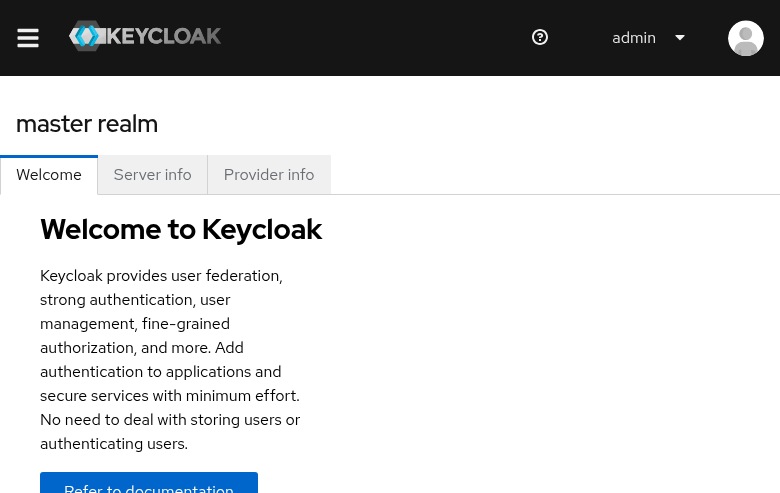

### Step 2: Create or Select a Realm

Realms isolate users and applications. For PKI Manager, create a dedicated realm or use an existing one.

1. Click the realm dropdown in the top-left sidebar
2. Click **Create realm** or select an existing realm (e.g., `pki-manager`)

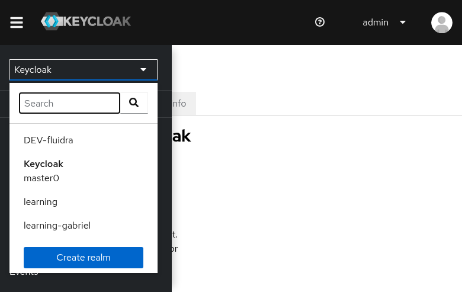

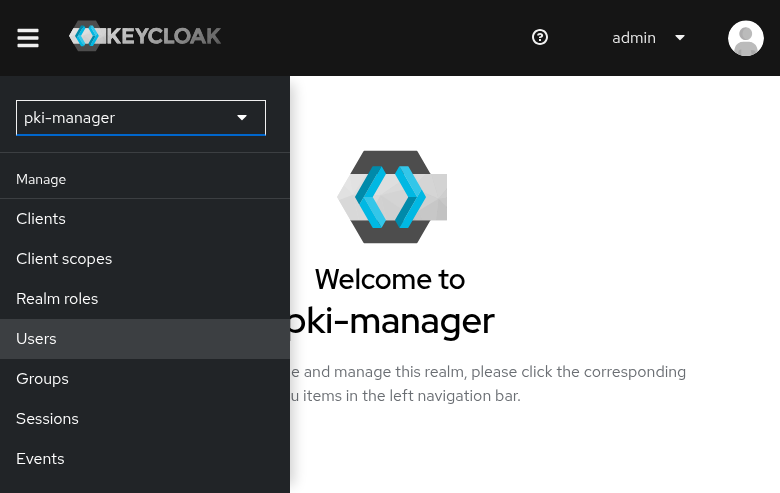

### Step 3: Create the SPA Client (pki-web)

The `pki-web` client is a **public client** for the frontend SPA application using PKCE.

#### 3.1 Navigate to Clients

1. In the sidebar, click **Clients**
2. Click **Create client**

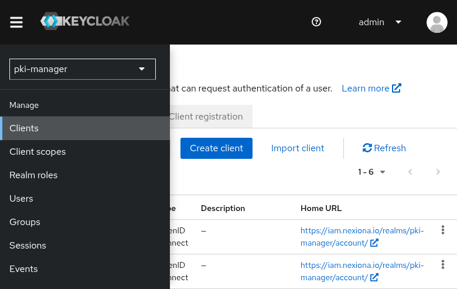

#### 3.2 General Settings (Step 1)

Configure the basic client information:

| Field | Value |
|-------|-------|
| Client type | OpenID Connect |
| Client ID | `pki-web` |
| Name | PKI Manager Web |
| Description | Public SPA client for PKI Manager frontend with PKCE |

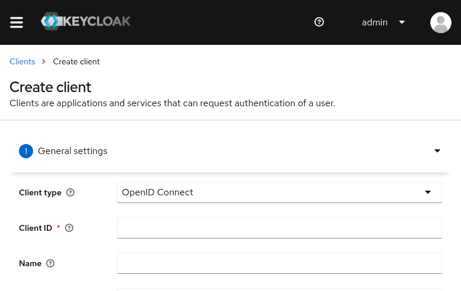
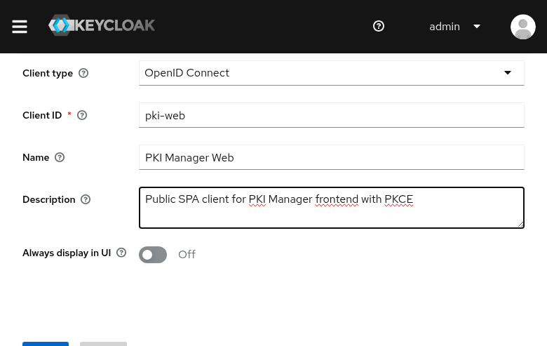

Click **Next**.

#### 3.3 Capability Config (Step 2)

Configure the client authentication and flows:

| Setting | Value | Reason |
|---------|-------|--------|
| Client authentication | **Off** | Public client (SPA cannot securely store secrets) |
| Authorization | Off | Not needed for basic authentication |
| Standard flow | **Enabled** | Authorization Code Flow with PKCE |
| Direct access grants | Enabled | Optional: allows password grant for testing |
| Implicit flow | Disabled | Not recommended for SPAs |
| Service accounts roles | Disabled | Not applicable for public clients |

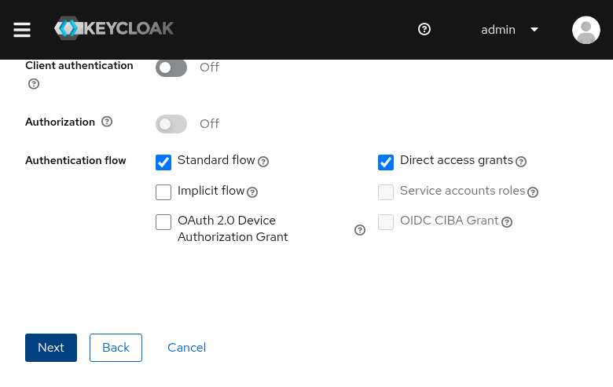

Click **Next**.

#### 3.4 Login Settings (Step 3)

Configure the redirect URIs and web origins:

| Field | Value | Description |
|-------|-------|-------------|
| Root URL | `https://pki.example.com` | Your frontend URL |
| Home URL | `https://pki.example.com` | Landing page after logout |
| Valid redirect URIs | `https://pki.example.com/*` | Allowed redirect destinations |
| Valid post logout redirect URIs | `https://pki.example.com/*` | Allowed post-logout destinations |
| Web origins | `https://pki.example.com` | CORS allowed origins |

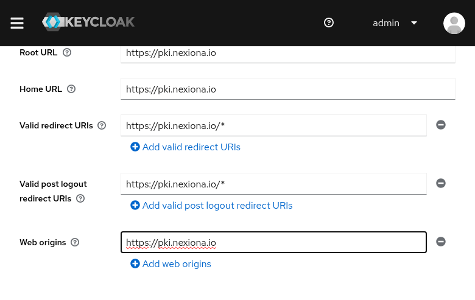

Click **Save**.

#### 3.5 Client Created

The client is now created and enabled.

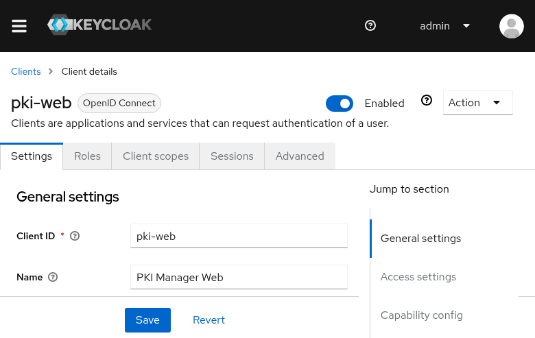

### Step 4: Create a Test User

Create a user to test the authentication flow.

#### 4.1 Navigate to Users

1. In the sidebar, click **Users**
2. Click **Create new user**

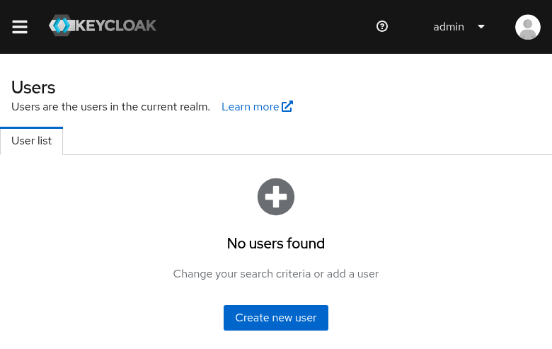

#### 4.2 Fill User Details

| Field | Value |
|-------|-------|
| Username | `testuser` |
| Email | `testuser@example.com` |
| First name | Test |
| Last name | User |

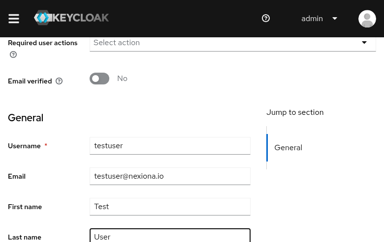

Click **Create**.

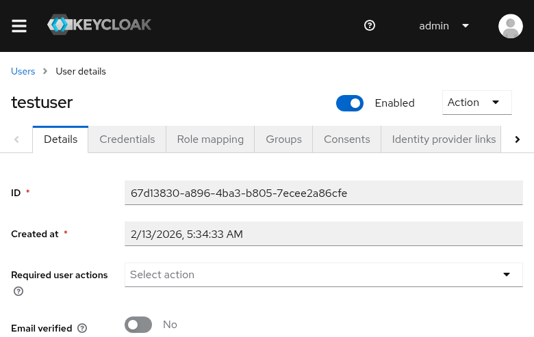

#### 4.3 Set Password

1. Go to the **Credentials** tab
2. Click **Set password**

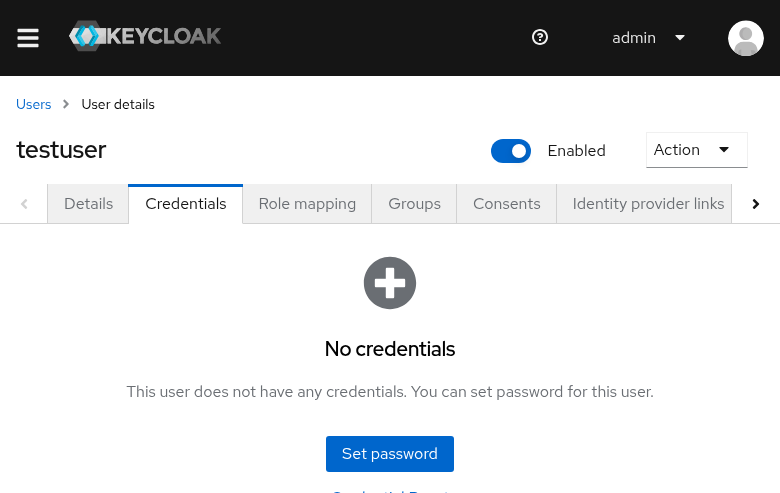

3. Enter password and confirmation
4. Set **Temporary** to **Off** (user won't be forced to change password)
5. Click **Save**

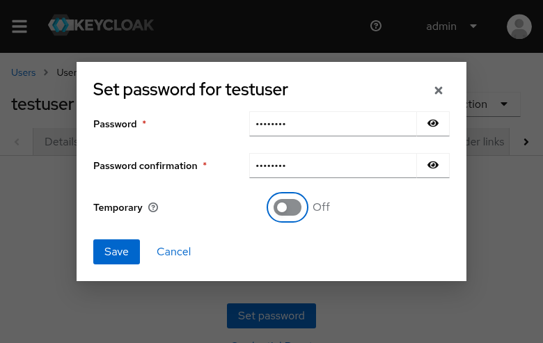

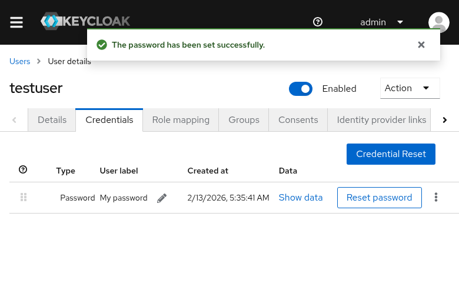

### Step 5: (Optional) Create M2M Client (pki-service)

For machine-to-machine authentication (API access without user interaction):

1. Create a new client with:
   - Client ID: `pki-service`
   - Client authentication: **On** (confidential client)
   - Service accounts roles: **Enabled**
   - All other flows: **Disabled**

2. After creation, go to **Credentials** tab to get the client secret

3. Add to backend `OIDC_AUDIENCE`: `pki-web,pki-service`

## PKI Manager Configuration

### Backend Configuration

Add these environment variables to your backend `.env` file:

```bash
# OIDC Authentication
OIDC_ISSUER=https://your-keycloak-domain/realms/pki-manager
OIDC_AUDIENCE=pki-web,pki-service
OIDC_ROLES_CLAIM=realm_access.roles
```

| Variable | Description |
|----------|-------------|
| `OIDC_ISSUER` | Keycloak realm URL (must match `iss` claim in tokens) |
| `OIDC_AUDIENCE` | Expected `aud` claim(s), comma-separated |
| `OIDC_ROLES_CLAIM` | JSON path to roles in the JWT token |

### Frontend Configuration

#### Option A: Build-time Configuration

Add to frontend `.env` before building:

```bash
VITE_OIDC_AUTHORITY=https://your-keycloak-domain/realms/pki-manager
VITE_OIDC_CLIENT_ID=pki-web
VITE_OIDC_SCOPE=openid profile email
```

#### Option B: Runtime Configuration (Docker)

Mount a `config.json` file:

```json
{
  "apiUrl": "https://api.pki.example.com/trpc",
  "oidc": {
    "authority": "https://your-keycloak-domain/realms/pki-manager",
    "clientId": "pki-web",
    "scope": "openid profile email"
  }
}
```

Add volume mount in `docker-compose.yml`:

```yaml
services:
  frontend:
    volumes:
      - ./config.json:/usr/share/nginx/html/config.json:ro
```

After a change of `config.json`, run `docker compose restart frontend`. The frontend container
reads the CSP origins from the file when it starts
([details](deployment.md#security-headers-of-the-frontend-container)).

### Docker Configuration

Example `.env` for Docker deployment:

```bash
# Backend OIDC
OIDC_ISSUER=https://your-keycloak-domain/realms/pki-manager
OIDC_AUDIENCE=pki-web,pki-service
OIDC_ROLES_CLAIM=realm_access.roles

# Frontend (if not using runtime config.json)
VITE_OIDC_AUTHORITY=https://your-keycloak-domain/realms/pki-manager
VITE_OIDC_CLIENT_ID=pki-web
```

## Testing the Integration

1. **Access PKI Manager**: Navigate to `https://pki.example.com`

2. **Login Redirect**: You should be redirected to Keycloak login page

3. **Authenticate**: Enter test user credentials

4. **Callback**: After successful login, you're redirected back to PKI Manager

5. **Verify Token**: Check browser DevTools → Network → look for `Authorization: Bearer` header in API calls

## Troubleshooting

### "Invalid redirect URI" Error

**Cause**: The redirect URI doesn't match Keycloak's allowed list.

**Solution**:
- Verify `Valid redirect URIs` in Keycloak client settings
- Ensure the frontend URL exactly matches (including protocol and trailing slashes)

### "Invalid token issuer" Error

**Cause**: `OIDC_ISSUER` doesn't match the `iss` claim in the token.

**Solution**:
- Check the exact Keycloak realm URL
- Ensure no trailing slash mismatch
- Format: `https://keycloak-domain/realms/realm-name`

### "CORS blocked" Error

**Cause**: Keycloak or backend not allowing the frontend origin.

**Solution**:
- Add frontend URL to Keycloak client's `Web origins`

### "Token expired" or Silent Renewal Fails

**Cause**: Refresh token expired or silent renewal iframe blocked.

**Solution**:
- Check Keycloak realm's token lifespan settings
- Ensure `silent-renew.html` is accessible
- The iframe is used only when the client gets no refresh token. Then the browser must send the
  Keycloak session cookie in the iframe: check that third-party cookies are not blocked when
  Keycloak is on another site
- In Docker, restart the frontend container after a change of `config.json`
  ([How the web UI renews the token](oidc.md#frontend-environment-variables))

### User Gets "Access Denied" After Login

**Cause**: Token audience doesn't include the expected client ID.

**Solution**:
- Verify `OIDC_AUDIENCE` includes `pki-web`
- Check Keycloak client's audience mapper if customized

## Quick Reference

### Keycloak URLs

| Endpoint | URL Pattern |
|----------|-------------|
| Admin Console | `https://keycloak-domain/admin` |
| Realm Settings | `https://keycloak-domain/admin/master/console/#/realm-name` |
| OIDC Discovery | `https://keycloak-domain/realms/realm-name/.well-known/openid-configuration` |
| Token Endpoint | `https://keycloak-domain/realms/realm-name/protocol/openid-connect/token` |
| UserInfo Endpoint | `https://keycloak-domain/realms/realm-name/protocol/openid-connect/userinfo` |

### PKI Manager Environment Variables

| Variable | Example | Required |
|----------|---------|----------|
| `OIDC_ISSUER` | `https://keycloak.example.com/realms/pki` | Yes (backend) |
| `OIDC_AUDIENCE` | `pki-web,pki-service` | Yes (backend) |
| `OIDC_ROLES_CLAIM` | `realm_access.roles` | No (default shown) |
| `VITE_OIDC_AUTHORITY` | `https://keycloak.example.com/realms/pki` | Yes (frontend) |
| `VITE_OIDC_CLIENT_ID` | `pki-web` | Yes (frontend) |
| `VITE_OIDC_SCOPE` | `openid profile email` | No (default shown) |

## The realm of the end-to-end tests

The end-to-end tests use their own Keycloak realm (`pki-e2e`), imported from
`docker/keycloak-e2e-realm.json` with two test users. See [Testing](../development/testing.md).

## See Also

- [OIDC login](oidc.md): how OIDC works in PKI Manager (public clients, PKCE, token validation), all variables, other providers
- [Docker deployment](deployment.md): the production reference
- [Keycloak Documentation](https://www.keycloak.org/documentation)
- [OIDC Specification](https://openid.net/specs/openid-connect-core-1_0.html)
