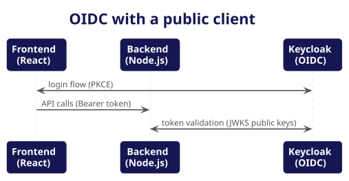
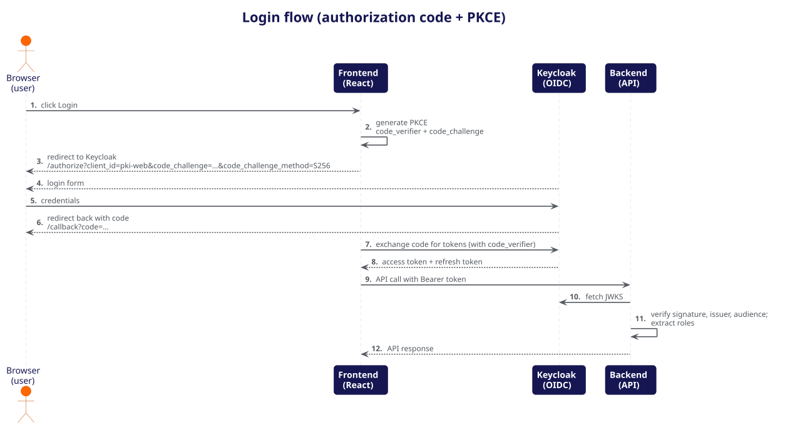
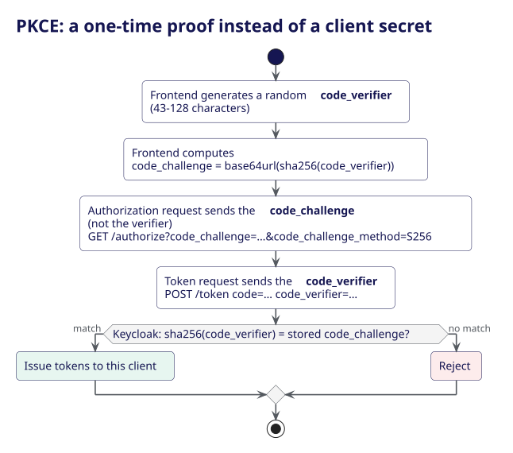
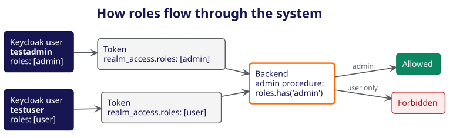
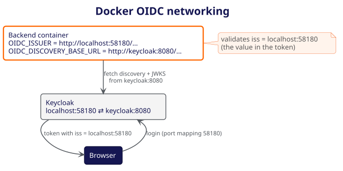
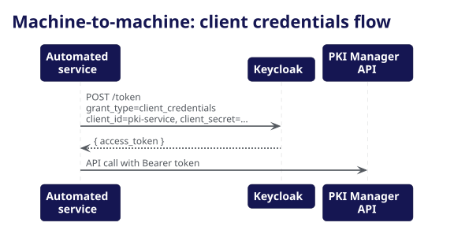

# OIDC Authentication in PKI Manager

This document explains how OpenID Connect (OIDC) authentication works between PKI Manager and identity providers like Keycloak.

## Overview

PKI Manager uses OIDC for authentication with a **public client** architecture. This means:

- The frontend (React SPA) handles user login via the browser
- No client secret is used (secrets cannot be secured in browser code)
- PKCE (Proof Key for Code Exchange) provides security instead
- The backend only validates tokens - it never authenticates to Keycloak



## Public vs Confidential Clients

### Why No Client Secret?

A common question is: "Why don't we use a client ID and client secret to identify the app?"

The answer lies in the nature of browser-based applications:

| Client Type | Where Code Runs | Can Store Secrets? | Authentication Method |
|-------------|-----------------|--------------------|-----------------------|
| **Public** (SPA, mobile) | Browser/device | No - code is visible | PKCE |
| **Confidential** (server) | Server | Yes - code is private | Client Secret |

**PKI Manager's frontend is a public client** because:

1. All JavaScript code is downloaded to and runs in the user's browser
2. Anyone can view the source code (DevTools → Sources)
3. Any "secret" embedded in the code would be exposed
4. Therefore, we cannot use a client secret

Instead, we use **PKCE** - a cryptographic proof that the same browser session that started the login is the one completing it.

### Keycloak Client Configuration

```json
{
  "clientId": "pki-web",
  "publicClient": true,
  "standardFlowEnabled": true,
  "attributes": {
    "pkce.code.challenge.method": "S256"
  }
}
```

- `publicClient: true` - No secret required
- `standardFlowEnabled: true` - Authorization Code Flow
- `pkce.code.challenge.method: S256` - Require PKCE with SHA-256

## The Authentication Flow

Here's the complete flow when a user logs into PKI Manager:



### Step-by-Step Breakdown

1. **User clicks Login** - Frontend initiates authentication
2. **Generate PKCE** - Frontend creates a random `code_verifier` and its SHA-256 hash (`code_challenge`)
3. **Redirect to Keycloak** - Browser goes to Keycloak with `code_challenge` (not the verifier!)
4. **Login form** - Keycloak shows the login page
5. **Enter credentials** - User authenticates with username/password
6. **Authorization code** - Keycloak redirects back with a temporary code
7. **Exchange code** - Frontend sends code + `code_verifier` to get tokens
8. **Receive tokens** - Keycloak returns access token, refresh token, ID token
9. **API calls** - Frontend includes `Authorization: Bearer <token>` in requests
10. **Validate token** - Backend verifies signature using Keycloak's public keys
11. **Authorized response** - Backend returns data based on user's roles

## PKCE: The Secret Replacement

PKCE (pronounced "pixy") replaces the client secret with a **one-time cryptographic proof**.

### How It Works



### Why PKCE Is Secure

| Attack Scenario | Protection |
|-----------------|------------|
| Attacker intercepts authorization code | Cannot use it without `code_verifier` |
| Attacker tries to guess `code_verifier` | 256-bit entropy (impossible) |
| Attacker intercepts `code_challenge` | Cannot reverse SHA-256 hash |
| Replay attack | Each login uses new random `code_verifier` |

The `code_verifier` only leaves the browser memory once - when exchanging the code for tokens. By that point, it's sent over HTTPS directly to Keycloak.

## Token Validation

The backend **never authenticates to Keycloak**. It only validates tokens using public key cryptography.

### What the Backend Does

```typescript
// backend/src/lib/oidc.ts (discovery, JWKS) and backend/src/lib/jwt.ts (validation)

// 1. At startup: Fetch OIDC discovery document
const discovery = await fetch(
  'http://keycloak:8080/realms/pki-e2e/.well-known/openid-configuration'
);
// Returns: { issuer, jwks_uri, token_endpoint, ... }

// 2. Get public keys (JWKS - JSON Web Key Set)
const jwks = createRemoteJWKSet(new URL(discovery.jwks_uri));

// 3. For each request: Validate the token
const { payload } = await jwtVerify(token, jwks, {
  issuer: 'http://localhost:58180/realms/pki-e2e',
});
// then check that `aud` (or, as a fallback, `azp`) matches OIDC_AUDIENCE

// 4. Extract user info from token payload
const userId = payload.sub;
const email = payload.email;
const roles = payload.realm_access?.roles; // ['admin'] or ['user']
```

### Token Structure

A JWT (JSON Web Token) has three parts:

```
eyJhbGciOiJSUzI1NiIsInR5cCI6IkpXVCJ9.eyJpc3MiOiJodHRwOi8vbG9jYWxob3N0OjgxODAvcmVhbG1zL3BraS1lMmUiLCJhdWQiOiJwa2ktd2ViIiwic3ViIjoiMTIzNDU2Nzg5MCIsInJlYWxtX2FjY2VzcyI6eyJyb2xlcyI6WyJhZG1pbiJdfX0.signature
│                              │                                                                                                                    │
└──────── Header ──────────────┴──────────────────────────────────── Payload ───────────────────────────────────────────────────────────────────────┴── Signature ──
```

**Decoded payload:**
```json
{
  "iss": "http://localhost:58180/realms/pki-e2e",
  "aud": "pki-web",
  "sub": "user-uuid-here",
  "email": "testadmin@example.com",
  "realm_access": {
    "roles": ["admin", "user"]
  },
  "exp": 1739456789,
  "iat": 1739453189
}
```

### Validation Steps

1. **Signature verification** - Using Keycloak's public RSA key
2. **Issuer check** - `iss` must match configured `OIDC_ISSUER`
3. **Audience check** - `aud` (or, as a fallback, `azp`) must match one of the configured `OIDC_AUDIENCE` values
4. **Expiration check** - `exp` must be in the future
5. **Not-before check** - `nbf`, when present, must be in the past

## Role-Based Access Control

PKI Manager uses Keycloak realm roles for authorization:

| Role | Permissions |
|------|-------------|
| `user` | View CAs and certificates, issue certificates, download |
| `admin` | All user permissions + create/revoke/delete CAs and certificates |

### How Roles Flow Through the System



### Backend Middleware

```typescript
// backend/src/trpc/init.ts and backend/src/trpc/middleware/auth.ts (simplified)

// Protected procedure - any authenticated user
export const protectedProcedure = t.procedure.use(authMiddleware);

// Admin procedure - requires 'admin' role
export const adminProcedure = protectedProcedure.use(async ({ ctx, next }) => {
  if (!ctx.user.roles.includes('admin')) {
    throw new TRPCError({
      code: 'FORBIDDEN',
      message: 'Admin role required'
    });
  }
  return next({ ctx });
});
```

## Docker Networking Considerations

When running in Docker, there's a networking challenge:

- **Browser** accesses Keycloak at `localhost:58180`
- **Backend container** cannot reach `localhost:58180` (it refers to itself)
- **Tokens** have `iss: http://localhost:58180/realms/pki-e2e`

### Solution: OIDC_DISCOVERY_BASE_URL



**Configuration:**
```yaml
# docker-compose.e2e.yml
backend:
  environment:
    # What's in tokens (for validation)
    - OIDC_ISSUER=http://localhost:58180/realms/pki-e2e
    # Where to fetch OIDC config (Docker network)
    - OIDC_DISCOVERY_BASE_URL=http://keycloak:8080/realms/pki-e2e
```

## Machine-to-Machine Authentication

For server-to-server communication without user interaction, use a **confidential client**:



**When to use this:**
- CI/CD pipelines issuing certificates
- Automated certificate renewal services
- Integration with other systems

**Keycloak setup:**
1. Create client `pki-service` with `publicClient: false`
2. Enable "Service accounts roles"
3. Assign appropriate roles
4. Get client secret from Credentials tab

## Configuration Reference

### Backend Environment Variables

| Variable | Required | Description |
|----------|----------|-------------|
| `OIDC_ISSUER` | Both or none | Token issuer URL (must match `iss` claim) |
| `OIDC_AUDIENCE` | Both or none | Expected audience(s), comma-separated |
| `OIDC_ROLES_CLAIM` | No | Path to roles in token (default: `realm_access.roles`) |
| `OIDC_DISCOVERY_BASE_URL` | No | Override URL for fetching OIDC config |
| `OIDC_ROLES_SOURCE` | No | `token` (default) or `userinfo`: where roles are read from |

Set `OIDC_ISSUER` and `OIDC_AUDIENCE` together to turn login on. With both unset, login is off
(see [Run without login](#run-without-login)). One without the other stops the backend at startup.

### Frontend Environment Variables

| Variable | Required | Description |
|----------|----------|-------------|
| `VITE_OIDC_AUTHORITY` | Yes | OIDC provider URL (same as `OIDC_ISSUER`) |
| `VITE_OIDC_CLIENT_ID` | Yes | Public client ID (e.g., `pki-web`) |
| `VITE_OIDC_SCOPE` | No | OAuth scopes (default: `openid profile email`) |

The redirect URI is `<origin>/callback`, the post-logout URI is `<origin>/` and silent renewal uses `<origin>/silent-renew.html`.

The `VITE_*` values are read when the frontend is built (development with Vite, or your own image).
In Docker, set the same values in `docker/config.json` instead (`oidc.authority`, `oidc.clientId`,
`oidc.scope`): the web UI reads that file when it starts, and its values win over the build values.
No image rebuild is needed. [Keycloak setup](keycloak.md#frontend-configuration) shows the file.

### Example Configuration

```bash
# Backend
OIDC_ISSUER=https://keycloak.example.com/realms/pki
OIDC_AUDIENCE=pki-web,pki-service
OIDC_ROLES_CLAIM=realm_access.roles

# Frontend (build-time or runtime config.json)
VITE_OIDC_AUTHORITY=https://keycloak.example.com/realms/pki
VITE_OIDC_CLIENT_ID=pki-web
```

## Providers

PKI Manager works with any OIDC provider that issues a signed JWT access token. Only Keycloak is
tested in this repository ([Keycloak setup](keycloak.md)). The values below are a starting point
for other providers: check them in your provider.

**Provider-specific issuer URLs:**
- **Keycloak**: `https://keycloak.example.com/realms/your-realm`
- **Auth0**: `https://your-tenant.auth0.com`
- **Okta**: `https://your-org.okta.com`
- **Azure AD**: `https://login.microsoftonline.com/{tenant-id}/v2.0`

**Provider-specific roles claim paths:**
- **Keycloak**: `realm_access.roles`
- **Auth0**: `permissions` or custom namespace
- **Okta**: `groups`
- **Azure AD**: `roles`

## Run without login

With `OIDC_ISSUER` and `OIDC_AUDIENCE` both unset on the backend, and no `oidc` block in the web UI
configuration, there is no login: the management API and the web UI accept every call. Use this
only to try PKI Manager on your own machine.

Two things stay protected without OIDC:

- `/api/v1/external/*` always needs an integration token ([Integration API](../api/integrations.md)).
- The SSH CA operations answer `403` unless the backend runs with `ALLOW_UNAUTHENTICATED_SSH_CA=true`
  (development only).

## Roles from UserInfo (groups)

Complete OIDC templates for providers exposing roles through UserInfo are included:

- `backend/.env.oidc.example`: backend development settings.
- `frontend/.env.oidc.example`: frontend development settings, including `groups` scope.
- `docker/.env.oidc.example`: Docker Compose backend settings.
- `docker/config.oidc.example.json`: frontend runtime configuration for Docker.

For a new local development setup, run from the repository root:

```bash
cp -n backend/.env.oidc.example backend/.env
cp -n frontend/.env.oidc.example frontend/.env
```

For a new Docker setup, run from the repository root:

```bash
cp -n docker/.env.oidc.example docker/.env
cp -n docker/config.oidc.example.json docker/config.json
```

These commands preserve existing files. If configuration already exists, merge the
OIDC settings into it instead. Replace `id.example.com`,
`REPLACE_WITH_OIDC_CLIENT_ID` and `REPLACE_WITH_ACCESS_TOKEN_AUDIENCE` before
starting. Set API and frontend URLs to your deployment's browser-accessible URLs;
the templates use local development ports. Actual `.env` files are local
configuration and are not committed.

For Docker, `.env` configures the backend; the SPA separately reads
`docker/config.json`, which Compose already mounts. Setting only `VITE_OIDC_*` in
`docker/.env` does not configure frontend OIDC. After editing the files:

```bash
cd docker
docker compose up -d --force-recreate backend frontend
```

For local development, restart the stack with `just dev`
(see [Development setup](../development/setup.md)).

Some OIDC providers, including Pocket ID v2.18.0, supply user groups through ID
tokens and UserInfo rather than access-token role claims. These templates use
`groups` as an example scope and role claim; adjust both to your provider. For
providers embedding roles in access tokens, keep `OIDC_ROLES_SOURCE=token`. Enable the
optional UserInfo role source on the backend:

```dotenv
OIDC_ISSUER=https://id.example.com
OIDC_AUDIENCE=<expected-access-token-audience>
OIDC_ROLES_SOURCE=userinfo
OIDC_ROLES_CLAIM=groups
```

Use the actual `aud` in the access token for `OIDC_AUDIENCE`; do not assume it is
the client ID. Configure a public OIDC client with PKCE in your provider and assign
the user to the group named exactly `admin`. Request `openid profile email groups`
in `VITE_OIDC_SCOPE` (development) or `oidc.scope` in the frontend runtime
`config.json` (Docker). Set the authority and client ID to your OIDC provider values.
Register the frontend origin plus `/callback` and `/silent-renew.html` as callback
URLs, and the origin plus `/` as the logout redirect if supported.

Recreate the backend container after changing its environment, restart the
frontend development server after changing Vite variables, and sign in again to
grant the groups scope. Do not put a client secret in the SPA.

The backend still verifies the access token's signature, issuer and audience
locally before sending it to the discovered UserInfo endpoint. That endpoint must
share the discovered issuer's origin and use HTTPS (HTTP is allowed only for
loopback development). The backend needs outbound access to discovery, JWKS and
UserInfo. Redirects from UserInfo are refused and each lookup times out after five
seconds. A lookup failure or subject mismatch rejects authentication; missing
groups grant no admin rights. Token roles are not used as a fallback.

UserInfo is queried on every authenticated request, without caching roles. Group
changes therefore apply on the next request when the provider reflects them in
UserInfo; this adds a provider request and makes authentication depend on its
availability. The default `OIDC_ROLES_SOURCE=token` preserves existing JWT-based
providers and M2M clients; enable UserInfo only for deployments whose tokens can
access the provider's UserInfo endpoint. The GUI currently has no admin-role badge.

## Comparison Summary

| Aspect | Public Client (pki-web) | Confidential Client (pki-service) |
|--------|-------------------------|-----------------------------------|
| **Use case** | Browser SPA | Server-side automation |
| **Secret** | None (uses PKCE) | Required |
| **User interaction** | Yes (login form) | No |
| **Token exchange** | Browser → Keycloak | Server → Keycloak |
| **Security mechanism** | PKCE cryptographic proof | Shared secret |
| **Grant type** | Authorization Code + PKCE | Client Credentials |

## See Also

- [Keycloak setup](keycloak.md): step-by-step Keycloak configuration with screenshots
- [Docker deployment](deployment.md): the production reference
- [Testing](../development/testing.md): end-to-end tests with a pre-configured Keycloak

### External Resources

- [OAuth 2.0 for Browser-Based Apps (RFC)](https://datatracker.ietf.org/doc/html/draft-ietf-oauth-browser-based-apps)
- [PKCE (RFC 7636)](https://datatracker.ietf.org/doc/html/rfc7636)
- [OpenID Connect Core](https://openid.net/specs/openid-connect-core-1_0.html)
- [Keycloak Documentation](https://www.keycloak.org/documentation)
